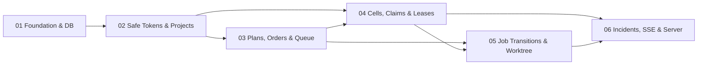

# `@repo/factory-server` — Implementation Todos (`todo/`)

Source: [PLAN.md](./PLAN.md) + [BE_RULES.md](./BE_RULES.md) + `.tmp/omino-api` reference architecture.
Rule: `BE_RULES.md` always wins on code shape (`domain -> db -> contracts -> application (ports + procedures) -> adapters/hono -> bootstrap -> tests`).

## Vertical Slices

**Scope Boundary (Backend Only)**: Every todo below is strictly scoped to `apps/factory-server/`. Do **not** connect or modify `apps/cell`, `apps/cli`, or any `packages/factory-*` packages. All Cell/Supervisor flows (`enroll`, `hello`, `claims`, `heartbeats`, `jobs/:id/transitions`, `incidents/:id/resolve`) are verified via black-box HTTP requests (`app.request()`) inside `apps/factory-server/test/`.

Each step is a self-contained vertical slice that migrates, typechecks, lints, and passes unit + black-box tests independently.

| #   | File                                                             | Slice Scope                                                                                                  | Depends on |
| :-- | :--------------------------------------------------------------- | :----------------------------------------------------------------------------------------------------------- | :--------- |
| 01  | [01-foundation-and-db.md](../../../todos/01-foundation-and-db.md)               | Package scaffold, branded IDs, time/events, `bun:sqlite` Drizzle schema + partial indexes, core Hono harness | —          |
| 02  | [02-safe-tokens-and-projects.md](../../../todos/02-safe-tokens-and-projects.md) | Safe Tokens (`sf_sup_`, `sf_join_`, `sf_cell_`), SHA-256 auth adapter, token rotation/revoke, `/projects`    | 01         |
| 03  | [03-plans-orders-and-queue.md](../../../todos/03-plans-orders-and-queue.md)     | `OrderPlan` & `WorkOrder` CRUD/transitions, `resolveBaseBranch`, markdown `/queue/import`, `/export`, `/actions` | 02         |
| 04  | [04-cells-claims-and-leases.md](../../../todos/04-cells-claims-and-leases.md)   | Cell `enroll`, `hello` (fast reconnect), long-poll `claims` (`waitMs`), `heartbeats`, lazy lease reaper      | 02, 03     |
| 05  | [05-job-execution-and-worktree-lifecycle.md](../../../todos/05-job-execution-and-worktree-lifecycle.md) | `/jobs/{id}/transitions`: `start` (`lineSnapshot`), `complete` (`nextJob`), `line_unavailable`, `worktree_missing`, `deliver` & `stale_base` | 03, 04     |
| 06  | [06-incidents-and-sse-stream.md](../../../todos/06-incidents-and-sse-stream.md) | Incident state machine, Mechanic job dispatch, `/incidents/{id}/resolve`, SSE `/stream`, `Bun.serve` CLI     | 04, 05     |

