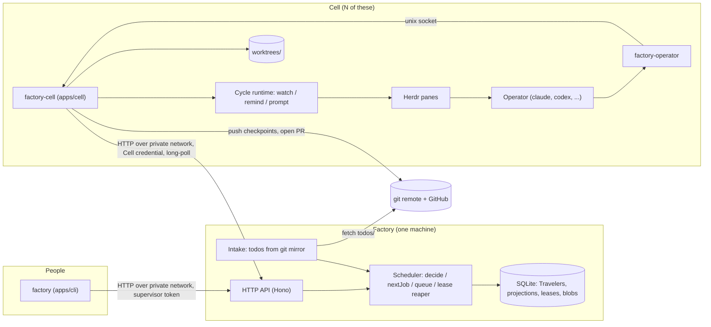
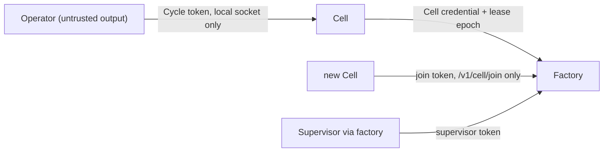
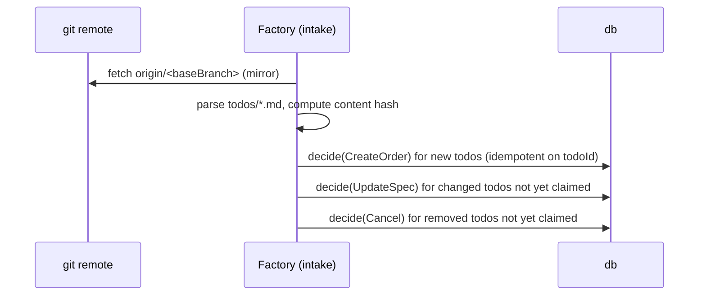
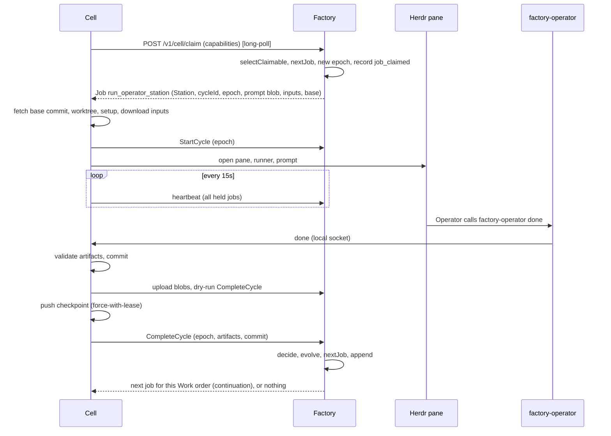
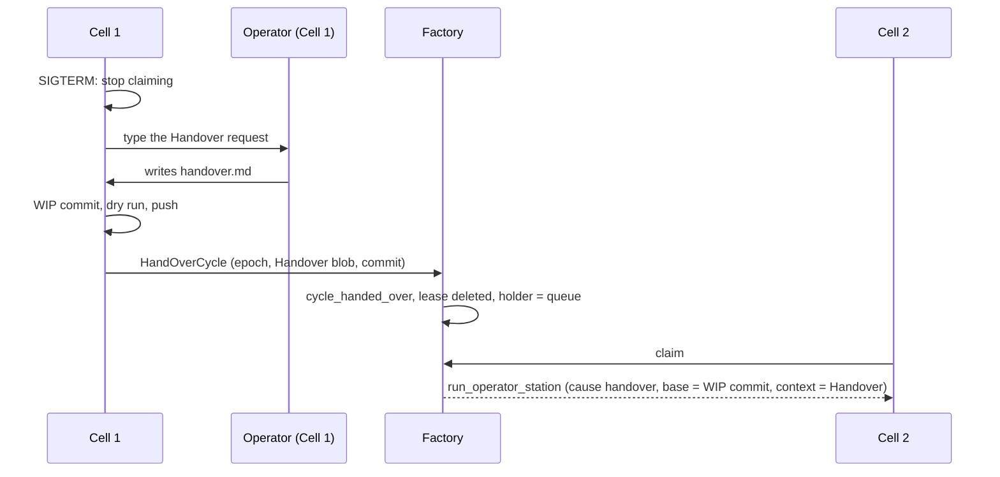

# Software Factory v2: architecture plan

## Goal

Turn a todo into a verified pull request by sending it down a declarative production Line, as in
v1, but as a **distributed system**: one Factory, any number of Cells that join and leave at will,
and a Work order state that is portable, never processed twice, and resumable from the Station where
it stopped.

## Requirements

| ID     | Requirement                                                                                                                                                                                                | Where it is solved                                                                                                          |
| :----- | :--------------------------------------------------------------------------------------------------------------------------------------------------------------------------------------------------------- | :-------------------------------------------------------------------------------------------------------------------------- |
| **R1** | **Portable queue.** The full queue and every Work order's progress can be moved to, or rebuilt on, another machine.                                                                                        | Machine-independent events (CORE §3), blobs in the database (STORAGE §5), export/import and rebuild from git (STORAGE §7–8) |
| **R2** | **No double work.** With two or more Cells, a Work order is executed by at most one of them at a time, including after crashes and network partitions.                                                     | Atomic claim + lease + fencing epoch + optimistic append + dry run before push (PROTOCOL §5, §8.2, STORAGE §3)              |
| **R3** | **Non-blocking Andons.** A stuck Operator raises an Andon; its Cell is released at once and takes other work; the Work order keeps every passed Station and resumes from the blocked Station, on any Cell. | `holder = supervisor` releases the lease (CORE §4), checkpoint commits (PROTOCOL §8), `resumed` (CORE §4.3)                 |
| **R4** | **Deterministic control.** No LLM decides what runs next.                                                                                                                                                  | Pure `decide` / `nextJob` (CORE §5–6)                                                                                       |
| **R5** | **Auditable.** Every decision can be explained from the Traveler.                                                                                                                                          | Append-only event log; rendered prompts and nudges stored                                                                   |
| **R6** | **Runner-agnostic.** Any supported runner can fill any Operator station.                                                                                                                                   | Runner adapters live only in the Cell                                                                                       |
| **R7** | **Declarative Lines.** New Operator profiles and Lines need no TypeScript.                                                                                                                                 | `factory-definitions` (carried over from v1)                                                                                |
| **R8** | **Replaceable Cells.** A Cell can join with a join token and leave at any time; leaving on purpose loses no work.                                                                                          | Pool enrollment, Handover on leave (PROTOCOL §1, §9)                                                                        |

## Non-goals (v2.0)

- **A highly available Factory.** There is exactly one. If it is down briefly, Cells keep going; if
  it is down past the self-fence window, in-flight Cycles are lost and restarted (PROTOCOL §11).
  HA is possible later because state is append-only (OPEN-QUESTIONS Q1).
- **Multi-tenant or untrusted Cells.** Cells are machines you own.
- **A web UI.** The HTTP API and the event stream are designed so one can be added (`apps/web`).
- **Parallel Stations inside one Work order.** One Work order runs one Station at a time.
  Parallelism is across Work orders.
- **Editing v1.** v1 keeps working unchanged until cut-over (ROADMAP M9).
- **An automatic Line lead.** v1's on-call operator returns in M10; until then every Andon goes to
  the Supervisor.

## Principles

| Principle                                                      | Meaning                                                                                                                                                                                       |
| :------------------------------------------------------------- | :-------------------------------------------------------------------------------------------------------------------------------------------------------------------------------------------- |
| **The Factory decides, the Cell executes**                     | `nextJob` runs only on the Factory. A Cell never chooses what to do next; it asks for a job and reports what happened.                                                                        |
| **The core is pure**                                           | `evolve`, `decide`, `nextJob`, `toProjection`, `selectClaimable` and the Cycle policy perform no I/O and read no clock. Time arrives in events and commands.                                  |
| **Events are facts about the Work order, not about a machine** | No absolute path, pane id, hostname-dependent value or process id is part of the Traveler. Machine-local runtime data stays on the Cell.                                                      |
| **One writer per Work order at a time**                        | A Traveler accepts writes only from the holder of the current lease epoch (plus the Supervisor and the Factory itself).                                                                       |
| **Every write is idempotent**                                  | Every command carries an idempotency key. Retrying any request after a timeout is always safe.                                                                                                |
| **Progress survives the Cell**                                 | Work is pushed to the Work order branch as checkpoint commits; artifacts are uploaded as blobs. Losing a Cell loses at most the in-flight Cycle; a Cell that leaves on purpose hands it over. |
| **An Andon never holds a Cell**                                | A Work order waiting on the Supervisor has no lease. An open question is the one bounded exception.                                                                                           |
| **The Line is pinned**                                         | A Work order runs the Line snapshotted at creation. Editing YAML never changes a running Work order.                                                                                          |
| **Operators reach the system only through `factory-operator`** | Same six verbs for every runner; no runner-specific plugin.                                                                                                                                   |
| **Only the Cell touches terminals**                            | Herdr, panes, keys and nudges are a Cell concern. The Factory does not know Herdr exists.                                                                                                     |

## Architecture



### Components

| Component                                        | Owns                                                                                                                                                                                           | Never does                                                              |
| :----------------------------------------------- | :--------------------------------------------------------------------------------------------------------------------------------------------------------------------------------------------- | :---------------------------------------------------------------------- |
| **Factory** (`apps/server`, `factory-server`)    | The database; intake of todos; the queue; leases and epochs; `decide` for every command; `nextJob`; prompt rendering; the supervisor and cell APIs; the live event feed                        | Run Operators, touch Herdr, run Inspections, create worktrees, open PRs |
| **Cell** (`apps/cell`, `factory-cell`)           | Its mirror and worktrees; Herdr panes; runner adapters; Inspection execution; the Cycle runtime (watch, reminders, prompt delivery); the local Operator socket; checkpoint pushes; PR creation | Decide the next Station; write to the database; talk to another Cell    |
| **`factory-operator`** (`apps/operator-cli`)     | Passing an Operator's verbs to its Cell                                                                                                                                                        | Know the Factory's address or any Factory credential                    |
| **`factory`** (`apps/cli`)                       | Rendering the board and Travelers; offline `factory check`                                                                                                                                     | Open the database                                                       |
| **core** (`packages/factory-core`)               | Domain types, schemas, pure functions, contracts                                                                                                                                               | Any I/O                                                                 |
| **db** (`packages/factory-db`)                   | The `EventStore`, `BlobStore`, `LeaseStore` implementations and migrations                                                                                                                     | Domain decisions                                                        |
| **definitions** (`packages/factory-definitions`) | Operator profiles, Lines, templates, todo frontmatter, their parser                                                                                                                            | Runtime state                                                           |

### Trust boundaries



- An Operator can only affect **its own Cycle**. The Cell maps the per-Cycle local token to
  `(orderId, cycleId)`; an Operator cannot name another Work order.
- A Cell can only write to Work orders for which it holds the **current** lease epoch.
- A join token can only enroll a Cell; it cannot claim or write anything.
- Only a supervisor token can resume, reopen, answer, nudge, cancel or reprioritise.
- Content an Operator produces (artifacts, notes, questions) is data. The Factory never executes it.

## End-to-end flows

### F1. Intake



### F2. Claim and run one Operator station



### F3. Andon: the Operator blocks, the Cell moves on, another Cell resumes

```mermaid
sequenceDiagram
  participant O as factory-operator (Cell 1)
  participant C1 as Cell 1
  participant S as Factory
  participant U as factory (Supervisor)
  participant C2 as Cell 2
  O->>C1: block --reason "missing STRIPE_KEY" --handover handover.md
  C1->>C1: WIP commit, dry run, push checkpoint
  C1->>S: BlockCycle (epoch, Handover blob, commit)
  S->>S: andon_raised, holder = supervisor, lease deleted
  S-->>C1: released; Cell 1 claims the next Work order immediately
  U->>S: factory resume <order> --note "key added"
  S->>S: append resumed, holder = queue
  C2->>S: claim
  S-->>C2: run_operator_station (same Station, base = WIP commit, context = Handover + note)
```

### F4. A Cell dies mid-Cycle


### F5. A Cell leaves on purpose



## Glossary

| Term            | Meaning                                                                                                                                                                             |
| :-------------- | :---------------------------------------------------------------------------------------------------------------------------------------------------------------------------------- |
| **the factory** | The whole system.                                                                                                                                                                   |
| **Factory**     | The central control-plane server (`factory-server`). Owns the database, the Lines, the schedule and the Travelers.                                                                  |
| **Cell**        | A replaceable compute device (`factory-cell`) that joins, runs Cycles, and leaves at any time.                                                                                      |
| **Line**        | A declarative production workflow: an ordered list of Stations plus delivery settings.                                                                                              |
| **Station**     | One step on a Line: an **Operator station** or an **Inspection**.                                                                                                                   |
| **Operator**    | An AI specialist (an Operator profile such as `planner`, `builder`, `auditor`, run by an LLM runner) working an Operator station inside a Herdr pane or headless process on a Cell. |
| **Inspection**  | A deterministic command gate Station (lint, tests, type checks).                                                                                                                    |
| **Work order**  | One todo travelling down one Line. The aggregate of the core.                                                                                                                       |
| **Cycle**       | One execution of one Station on a Cell. A Station can have many (retries, restarts, handovers, resumes).                                                                            |
| **Job**         | A unit of work the Factory hands to a Cell: `run_operator_station`, `run_inspection`, `deliver`. One job contains exactly one Cycle, or none (`deliver`).                           |
| **Lease**       | A Cell's time-limited right to execute a Work order's current job.                                                                                                                  |
| **Epoch**       | A per-Work-order counter incremented on every claim. The fencing token.                                                                                                             |
| **Holder**      | Who must act next on a Work order: the `queue`, a `cell`, the `supervisor`, or `none`.                                                                                              |
| **Checkpoint**  | A commit on `factory/<todoId>` pushed after a passed Station, a block or a handover; the base of the next Cycle.                                                                    |
| **Blob**        | Content-addressed text (artifact, prompt, log, Handover) stored by the Factory.                                                                                                     |
| **Andon**       | A stop that needs the Supervisor. Raising it releases the Cell immediately.                                                                                                         |
| **Handover**    | What an Operator writes when it blocks or when its Cell leaves: what it did, what is missing, how to continue.                                                                      |
| **Traveler**    | The append-only event log of one Work order.                                                                                                                                        |
| **Supervisor**  | The person operating the `factory` CLI.                                                                                                                                             |
| **Line lead**   | (M10) An automatic responder that triages Andons before they reach the Supervisor; v1's on-call operator.                                                                           |
