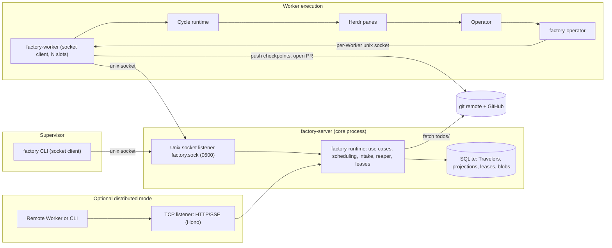
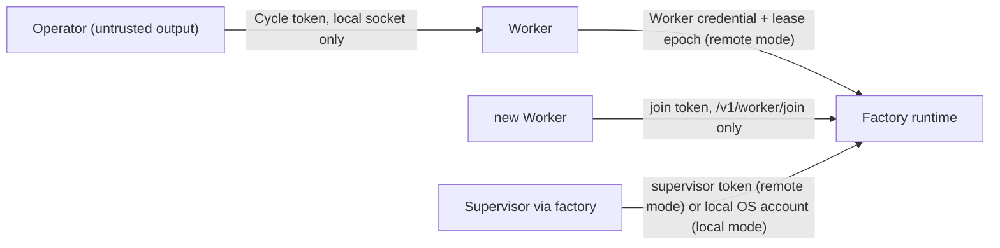
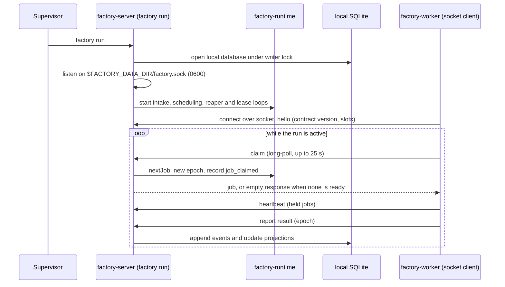
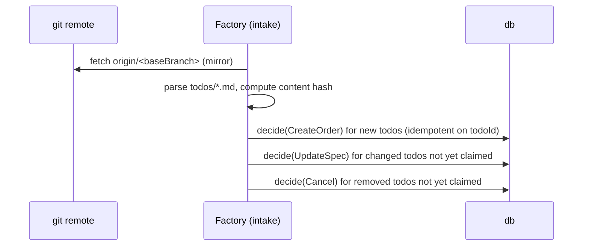
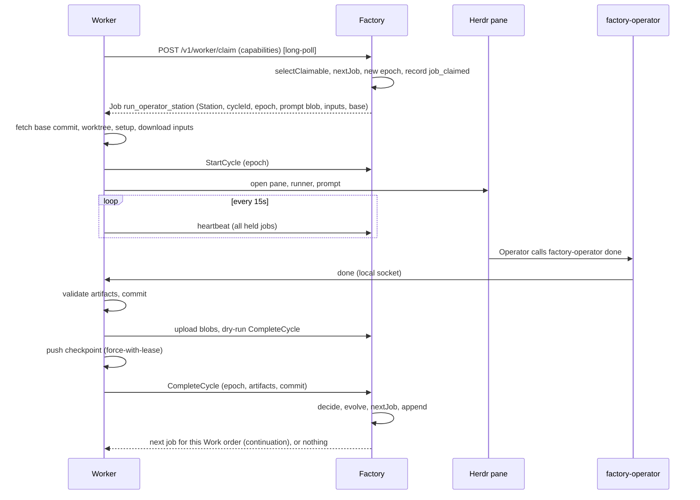
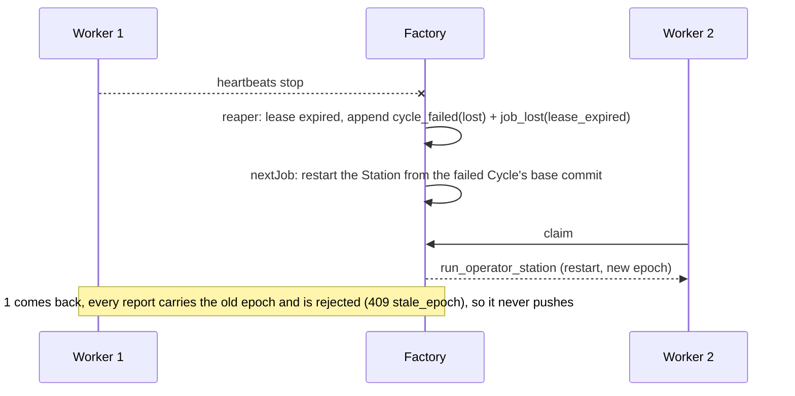
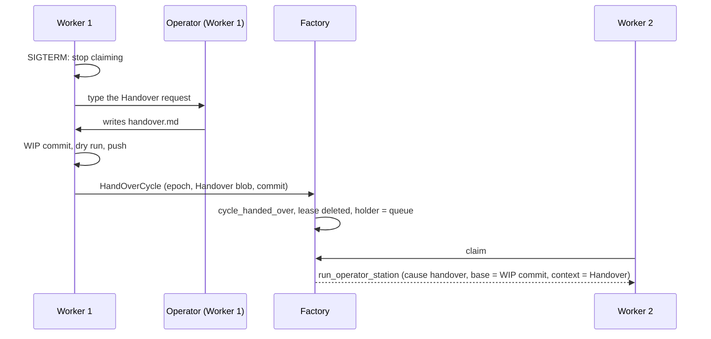

# Software Factory v2: architecture plan

## Goal

Turn a todo into a verified pull request by sending it down a declarative production Line, as in
v1. **The server over a local Unix socket is the core of v2.0**: one `factory-server` process owns the
local database through the writer lock, runs the queue, and serves the CLI and Workers over
`$FACTORY_DATA_DIR/factory.sock`. It needs no network listener. An **optional, later distributed mode**
adds TCP with HTTP/SSE to the same server so Workers on other machines can join. In either mode, Work order state is portable,
protected against duplicate processing, and resumable from the Station where it stopped.

## Requirements

| ID     | Requirement                                                                                                                                                                                                | Where it is solved                                                                                                          |
| :----- | :--------------------------------------------------------------------------------------------------------------------------------------------------------------------------------------------------------- | :-------------------------------------------------------------------------------------------------------------------------- |
| **R1** | **Portable queue.** The full queue and every Work order's progress can be moved to, or rebuilt on, another machine.                                                                                        | Machine-independent events (CORE §3), blobs in the database (STORAGE §5), export/import and rebuild from git (STORAGE §7–8) |
| **R2** | **No double work.** With two or more Workers, a Work order is executed by at most one of them at a time, including after crashes and network partitions.                                                     | Atomic claim + lease + fencing epoch + optimistic append + dry run before push (PROTOCOL §5, §8.2, STORAGE §3)              |
| **R3** | **Non-blocking Andons.** A stuck Operator raises an Andon; its Worker is released at once and takes other work; the Work order keeps every passed Station and resumes from the blocked Station, on any Worker. | `holder = supervisor` releases the lease (CORE §4), checkpoint commits (PROTOCOL §8), `resumed` (CORE §4.3)                 |
| **R4** | **Deterministic control.** No LLM decides what runs next.                                                                                                                                                  | Pure `decide` / `nextJob` (CORE §5–6)                                                                                       |
| **R5** | **Auditable.** Every decision can be explained from the Traveler.                                                                                                                                          | Append-only event log; rendered prompts and nudges stored                                                                   |
| **R6** | **Runner-agnostic.** Any supported runner can fill any Operator station.                                                                                                                                   | Runner adapters live only in the Worker                                                                                       |
| **R7** | **Declarative Lines.** New Operator profiles and Lines need no TypeScript.                                                                                                                                 | `factory-definitions` (carried over from v1)                                                                                |
| **R8** | **Replaceable Workers.** A Worker can join with a join token and leave at any time; leaving on purpose loses no work.                                                                                          | Pool enrollment, Handover on leave (PROTOCOL §1, §9)                                                                        |

## Non-goals (v2.0)

- **A highly available distributed control plane.** Distributed mode has one active `factory-server`.
  If it is down briefly, remote Workers keep going; if it is down past the self-fence window, in-flight
  Cycles are lost and restarted (PROTOCOL §11). HA is possible later because state is append-only
  (OPEN-QUESTIONS Q1). Local mode does not require a network listener; it uses the local Unix socket.
- **Multi-tenant or untrusted Workers.** Workers are machines you own.
- **A web UI.** The HTTP API and the event stream are designed so one can be added (`apps/web`).
- **Parallel Stations inside one Work order.** One Work order runs one Station at a time.
  Parallelism is across Work orders.
- **Editing v1.** v1 keeps working unchanged until cut-over (ROADMAP M9).
- **An automatic Line lead.** v1's on-call operator returns in M10; until then every Andon goes to
  the Supervisor.

## Principles

| Principle                                                      | Meaning                                                                                                                                                                                                                                     |
| :------------------------------------------------------------- | :------------------------------------------------------------------------------------------------------------------------------------------------------------------------------------------------------------------------------------------ |
| **The runtime decides, the Worker executes**                     | `nextJob` runs in the `factory-server` runtime. A Worker never chooses what to do next; it asks for a job and reports what happened. In local mode, the server listens on the Unix socket; in distributed mode, it also exposes HTTP over TCP. |
| **The core is pure**                                           | `evolve`, `decide`, `nextJob`, `toProjection`, `selectClaimable` and the Cycle policy perform no I/O and read no clock. Time arrives in events and commands.                                                                                |
| **Events are facts about the Work order, not about a machine** | No absolute path, pane id, hostname-dependent value or process id is part of the Traveler. Machine-local runtime data stays on the Worker.                                                                                                    |
| **One writer per Work order at a time**                        | A Traveler accepts writes only from the holder of the current lease epoch (plus the Supervisor and the runtime).                                                                                                                            |
| **Every write is idempotent**                                  | Every command carries an idempotency key. Retrying any request after a timeout is always safe.                                                                                                                                              |
| **Progress survives the Worker**                                 | Work is pushed to the Work order branch as checkpoint commits; artifacts are uploaded as blobs. Losing a Worker loses at most the in-flight Cycle; a Worker that leaves on purpose hands it over.                                               |
| **An Andon never holds a Worker**                                | A Work order waiting on the Supervisor has no lease. An open question is the one bounded exception.                                                                                                                                         |
| **The Line is pinned**                                         | A Work order runs the Line snapshotted at creation. Editing YAML never changes a running Work order.                                                                                                                                        |
| **Operators reach the system only through `factory-operator`** | Same six verbs for every runner; no runner-specific plugin.                                                                                                                                                                                 |
| **Only the Worker touches terminals**                            | Herdr, panes, keys and nudges are a Worker concern. The runtime does not know Herdr exists.                                                                                                                                                   |

## Architecture

The core is one process, `factory-server` (`apps/server`), which runs the shared `factory-runtime`
application API. Commands, validation and domain decisions do not vary by transport. Local and remote
databases are independent sources of truth (STORAGE §1).

The server does not start a network listener in local mode. It uses the local Unix socket
`$FACTORY_DATA_DIR/factory.sock` (mode 0600), and trust is the operating-system account. One writer owns
the local database through an exclusive lock (STORAGE §1): `factory run` (the local start command for
the server) holds it for its lifetime and keeps intake, scheduling and the reaper active. The CLI and
Workers are socket clients and never open the database. If no server is running, a one-shot CLI write
may start the runtime in-process for that command while holding the writer lock; reads are always allowed.
Distributed mode (optional, M4R, built after the local core) adds TCP with HTTP/SSE to the same server
so Workers on other machines can join.



### Components

| Component                                          | Owns                                                                                                                                                                                           | Never does                                                                              |
| :------------------------------------------------- | :--------------------------------------------------------------------------------------------------------------------------------------------------------------------------------------------- | :-------------------------------------------------------------------------------------- |
| **`factory-runtime`** (`packages/factory-runtime`) | Application use cases; database lifecycle; intake; queue; leases and epochs; `decide` for commands; `nextJob`; prompt rendering; the event feed used by `factory-server`                 | Transport (socket or HTTP), run Operators, touch Herdr, run Inspections, create worktrees, open PRs |
| **Worker** (`apps/worker`, `factory-worker`)             | Its mirror and worktrees; Herdr panes; runner adapters; Inspection execution; the Cycle runtime (watch, reminders, prompt delivery); the local Operator socket; checkpoint pushes; PR creation | Decide the next Station; write to the database; talk to another Worker                    |
| **`factory-operator`** (`apps/operator-cli`)       | Passing an Operator's verbs to its Worker                                                                                                                                                        | Know the Factory's address or any Factory credential                                    |
| **`factory`** (`apps/cli`)                         | Rendering; config and client selection; socket client to the running server (or remote client); one-shot in-process fallback; offline `factory check`                          | Depend directly on the runtime library, HTTP details or storage adapters                |
| **core** (`packages/factory-core`)                 | Domain types, schemas, pure functions, transport-neutral DTOs and ports                                                                                                                        | Any I/O                                                                                 |
| **runtime** (`packages/factory-runtime`)           | Application use cases composed over core ports and storage; shared by local and server modes                                                                                                   | HTTP transport and Worker execution                                                       |
| **server** (`apps/server`, `factory-server`)       | Core process: owns the database through the writer lock; Unix socket listener; optional TCP HTTP/SSE listener; auth; server lifecycle                                                | Own a second implementation of application decisions                                    |
| **db** (`packages/factory-db`)                     | The `EventStore`, `BlobStore`, `LeaseStore` implementations and migrations                                                                                                                     | Domain decisions                                                                        |
| **definitions** (`packages/factory-definitions`)   | Operator profiles, Lines, templates, todo frontmatter, their parser                                                                                                                            | Runtime state                                                                           |

### Trust boundaries



- An Operator can only affect **its own Cycle**. The Worker maps the per-Cycle local token to
  `(orderId, cycleId)`; an Operator cannot name another Work order.
- A Worker can only write to Work orders for which it holds the **current** lease epoch.
- A join token can only enroll a Worker; it cannot claim or write anything.
- In remote mode, only a supervisor token can resume, reopen, answer, nudge, cancel or reprioritise.
  In local mode, these operations are authorized by the local operating-system account.
- Content an Operator produces (artifacts, notes, questions) is data. The runtime never executes it.

## End-to-end flows

### F0. Local run over the Unix socket (no network listener)



### F1. Intake (either mode)



### F2. Claim and run one Operator station (distributed mode)



### F3. Andon: the Operator blocks, the Worker moves on, another Worker resumes (distributed mode)

```mermaid
sequenceDiagram
  participant O as factory-operator (Worker 1)
  participant C1 as Worker 1
  participant S as Factory
  participant U as factory (Supervisor)
  participant C2 as Worker 2
  O->>C1: block --reason "missing STRIPE_KEY" --handover handover.md
  C1->>C1: WIP commit, dry run, push checkpoint
  C1->>S: BlockCycle (epoch, Handover blob, commit)
  S->>S: andon_raised, holder = supervisor, lease deleted
  S-->>C1: released; Worker 1 claims the next Work order immediately
  U->>S: factory resume <order> --note "key added"
  S->>S: append resumed, holder = queue
  C2->>S: claim
  S-->>C2: run_operator_station (same Station, base = WIP commit, context = Handover + note)
```

### F4. A Worker dies mid-Cycle (distributed mode)



### F5. A Worker leaves on purpose (distributed mode)



## Glossary

| Term                | Meaning                                                                                                                                                                             |
| :------------------ | :---------------------------------------------------------------------------------------------------------------------------------------------------------------------------------- |
| **the factory**     | The whole system.                                                                                                                                                                   |
| **Factory runtime** | The application and scheduling layer that owns the active database and Travelers. It runs inside the core process `factory-server`, which serves it over the Unix socket locally and, optionally, TCP HTTP in distributed mode. |
| **Worker**            | A replaceable compute device (`factory-worker`) that joins, runs Cycles, and leaves at any time.                                                                                      |
| **Line**            | A declarative production workflow: an ordered list of Stations plus delivery settings.                                                                                              |
| **Station**         | One step on a Line: an **Operator station** or an **Inspection**.                                                                                                                   |
| **Operator**        | An AI specialist (an Operator profile such as `planner`, `builder`, `auditor`, run by an LLM runner) working an Operator station inside a Herdr pane or headless process on a Worker. |
| **Inspection**      | A deterministic command gate Station (lint, tests, type checks).                                                                                                                    |
| **Work order**      | One todo travelling down one Line. The aggregate of the core.                                                                                                                       |
| **Cycle**           | One execution of one Station on a Worker. A Station can have many (retries, restarts, handovers, resumes).                                                                            |
| **Job**             | A unit of work the runtime hands to a Worker: `run_operator_station`, `run_inspection`, `deliver`. One job contains exactly one Cycle, or none (`deliver`).                           |
| **Lease**           | A Worker's time-limited right to execute a Work order's current job.                                                                                                                  |
| **Epoch**           | A per-Work-order counter incremented on every claim. The fencing token.                                                                                                             |
| **Holder**          | Who must act next on a Work order: the `queue`, a `worker`, the `supervisor`, or `none`.                                                                                              |
| **Checkpoint**      | A commit on `factory/<todoId>` pushed after a passed Station, a block or a handover; the base of the next Cycle.                                                                    |
| **Blob**            | Content-addressed text (artifact, prompt, log, Handover) stored by the runtime.                                                                                                     |
| **Andon**           | A stop that needs the Supervisor. Raising it releases the Worker immediately.                                                                                                         |
| **Handover**        | What an Operator writes when it blocks or when its Worker leaves: what it did, what is missing, how to continue.                                                                      |
| **Traveler**        | The append-only event log of one Work order.                                                                                                                                        |
| **Supervisor**      | The person operating the `factory` CLI.                                                                                                                                             |
| **Line lead**       | (M10) An automatic responder that triages Andons before they reach the Supervisor; v1's on-call operator.                                                                           |
