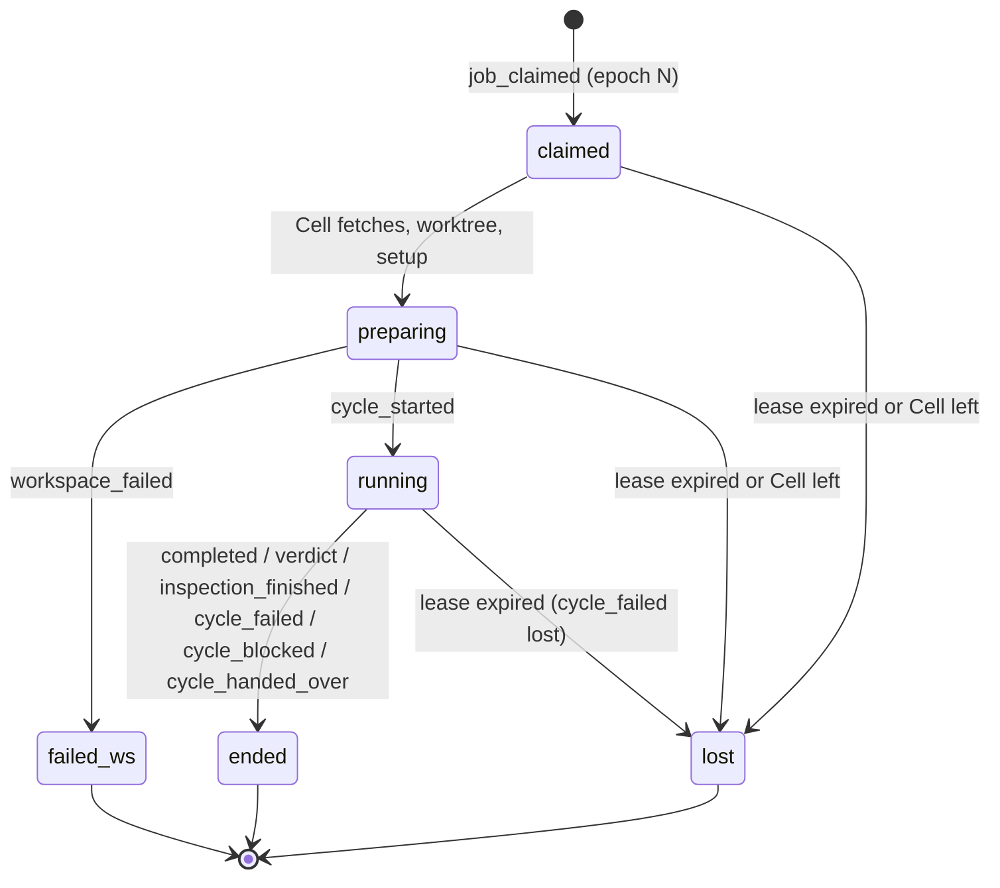

# Protocol: how the parts talk

All request and response bodies are transport-neutral zod schemas in `factory-core/src/contracts/`.
The runtime, server, Cell and both CLIs import the same schemas; there is no hand-written duplicate
of a payload anywhere. Every client, local or remote, sends the same contracts over HTTP + SSE to
`factory-server`, which runs the runtime. The HTTP routes below are the one transport; there is no socket.

## 1. Actors and credentials

| Actor                           | Credential                                                                                    | Reaches                                           | Scope                                                                           |
| :------------------------------ | :-------------------------------------------------------------------------------------------- | :------------------------------------------------ | :------------------------------------------------------------------------------ |
| Supervisor via `factory`        | Local: the local token in the discovery file (§2); remote: supervisor token (`FACTORY_TOKEN`) | `factory-server` over HTTP, or its supervisor API | everything a Supervisor may do                                                  |
| Cell, enrolling                 | join token (`FACTORY_JOIN_TOKEN`), created by `factory cells token create`                    | Remote `POST /v1/cell/join`                       | obtaining a Cell credential                                                     |
| Cell, enrolled                  | Cell credential, returned once by `join`                                                      | `factory-server` over HTTP (local or remote)      | writes only to Work orders for which it holds the current epoch; reads any blob |
| Operator via `factory-operator` | per-Cycle local token (`FACTORY_CYCLE_TOKEN`), random, created by the Cell                    | its Cell's localhost endpoint only                | only its own Cycle                                                              |

Tokens are opaque random strings. The runtime stores only their hashes.

- **Join tokens** are pool-level and reusable until they expire or are revoked. They enroll Cells;
  they cannot claim work.
- **Cell credentials** identify one Cell (`cellId`). A Cell keeps its credential in its config
  directory and reuses it across restarts, so it keeps its identity and its warm worktrees. A Cell
  with no credential, or one rejected with `401`, joins again and becomes a new Cell.
- Revoking a Cell (`factory cells rm <id>`) makes its active leases expire; the next claim, heartbeat or board read reaps them (§5.4).
- In remote mode, the **first supervisor token** is created on the Factory host with
  `factory-server admin token create <name>`, which writes through the runtime to its database.
  There is no network path that creates a supervisor token. Local mode uses the local token the server
  writes to the discovery file (§2) and needs no stored supervisor token.
- **Local token and local join token** (local mode only). On start the server mints two random tokens
  and writes them to `$FACTORY_DATA_DIR/server.json` (§2). The local supervisor token lives in the
  server's memory only: it is checked before the stored tokens and is never written to the database, so
  it ends with the process. The local join token is a runtime join token: it lets a local Cell enrol once,
  and it is revoked on a clean shutdown. Only the `local` credential class admits the local supervisor token
  to `POST /v1/admin/backup`; a remote supervisor token is refused there.

## 2. Transport

- **One transport, everywhere.** `factory-server` always serves HTTP/1.1 + JSON and SSE, served by Hono.
  It binds `127.0.0.1:7878` by default; `FACTORY_BIND` sets another address (port `0` asks the system for
  a free port, for tests). No switch turns it on. The shared zod contracts are the payloads.
- **Local mode (default):** `factory` and local Cells find the server through the discovery file
  `$FACTORY_DATA_DIR/server.json`, written on start and removed on a clean shutdown. It holds `url`,
  `token` (the local supervisor token) and `joinToken` (the local join token; §1). The file is written
  with mode `0600` on POSIX (Windows has no such mode, and the file keeps the account's default). A
  client that finds no file, or a file whose server does not answer, runs the one-shot `--once` path (§10).
  No `FACTORY_TOKEN` is needed. Trust is the operating-system account that can read the file.
- **Remote mode:** the same listener serves other machines. Remote clients set `FACTORY_URL` and
  `FACTORY_TOKEN`; remote Cells set `factory_url` and the join token. Remote Cells SHOULD reach it over a
  private network (WireGuard / Tailscale) or a TLS reverse proxy. The server does not terminate TLS itself
  in v2.0. WebSocket is not used in v2.0.
- Remote Cells open **no inbound port**. Everything the Factory needs to tell a Cell arrives in
  responses to requests the Cell makes (claim long-poll and heartbeat).
- `factory-operator` talks to its Cell over a localhost HTTP endpoint (`$FACTORY_OPERATOR_URL`, §3.3).

## 3. APIs

### 3.0 Client adapters

The CLI depends on the transport-neutral `FactoryClient` contract, not on HTTP. Its operations cover
board/order/event/blob reads, Supervisor commands, the task API, project registry, Cell administration,
admin operations and event subscription. The Cell uses the corresponding Cell client operations: initialize, claim,
heartbeat, submit command, and read/write blobs.

- `RemoteFactoryClient` (the one HTTP client of the CLI) serializes the shared request/response schemas
  over the HTTP routes below and maps HTTP errors to the shared error contract. The CLI uses it in both
  modes: local mode points it at the URL and token of the discovery file, remote mode at `FACTORY_URL`
  and `FACTORY_TOKEN`. A Cell uses the same HTTP client with its Cell credential.
- The in-process fallback is used only for a one-shot CLI write when no server answers. It runs
  `factory-server --once` (JSON on stdin and stdout), which starts the runtime for that command while
  holding the writer lock (STORAGE §1). It is not a Cell path.
- Rendering, CLI configuration and storage access are not part of `FactoryClient`. Neither client
  adapter may implement domain decisions or access SQLite directly.
- Event subscription is an async stream in the client contract; the CLI reads the server's event feed
  from `GET /v1/stream` (SSE), the same stream in both modes.

### 3.1 Supervisor operations (`factory` → runtime)

These operations are available through `FactoryClient` in both modes. Both modes map them to the HTTP
routes below; local mode sends them to the loopback address in the discovery file.

| Method                    | Path                           | Purpose                                                                                                                                                                                                                                                                              |
| :------------------------ | :----------------------------- | :----------------------------------------------------------------------------------------------------------------------------------------------------------------------------------------------------------------------------------------------------------------------------------- |
| `GET`                     | `/v1/board`                    | Queue projection: every open Work order, plus terminal ones updated in the last 7 days (`?all=1` for everything), with status, holder, Station, age                                                                                                                                  |
| `GET`                     | `/v1/orders/:id`               | Work order detail: state summary, Cycles, open question, Andon, checkpoint                                                                                                                                                                                                           |
| `GET`                     | `/v1/orders/:id/events?after=` | The Work order's Traveler                                                                                                                                                                                                                                                            |
| `GET`                     | `/v1/plans`                    | Order Plans of every project: slug, project, phase, member count, plan PR state, Andon (CORE §12). Route name `supervisor/plans`                                                                                                                                                     |
| `GET`                     | `/v1/plans/:slug?project=`     | One plan: members in chain order, each with board status, base branch, PR link and blocker, plus the plan PR and Andon. Route name `supervisor/plans/show`                                                                                                                           |
| `GET`                     | `/v1/blobs/:ref`               | A blob (prompt, artifact, log, Handover)                                                                                                                                                                                                                                             |
| `POST`                    | `/v1/orders/:id/answer`        | `Answer`                                                                                                                                                                                                                                                                             |
| `POST`                    | `/v1/orders/:id/resume`        | `Resume` (`--note`, `--from <station>`, `--grant <n>`)                                                                                                                                                                                                                               |
| `POST`                    | `/v1/orders/:id/reopen`        | `Reopen` (`--from <station>`, `--note`)                                                                                                                                                                                                                                              |
| `POST`                    | `/v1/orders/:id/nudge`         | `Nudge`                                                                                                                                                                                                                                                                              |
| `POST`                    | `/v1/orders/:id/cancel`        | `Cancel`                                                                                                                                                                                                                                                                             |
| `POST`                    | `/v1/orders/:id/priority`      | `Reprioritise`                                                                                                                                                                                                                                                                       |
| `POST`                    | `/v1/orders`                   | `createOrder`: a Work order from `projectId`, `todoId`, `title`, `type`, `body` (markdown spec), `line` (a `LineSnapshot`, pinned as sent, hash verified), `priority`, `dependsOn`, optional `plan`, `baseBranch`. Idempotent by `commandId`. Socket path `supervisor/orders/create` |
| `POST`                    | `/v1/plans`                    | `createPlan`: `projectId`, `slug`, optional `baseBranch`, `members[]` (`todoId`, `title`, `type`, `body`, `line`, `priority`) in chain order. Creates the plan, each member's Work order and the chain. Idempotent by `commandId`. Socket path `supervisor/plans/create`             |
| `POST`                    | `/v1/orders/:id/pr-state`      | `recordPrState`: `prUrl`, `state` (`open \| merged \| closed`). Refused as `precondition` while the Work order has no PR. Route name `supervisor/orders/pr-state`                                                                                                                    |
| `POST`                    | `/v1/plans/:id/pr-state`       | `recordPlanPrState`: `prUrl`, `state`. Refused as `precondition` while the plan has no PR. Route name `supervisor/plans/pr-state`                                                                                                                                                    |
| `POST`                    | `/v1/webhooks/github`          | GitHub `pull_request` webhook (§3.6): records a PR's state on the Work order or plan holding its URL. Outside bearer auth                                                                                                                                                            |
| `GET`                     | `/v1/cells`                    | Cells, their last heartbeat, busy state, current job                                                                                                                                                                                                                                 |
| `DELETE`                  | `/v1/cells/:id`                | Revoke a Cell                                                                                                                                                                                                                                                                        |
| `POST` / `GET` / `DELETE` | `/v1/join-tokens`              | Create (returns the token once) / list / revoke join tokens                                                                                                                                                                                                                          |
| `GET`                     | `/v1/projects`                 | Project registry: every registered project, with its base branch, max running and dependency policy                                                                                                                                                                                  |
| `POST`                    | `/v1/projects`                 | Register a project: `projectId`, `repoUrl`, `baseBranch`, `maxRunning`, `depPolicy`. Refused as `precondition` when the id exists                                                                                                                                                    |
| `POST`                    | `/v1/projects/:id`             | Change `baseBranch`, `maxRunning` or `depPolicy` (at least one). `repoUrl` cannot change (remove and re-add). Rules below                                                                                                                                                            |
| `DELETE`                  | `/v1/projects/:id`             | Remove a project. Refused as `precondition` while it has any Work order or event                                                                                                                                                                                                     |
| `GET`                     | `/v1/stream`                   | Server-sent events: every stored event from `Last-Event-ID` (= `globalSeq`)                                                                                                                                                                                                          |
| `GET`                     | `/v1/admin/export`             | Remote export endpoint. Import is a local runtime admin operation, never an HTTP route.                                                                                                                                                                                              |

Every `POST` carries a `commandId` generated by the CLI (a ULID per invocation, reused on its own
retries).

**Order Plans.** The board row of a Work order gains `plan`, `baseBranch` and `dependsOn`. The
`resume` and `cancel` routes also accept a `PlanId` (`<projectId>:plan:<slug>`, CORE §2) in place of an
order id and then run `Resume` or `Cancel` on the plan (CORE §12.3); `factory plan status` prints that
id next to an Andon. The plan routes are read-only; a plan is created by `POST /v1/plans`, never by the server itself.
In remote and `--once` mode they are the same operations over the same contracts (RULES §6.5).

Project registry (`/v1/projects`). The route names are `supervisor/projects` (list),
`supervisor/projects/add`, `supervisor/projects/set` and `supervisor/projects/remove`; each takes the
same body as its HTTP route, with `projectId` in the body on `set` and `remove`.

- Add: `projectId` is a slug; `repoUrl` is required; `baseBranch` defaults to `main`; `maxRunning` is a
  positive integer (default 2); `depPolicy` is `delivered` or `merged` (default `delivered`). An
  existing `projectId` is refused as `precondition`, so a replayed add is refused too; the registry has
  no `commandId` dedupe (like join-token revoke).
- Set: at least one of `baseBranch`, `maxRunning`, `depPolicy`. A `baseBranch` change is refused as
  `precondition` while the project has a Work order that is not `delivered`, `merged` or `cancelled`
  (running orders must not switch base; v2-21 pins the base per Work order). Setting the same base
  branch is a no-op. `repoUrl` is not accepted (the body is strict): the Cell works in the repo's `origin`,
  so a stored second url would go stale; remove and re-add the project.
- Remove: refused as `precondition` while the project has any Work order or event. A project
  with history is never deleted, so projections stay rebuildable (STORAGE §4).
- An unknown `projectId` on set or remove answers `not_found`.
- Ensure (Cell route `cell/projects/ensure`, HTTP `POST /v1/cell/projects/ensure`, credential `cell`):
  `projectId` and `repoUrl`. A missing project is added with the add defaults and `created: true`; an
  existing one is answered as stored with `created: false` and never changed (its base branch, max running,
  dependency policy and repo url stay). Two Cells that ensure the same id both succeed. A Cell runs it at
  start, before `hello` (§9).
- A project is served only by Cells whose `hello` lists it. The Factory does not push projects to Cells: a
  Cell lists its projects at `hello`, and the queue offers it only Work orders of those projects. A Cell
  lists the project of its repository (§9) and the projects its config names.

### 3.2 Cell operations (Cell → runtime)

The Cell operation contracts are shared by local and remote adapters. The HTTP routes below are used
only in remote mode.

| Method | Path                            | Purpose                                                                                                                                                                                                                                             |
| :----- | :------------------------------ | :-------------------------------------------------------------------------------------------------------------------------------------------------------------------------------------------------------------------------------------------------- |
| `POST` | `/v1/cell/join`                 | `{ joinToken, name }` → `{ cellId, credential }`. The only call authenticated by a join token.                                                                                                                                                      |
| `POST` | `/v1/cell/hello`                | Announce version, projects, runners, capabilities. Returns runtime config (TTL, intervals).                                                                                                                                                         |
| `POST` | `/v1/cell/claim`                | Long-poll (≤ 25 s) for one job. Returns `Job` or `204`.                                                                                                                                                                                             |
| `POST` | `/v1/cell/heartbeat`            | Extend the leases of all held jobs at once. Returns per-job `ok \| stale` and pending **signals**.                                                                                                                                                  |
| `GET`  | `/v1/blobs/:ref`                | Download a blob named in a `Job` (prompt, inputs).                                                                                                                                                                                                  |
| `PUT`  | `/v1/blobs/:ref`                | Upload a blob. Idempotent; the runtime verifies the hash.                                                                                                                                                                                           |
| `POST` | `/v1/cell/jobs/:jobId/commands` | Every command of §3.4, in one envelope `{ commandId, epoch, command, dryRun? }`. A plan job names its plan instead, `{ planId, commandId, epoch, command, dryRun? }`; the plan variant answers `next: null`. Response: `{ dryRun, events, next? }`. |

With `dryRun: true` the runtime runs `decide` and returns the events it _would_ append, or the error,
and stores nothing (no events, no idempotency record). Cells use it before a checkpoint push (§8.2).

### 3.3 Operator API (`factory-operator` → Cell, localhost HTTP)

Each Cycle gets its own endpoint: the Cell starts an HTTP server bound to `127.0.0.1` on an
OS-assigned ephemeral port (`listen(0)`) when the Cycle starts, and closes it when the Cycle ends.
The Cell passes the base URL as `FACTORY_OPERATOR_URL` (for example `http://127.0.0.1:52817`) and the
Cycle token as `FACTORY_CYCLE_TOKEN`. The endpoint is loopback-only, so it is never reachable from
another machine. It has no Unix socket and no path-length limit, so it works the
same on every operating system.

- **Request:** `POST /` with `content-type: application/json`. The body is one verb: its `op` and
  payload, plus `token`. `factory-operator` also sends `Authorization: Bearer <token>`; when that header
  is present it is the token checked, else the body's `token` is. Any other method answers `405`
  (`Allow: POST`); any other path answers `404`; a body over 1 MiB answers `413`.
- **Token:** compared in constant time against the Cycle's token. A missing or wrong token answers
  `401` before the verb is read.
- **Reply:** one `OperatorReply` JSON object, with the status: `200` for `ok: true`; `400` for
  `code: invalid` (not JSON, unknown verb, extra field); `401` for `unauthorized`; `409` for a refusal
  the Cell makes (`rejected`, `stale_epoch`, `not_live`, `precondition`); `500` for `internal`.
- **Client:** `factory-operator` exits 0 on `ok: true`, 1 on a refusal (it prints `code: message`),
  2 on bad arguments or a missing environment variable, and 3 when the endpoint cannot be reached or
  answers with something it cannot read.

| Verb                                                        | Maps to                                                                      |
| :---------------------------------------------------------- | :--------------------------------------------------------------------------- |
| `factory-operator done`                                     | `CompleteCycle`                                                              |
| `factory-operator verdict pass` / `fail --feedback <file>`  | `SubmitVerdict`                                                              |
| `factory-operator ask "<question>"`                         | `AskQuestion` (blocks until answered or the hold expires)                    |
| `factory-operator tell <station\|supervisor> "<note>"`      | `LeaveNote`                                                                  |
| `factory-operator block --reason "<why>" --handover <file>` | `BlockCycle{source: operator}`                                               |
| `factory-operator context`                                  | Prints the Cycle's inputs, outputs and instructions again (read-only, local) |

Terminal verbs (`done`, `verdict`, `block`) go through the checkpoint procedure of §8.2: validate
locally, upload blobs, commit, dry-run, push, send. Mid-Cycle verbs (`ask`, `tell`) are forwarded
immediately without committing or closing the pane. The Operator gets a clear error and a non-zero
exit code for anything rejected at any stage.

### 3.4 Commands a Cell forwards

`StartCycle`, `ReportWorkspaceFailed`, `CompleteCycle`, `SubmitVerdict`, `ReportInspection`,
`FailCycle`, `BlockCycle`, `HandOverCycle`, `AskQuestion`, `LeaveNote`, `RecordUsage`, `ReleaseJob`,
`ReportDelivery` (CORE §5.2), and for plan jobs `ReportPlanBranch`, `ReportPlanPr`, `ReportPlanReady`,
`ReportPlanJobFailed` and `ReleaseJob` (CORE §12.3).

### 3.5 Errors

| HTTP          | `code`         | Cell reaction                                                                               |
| :------------ | :------------- | :------------------------------------------------------------------------------------------ |
| 401           | —              | The Cell credential is unknown or revoked: stop every job, then `join` again.               |
| 404           | `not_found`    | A bug or a deleted Work order: drop the job.                                                |
| 409           | `stale_epoch`  | **Stop the job now**: close the pane, do not push, keep the worktree for inspection.        |
| 409           | `not_live`     | The Cycle already ended; drop the command.                                                  |
| 409           | `precondition` | Report to the Operator; continue the Cycle.                                                 |
| 422           | `invalid`      | Report to the Operator with the issues; continue the Cycle.                                 |
| 5xx / network | —              | Retry with the same `commandId`, exponential backoff, until the self-fence deadline (§5.3). |

## 4. Jobs

```ts
interface Job {
  jobId: JobId;
  orderId: OrderId | PlanId; // the stream the job belongs to; a PlanId for the three plan_* kinds
  projectId: ProjectId;
  epoch: number;
  kind:
    | 'run_operator_station'
    | 'run_inspection'
    | 'deliver'
    | 'plan_branch'
    | 'plan_pr'
    | 'plan_pr_ready'
    | 'mechanic'; // CORE §14.4: triages one Andon; no workspace, no station; `mechanic` block set
  repo: { url: string; baseBranch: string; branch: string };
  // Work order job: branch = factory/<todoId>; baseBranch = the project's base branch, or for a plan
  //   member the resolved plan base: `feat/<slug>` or `factory/<predecessorTodoId>` (CORE §12.5).
  // plan job: branch = feat/<slug>; baseBranch = the plan's baseBranch.
  base: CommitSha | { branchBase: string }; // CORE 'branch_base' → { branchBase: repo.baseBranch }; resolved by the Cell at fetch time
  workspace?: {
    dir: string;
    sync: string[];
    setup: string[];
    timeoutMs: number;
  }; // dir = <todoId>, relative to <repo>/.worktrees/; absent on plan jobs (no worktree)
  station?: {
    stationId;
    cycleId;
    n;
    cause;
    // run_operator_station:
    operator?: {
      profile; // e.g. 'planner', 'builder', 'auditor'
      runner;
      model;
      permission: 'read' | 'write';
      headless: boolean;
      timeoutMs;
    };
    // The Cell renders the Operator prompt from these inputs and the repo's own `.factory/` (its profile,
    // templates, rules and skills). The server sends no rendered prompt and no repo template.
    prompt?: {
      taskId: string; // the todo id, as `{{taskId}}`
      todoBodyBlob: BlobRef; // the spec body
      context: CycleContext; // the Cycle's inputs, notes, feedback, resume and outputs (CORE §7), as blob refs
      budget: { retry: number; max: number };
    };
    inputs?: { blob: BlobRef; path: string }[]; // relative to the worktree
    outputs?: { key: string; path: string; required: boolean }[];
    verdict?: boolean;
    runtimePrompts?: {
      // rendered by the runtime from templates; the Cell only types them
      answer: string; // contains the literal placeholder {{answer}}
      nudge: string; // contains {{text}}
      idleReminder: string;
      silentReminder: string;
      handoverRequest: string;
    };
    // run_inspection:
    exec?: string[];
    inspectionTimeoutMs?: number;
  };
  // deliver: the Cell renders the commit message, the PR title and the PR body from these refs and the repo's
  // `.factory/templates/pr/`. It removes `todos/<taskId>.md` only when that file exists (intake orders have one;
  // API-created orders do not).
  deliver?: {
    taskId: string;
    type: string;
    title: string; // the spec title, the fallback subject of the generated commit
    todoBodyBlob: BlobRef;
    commitBlob?: BlobRef; // the builder's commit artifact, when the Line delivers one
    reportBlob?: BlobRef; // the builder's report artifact
    logCommand: string;
    verification: (
      | { kind: 'inspection'; stationId: string; commands: string[] }
      | { kind: 'operator'; stationId: string; profile: string }
    )[];
  };
  // mechanic: `incident: { reason, detail }`; the Cell renders the incident prompt from it.
  plan?: {
    // plan_* jobs only
    slug: string;
    title: string; // PR title
    bodyBlob?: BlobRef; // plan_pr / plan_pr_ready: the PR body, listing the sub-PRs (CORE §12.7)
    prUrl?: string; // plan_pr_ready: the PR to mark ready
  };
}
```

**Plan jobs.** `plan_branch`, `plan_pr` and `plan_pr_ready` belong to an Order Plan (CORE §12). They
are claimed, leased, heartbeated and fenced like any other job (§5): `job_claimed` with a new epoch on
the plan stream, a lease row, the reaper, `stale_epoch` on a late write. They have no Station, no
Cycle, no worktree and no `workspace` block: the Cell only fetches the repo's `origin` and talks to `git` and
the GitHub adapter. A job that cannot finish reports `ReportPlanJobFailed`; two in a row raise the
plan's Andon. All three are **idempotent**, so a retry or a takeover never creates a second branch or
PR.

| Kind            | The Cell…                                                                                                                                                                  | Reports                       | Runs when                                                       |
| :-------------- | :------------------------------------------------------------------------------------------------------------------------------------------------------------------------- | :---------------------------- | :-------------------------------------------------------------- |
| `plan_branch`   | fetches; if `refs/heads/feat/<slug>` is absent, creates it at `origin/<baseBranch>` and pushes it **without force**; if present, uses its current tip                      | `ReportPlanBranch { commit }` | before the root's first job (the root is not claimable earlier) |
| `plan_pr`       | looks for a PR with head `feat/<slug>` and base `<baseBranch>` (open or already merged); if none, opens a **draft** PR with `plan.title` and `plan.bodyBlob` (sub-PR list) | `ReportPlanPr { prUrl }`      | once the root member is `merged`                                |
| `plan_pr_ready` | updates the PR body from `plan.bodyBlob` and marks the PR ready for review; already ready is a success                                                                     | `ReportPlanReady`             | once every member is `merged`                                   |

Before the push of `plan_branch` the Cell dry-runs `ReportPlanBranch` (`dryRun`, §8.2 step 4), so a
fenced Cell never creates the branch. `--force` is never used for a plan branch; a push rejected
because the branch appeared meanwhile is a success if it is the branch the job would have created
(same base), else `ReportPlanJobFailed`.

**Deliver of a plan member.** For a Work order that belongs to a plan, `repo.baseBranch` is the plan
base of CORE §12.5. The Cell uses it as `branch_base` for every Station job and for `deliver`:
rebase the branch onto `origin/<repo.baseBranch>`, squash, remove the todo, push, and open the PR
**with that base** (`gh pr create --base <repo.baseBranch>`), or find the existing open PR for the
branch. If the existing PR targets another base (the predecessor was merged and GitHub retargeted it,
or the reverse), the Cell leaves it: GitHub owns the retarget and the PR is the same PR. A missing
base branch on the remote or a rebase conflict (for example after a reopened predecessor was
rewritten) is `delivery_failed`.

`cycle_started.baseCommit` records the commit the Cell actually resolved, so every later Cycle that
refers to "its base" is exact.



**Continuation.** When a Cell's command ends a job and `nextJob` for the same Work order is another
job that this Cell can run, the runtime claims it for that Cell **in the same transaction** as the
command's events (STORAGE §3) and returns it in `next`. Because the stored idempotent response
includes `next`, a lost response and a retry give the Cell the same job. The worktree stays warm and
the Line keeps moving without a queue round trip. The runtime MAY skip this when a higher-priority
Work order is waiting.

The Cell runs the continuation on the same Cell, before it claims again. A Cell that is stopping or
fenced will not run it: a stopping Cell releases it at once with `ReleaseJob` (§9), a fenced Cell
sends nothing (§5.4) and lets the lease lapse. A `ReleaseJob` never returns a continuation: the Work
order goes back to the queue, not to the Cell that released it.

## 5. Leases and fencing

### 5.1 Numbers

| Setting            | Default                                            |
| :----------------- | :------------------------------------------------- |
| Lease TTL          | 60 s                                               |
| Heartbeat interval | 15 s                                               |
| Reaping            | lazy: on claim, heartbeat and board reads (§5.4)   |
| Cell self-fence    | no successful heartbeat for 45 s                   |
| Factory boot grace | every lease's expiry is set to `now + TTL` on boot |

All four are Factory settings, returned to Cells by `hello`. Self-fence MUST stay below the TTL.
A Factory that is unreachable for longer than the self-fence window costs every in-flight Cycle
(§11); raise TTL and self-fence together if Factory restarts are slow (OPEN-QUESTIONS Q16).

**Test knobs.** `factory-server` reads four environment variables, one per setting above:
`FACTORY_LEASE_TTL_MS`, `FACTORY_HEARTBEAT_MS`, `FACTORY_SELF_FENCE_MS` and
`FACTORY_CLAIM_TICK_MS` (the claim re-read interval, `DEFAULT_CONFIG.claimTickMs`). There is no reaper
or poll interval: the server runs no timer. Each takes a positive
whole number of milliseconds. Unset, the defaults above apply; production sets none of them. The
distributed suite (`pnpm --filter @repo/factory-cell test:distributed`) runs with short timings. A
self-fence that is not below the TTL is refused at start (`apps/server/src/runtime-config.ts`).

**Cut-over flag.** `FACTORY_V2_ONLY` (`1` or `0`, `RuntimeConfig.v2Only`) is a Factory setting, not a
timing knob. Unset means `1`: the Supervisor's todo intake turns only todos with `factory: v2` in their frontmatter into Work
orders and skips the rest silently, because v1 owns them (ROADMAP M9; v1's `pick-todo.ts` skips the
same todos). `0` makes v2 take every todo, and is for after the trial only, once v1 is frozen. Any other
value is refused at start. Trial runbook: [TRIAL.md](TRIAL.md).

### 5.2 Claim

One SQLite transaction (`BEGIN IMMEDIATE`, STORAGE §3):

1. Read the queue projection, run `selectClaimable` for this Cell.
2. For the first candidate: load the Traveler, `evolve`, `nextJob` must be `job`.
3. `decide(ClaimJob)` → `job_claimed{epoch+1}`; append with `expectedSeq`.
4. Insert the lease row `(orderId, jobId, cellId, epoch, expiresAt)`.
5. Render the prompt and the runtime prompts (if an Operator station), store the prompt as a blob,
   build the `Job`.

If step 3 fails on `expectedSeq` (another writer moved the Work order), try the next candidate.

Plan jobs are offered first (§4): the same claim on the plan stream, `ClaimJob` and its lease written in
one transaction, so a claimed plan job always has a lease the reaper can expire. A plan job's
`orderId` is its PlanId; its report is the plan variant of `submitCommand` (§3.2), fenced by the same
lease and epoch.

### 5.3 Fencing, three layers

1. **Database.** Every cell or operator command carries `epoch`. `decide` rejects
   `epoch ≠ activeJob.epoch` with `stale_epoch`. A Cell that comes back from a partition cannot write
   anything. (The one command without an epoch, `RecordUsage`, cannot change what runs next.)
2. **Self-fence.** A Cell that has had no successful heartbeat for 45 s stops its jobs itself (closes
   the pane, no push, no delivery). The runtime expires the lease only at 60 s, so a Cell has
   stopped before another Cell can be given the same Work order, up to clock drift between the two
   machines' monotonic timers.
3. **Git.** A Cell pushes to the Work order branch only after the runtime has confirmed, by a dry
   run, that it still holds the epoch (§8.2). A Cell that lost its lease gets `stale_epoch` and never
   pushes. The branch is therefore always written by the current holder; what a previous holder left
   on it is overwritten, never built upon by accident.

The Traveler, not the branch, says which commits count: a commit matters only if an accepted event
names it.

### 5.4 Reaper

There is no timer. The reaper runs lazily, inside the write transaction of the read or write that asks
for it: `claim` (before the queue is selected), `heartbeat`, and the board and order reads. Each pass
runs, for every lease with `expiresAt < now`, `ExpireLease` through the standard command loop
(`decide(ExpireLease)` → `cycle_failed{lost}` + `job_lost{lease_expired}`, delete the lease, then
evaluate `nextJob` and append `andon_raised` if the restart budget is spent). The Work order returns to
the queue and `nextJob` restarts the Station (CORE §5.3). A dead Cell's lease is back in the queue on the
next claim, heartbeat or board read. Boot grace (§5.1) holds the reaper until one TTL after start.

### 3.6 GitHub webhook

`POST /v1/webhooks/github` takes GitHub's `pull_request` deliveries. It sits outside bearer auth: its
credential is the HMAC of the raw body, `X-Hub-Signature-256: sha256=<hex HMAC-SHA256>` with the secret
in `GITHUB_WEBHOOK_SECRET`, compared in constant time. A missing or wrong signature is `401 unauthorized`;
with no secret configured the route answers `503 not_configured`, and a delivery without an
`X-GitHub-Delivery` id is `422 invalid`. `opened` and `reopened` record the PR as `open`; `closed` records
`merged` when GitHub says `merged: true` and `closed` otherwise. Every other event or action is
acknowledged (`200`) and records nothing. The state is recorded on every Work order and every Order Plan
whose stored `prUrl` is the PR's URL, with the delivery id as the command id, so a redelivery records
nothing new (the body answers `{ recorded }`). A stream already at that state is left alone.

## 6. Idempotency

- Every command carries a `commandId`. The store keeps `(commandId → seq range, response)`; a repeat
  returns the stored response and appends nothing (STORAGE §3).
- Cell-generated ids are derived from content, so they survive a crash and restart of the Cell
  process: `<jobId>:<command kind>:<first 16 hex of sha256(canonical JSON of the command)>`.
- Operator commands get their id the same way when the Cell receives the call. Consequence: an
  Operator that sends the exact same `ask` or `tell` twice in one Cycle gets the first result again.
- Supervisor commands: a ULID per CLI invocation (§3.1).
- Blob uploads are idempotent by construction (content address).

## 7. Signals (Factory → Cell, during a job)

Delivered in heartbeat responses, acknowledged in the next heartbeat (`acked: signalId[]`).
Kept until acknowledged or the job ends. A job that ended on the runtime side (cancel, expiry) is
reported as `stale` in the heartbeat response, which is the Cell's cue to stop it.

| Signal                        | Cause                                                                                         | Cell action                                              |
| :---------------------------- | :-------------------------------------------------------------------------------------------- | :------------------------------------------------------- |
| `answer { questionId, text }` | `question_answered` for an open question                                                      | Type the answer into the pane (`runtimePrompts.answer`). |
| `nudge { text }`              | `nudged` (`factory nudge <order> "<text>"`, or a Mechanic/Supervisor helping a live Operator) | Type the text into the pane (`runtimePrompts.nudge`).    |

## 8. Git: branches and checkpoints

### 8.1 Refs

- One branch per Work order: `factory/<todoId>`, created from `origin/<baseBranch>` at the first job.
  For a plan member the first job creates it from the plan base instead: `origin/feat/<slug>` or
  `origin/factory/<predecessorTodoId>` (CORE §12.5).
- One branch per Order Plan: `feat/<slug>`, created by the `plan_branch` job from
  `origin/<baseBranch>` (§4). The Factory never force-pushes it and never deletes it; the Work order
  PRs merge into it (CORE §12.9). A Work order whose todo contains no `plan` never touches `feat/*`.
- The Cell's scratch directory `.cell/` in the worktree (inputs, outputs, prompts, logs) is excluded
  through the repo's common `info/exclude` (`<repo>/.git/info/exclude`), so the target repository
  needs no `.gitignore` entry. It is never part of a commit, a fingerprint or a delivery.
- Between Stations the work of a Work order is uncommitted, in its worktree `.worktrees/<todoId>/`
  under the Cell's repo. Its progress lives in the Factory (events and blobs, STORAGE §8), not in git.

Nothing under `factory/*` is pushed before `deliver`: no per-station branch, no WIP commit and no
`factory-wip/*` ref. (The Factory's earlier per-station `wip(<stationId>)` commits are retired.)

### 8.2 The checkpoint procedure

Used whenever a Cycle ends with work to keep (`done`, `verdict`, `block`, handover):

1. **Validate** locally: declared outputs exist, are non-empty and are inside the worktree.
2. **Upload** output blobs (and the Handover or feedback).
3. **Read** the worktree's HEAD. It is the commit the Cycle started from: no commit is made, so the
   commit a command names is still the base, and the uncommitted work stays in the worktree for the
   next Station.
4. **Dry-run** the command (`dryRun: true`) with that commit. `stale_epoch` → stop. `precondition` /
   `invalid` → report to the Operator and continue the Cycle.
5. **Send** the command for real. Only now does the Cycle count.

Step 4 before step 5 is what keeps a fenced-off Cell from acting on the Work order. Nothing in the
checkpoint touches origin.

### 8.3 Per job kind

- **Worktree modes**: every station job carries `workspace.mode` (`fresh` or `reuse`). `fresh` places
  the worktree at the job's base, discarding what was there, and writes `.cell/worktree.json`
  (`orderId`, `baseCommit`). It is used for Station 0 and for a job that resumes from a commit the
  Supervisor or a reopen named. `reuse` keeps the worktree as it is: it fetches `origin`, runs no
  `sync` and never checks out or cleans, and it is used for every other Station job, retries,
  restarts and deliveries. The Mechanic repairing a workspace failure is `fresh`; any other Mechanic is
  `reuse`.
- **A worktree the job needs is not on this Cell** (a `reuse` job, the only kind that needs one from an
  earlier Station): the Cell sends `ReportWorktreeMissing{detail}` with no Cycle and no `setup`. The
  Work order returns to Station 0 (`phase: stations/0`), its checkpoint and per-Station budgets
  cleared, its lifetime retry budget kept, and its worktree reset counter raised. After
  `MAX_WORKTREE_RESETS` (2) resets without a delivery, the Work order raises the `workspace_failed`
  Andon instead of looping. A delivery or a Supervisor resume clears the counter. Station 0 jobs
  create their worktree and never report it missing.
- **Operator station with write permission**: the checkpoint procedure when the Operator finishes.
- **Operator station with read permission and Inspections**: the Cell fingerprints the worktree
  (`.cell/` excluded: porcelain status, the diff against HEAD, and the content of every untracked file)
  after the station's inputs are in place and again when it finishes. A station that changed the
  fingerprint fails as `cycle_failed{crashed, detail: "read-only station changed files"}`. A dirty tree
  from earlier Stations is not a change. They send their command without a commit.
- **Failure** (timed out, stalled, crashed, failed verdict): nothing is pushed. The work stays in the
  worktree; a restart runs in `reuse` mode unless it restarts Station 0.
- **Delivery** (`reuse`): stage every change (`git add -A`, `.cell/` excluded) and remove the todo file
  if it is still there; commit the staging on top of the worktree's HEAD; rebase it on
  `origin/<baseBranch>` (a conflict aborts the rebase and is `delivery_failed`); render the message
  from the Line's `deliver.commit` artifact; `reset --soft` to the base and commit once. Then dry-run
  `ReportDelivery`, push `factory/<todoId>` with `--force-with-lease` on the tip the Cell read from
  origin, open the PR (or find the existing open one), and `ReportDelivery`. Until the push lands, HEAD
  is put back on the commit the worktree started from, so origin never needs a commit only the Cell
  holds. For a plan member `<baseBranch>` is the job's `repo.baseBranch` (§4): the PR is opened against
  `feat/<slug>` or `factory/<predecessorTodoId>`, and the todo is removed on that line of history, so it
  leaves the plan branch with the sub-PR and leaves the project's base branch with the final plan PR.
- **Plan jobs** (`plan_branch`, `plan_pr`, `plan_pr_ready`): §4. They touch only `feat/<slug>` and the
  plan PR, never a `factory/*` branch, and need no worktree.

After delivery the squashed commit is the Work order's `delivery.commit`. A reopened Work order builds
on that commit (CORE §4.3 rule 9): its first job places the worktree fresh at it.

## 9. Cell internals

```text
~/.config/factory-cell/
└── config.toml                    # Factory URL, join token, projects, runners, capabilities
<repo>/.factory-local/cell/        # the Cell's state for its repository (gitignored); cell-2, ... per extra instance
├── credential                     # the Cell credential from `join` (mode 0600)
├── cell.lock                      # the instance's writer lock
└── runtime/<cycleId>.jsonl        # runtime journal (CORE §9.3)

<repo>/                            # the repository the Cell works in: its checkout and its origin remote
├── .git/info/exclude              # `.cell/`, `.worktrees/` and `.factory-local/`, added once by the Cell
├── .worktrees/<todoId>/           # one detached worktree per Work order held recently; LRU-evicted
│   └── .cell/                     # inputs, outputs, Cycle scratch (excluded from git)
└── .factory-local/locks/          # the repo lock (git.lock) and one in-use lease per worktree
```

The worktrees are made directly from the repo's `.git`, so `git worktree list` in the repo shows them. The
Cell never creates a bare mirror or a `repos/` directory, and it never moves the repo's checked-out branch.

Deleting the credential makes the Cell join again as a new Cell; nothing else is lost.

The data directory is `cell_data_dir` when the config sets it, else `<repo>/.factory-local/cell` (repo-scoped,
ADR `factory-add-repo-scoped-cell`). A Cell starts only inside a repository (`--repo-dir <path>` or the working
directory), at startup it ensures the repository's project (§3.1) from its `origin` remote, and it refuses a
repository with no origin. The project is `projects[0]` of the config when set, else the repository directory
name normalized to a project id.

Executing `run_operator_station`:

1. Under the repo lock, fetch `origin`; create or reset the detached worktree at `base` under
   `<repo>/.worktrees/`; lease it; evict the least recently used worktrees beyond the limit that no job
   holds. Then run `sync`, and `setup` unless the worktree is already prepared at that commit. On failure →
   `ReportWorkspaceFailed`.
2. `StartCycle`.
3. Download and write `inputs` blobs to their paths; create the Cycle token; start the Cycle's
   localhost Operator endpoint (§3.3).
4. Open a Herdr pane (or a headless process) with `FACTORY_OPERATOR_URL`, `FACTORY_CYCLE_TOKEN`,
   the runner command and the prompt blob.
5. Loop: heartbeat (shared), observe the pane, `watch` → remind / fail / block; deliver signals.
   When repeated `idle` / `silent` reminders cross the stall-alert threshold before `timeoutMs`, the
   Cell may upload a sanitized pane-tail blob so the Mechanic (M10) can inspect and issue a live
   `nudge` signal without ending the Cycle.
6. On a `factory-operator` call: §3.3. On a terminal result, close the pane.
7. `RecordUsage` if the runner reports usage.

`run_inspection`: steps 1–2, run each command with the timeout, upload the full log as a blob, keep
a cleaned 2 KiB tail (ANSI stripped, v1 logic), `ReportInspection`.

`deliver`: §8.3 delivery.

`plan_branch`, `plan_pr`, `plan_pr_ready`: fetch `origin` under the repo lock, then §4 (Plan jobs). A leaving Cell
lets such a job finish if it ends within 5 min, else `ReleaseJob`, like delivery.

**Leaving** (`SIGTERM`, or the device going away on purpose): stop claiming, then for each job:

| Job state                            | Action                                                                                                                                     | Result                                                                                                                                                      |
| :----------------------------------- | :----------------------------------------------------------------------------------------------------------------------------------------- | :---------------------------------------------------------------------------------------------------------------------------------------------------------- |
| An Operator Cycle is running         | Type `handoverRequest`; wait up to 5 min for the Operator to write its Handover; checkpoint (§8.2, outcome `handed_over`); `HandOverCycle` | The next Cell continues in its worktree with the Handover, or the Work order restarts at Station 0 when it does not hold that worktree (CORE §4.3 rule 13). |
| The Operator does not comply in time | `ReleaseJob`                                                                                                                               | `cycle_failed{lost}` + `job_lost{cell_left}`; restart from the clean base.                                                                                  |
| An Inspection or delivery is running | Let it finish if it ends within 5 min, else `ReleaseJob`                                                                                   |                                                                                                                                                             |
| No Cycle started yet                 | `ReleaseJob`                                                                                                                               | `job_lost{cell_left}`; back to the queue.                                                                                                                   |

The Cell exits when every job is released. A Cell that simply vanishes is handled by the reaper.

## 10. Supervisor CLI (`factory`)

| Command                                                                                                                                                                                                                                    | Purpose                                                                                                                                                                                                                                                                                             |
| :----------------------------------------------------------------------------------------------------------------------------------------------------------------------------------------------------------------------------------------- | :-------------------------------------------------------------------------------------------------------------------------------------------------------------------------------------------------------------------------------------------------------------------------------------------------- |
| `factory run`                                                                                                                                                                                                                              | Start the server (core): owns the database, serves the task API and state, serves HTTP on its listener                                                                                                                                                                                              |
| `factory status [--watch] [--all]`                                                                                                                                                                                                         | The board; `--watch` follows the runtime event feed locally or `/v1/stream` remotely                                                                                                                                                                                                                |
| `factory show <order>`                                                                                                                                                                                                                     | Work order detail, Cycles, Andon, Handover                                                                                                                                                                                                                                                          |
| `factory log <order> [-f]`                                                                                                                                                                                                                 | The Traveler, optionally followed                                                                                                                                                                                                                                                                   |
| `factory answer <order> "<text>"`                                                                                                                                                                                                          | Answer the open (or abandoned, unanswered) question                                                                                                                                                                                                                                                 |
| `factory resume <order> [--note "..."] [--from <station>] [--grant <n>]`                                                                                                                                                                   | Resume an Andon                                                                                                                                                                                                                                                                                     |
| `factory reopen <order> --from <station> [--note "..."]`                                                                                                                                                                                   | Send a delivered, unmerged Work order back for rework                                                                                                                                                                                                                                               |
| `factory nudge <order> "<text>"`                                                                                                                                                                                                           | Type into a live Operator's pane                                                                                                                                                                                                                                                                    |
| `factory cancel <order>` / `factory prio <order> <level>`                                                                                                                                                                                  |                                                                                                                                                                                                                                                                                                     |
| `factory plan ls`                                                                                                                                                                                                                          | List Order Plans: slug, project, member count, plan PR state (CORE §12)                                                                                                                                                                                                                             |
| `factory plan status <slug> [--project <id>]`                                                                                                                                                                                              | The chain in order: board status, base branch, PR link and blocker per member, plus the plan PR                                                                                                                                                                                                     |
| `factory cells [rm <id>]`                                                                                                                                                                                                                  | List or revoke Cells                                                                                                                                                                                                                                                                                |
| `factory cells token create [--ttl <d>] \| ls \| rm <id>`                                                                                                                                                                                  | Manage join tokens                                                                                                                                                                                                                                                                                  |
| `factory project ls`                                                                                                                                                                                                                       | List the registered projects                                                                                                                                                                                                                                                                        |
| `factory project add <id> --repo <url> [--base-branch <b>] [--dep-policy delivered\|merged] [--max-running <n>]`                                                                                                                           | Register a project (§3.1). A Cell serves it when it runs in a repository with this origin or its config lists it                                                                                                                                                                                    |
| `factory project set <id> [--base-branch <b>] [--dep-policy delivered\|merged] [--max-running <n>]`                                                                                                                                        | Change a project (§3.1); `--base-branch` is refused while it has an open Work order                                                                                                                                                                                                                 |
| `factory project rm <id>`                                                                                                                                                                                                                  | Remove a project with no history (§3.1)                                                                                                                                                                                                                                                             |
| `factory check [--dir <repoRoot>]`                                                                                                                                                                                                         | Offline: validate `<repo>/.factory/` (Operator profiles, Lines, prompt and PR templates) and cross-check `.nitpick/` when present (no Factory needed)                                                                                                                                               |
| `factory init [--dir <repoRoot>] [--force]`                                                                                                                                                                                                | Scaffold `<repo>/.factory/` (`lines/`, `operators/`, `templates/`) from the starter; refuses an existing one unless `--force`                                                                                                                                                                       |
| `factory order create --project <id> --todo-id <slug> --title <text> --type <t> --line <name> [--repo-dir <path>] [--priority ...] [--plan <slug>] [--depends-on <id,…>] [--base-branch <b>] (--file <path> \| --body <text> \| --file -)` | Create a Work order (§3.3). The Line is read and validated from `<repoDir>/.factory/lines/<name>.yml` and pinned as its snapshot                                                                                                                                                                    |
| `factory order pr-state <orderId> <open\|merged\|closed> --pr-url <url>`                                                                                                                                                                   | Set a Work order's PR state by hand: the fallback when no webhook is configured (§3.6). The order must already have a PR                                                                                                                                                                            |
| `factory plan create --project <id> --slug <slug> [--repo-dir <path>] [--base-branch <b>] --members <files…>`                                                                                                                              | Create an Order Plan (§3.3): the members, each a todo file, in chain order; each Line is read from `<repoDir>/.factory/lines/`                                                                                                                                                                      |
| `factory todos import [--project <id>] [--apply] [--remove] [--register]`                                                                                                                     | Import of `<repo>/todos/`: plans via `createPlan`, standalone todos via `createOrder`, in dependency order. A dry run unless `--apply`. Idempotent; `--remove` deletes files only after the server confirmed them. `--register` adds an unregistered project from the repo's origin (`projectAdd`, the add defaults). The project is the repo directory name unless `--project`. `factory todos migrate` is a hidden alias for one release |
| `factory todos export [--project <id>]` | Write each server order of the project that has no `todos/<todoId>.md` back to `todos/` (`board`, `orderDetail`, `blobGet`). Existing files are skipped and listed with the reason; nothing is overwritten |
| `factory admin export <file>`                                                                                                                                                                                                              | STORAGE §7                                                                                                                                                                                                                                                                                          |

`factory-server` is the core process: `factory run` is its local start command. It owns the database
through the writer lock, holds tasks and state only (no intake, no git, no gh, no timer), reaps expired
leases lazily (§5.4), and serves HTTP + SSE on its listener (§2), writing the discovery file for local
clients. `factory-cell` runs execution cells as HTTP clients; they never open the database. A CLI write
while the server runs goes through HTTP to that server. If no server runs, the CLI runs
`factory-server --once --data-dir <dir>` as a subprocess: it reads one `{route, request}` JSON object
on stdin, takes the writer lock, runs that route, prints `{ok, response | error}` on stdout and exits
(`0` ok, `1` failed, `2` refused, `3` writer held). The lock is released when the process exits, so
the CLI never opens the database itself. A read with no server runs the same way. `factory run` starts
the long-running server in the foreground and forwards SIGINT and SIGTERM to it.

Route names beyond the HTTP table above: `supervisor/events` is the feed's route name, served as
`/v1/stream` (SSE, from the cursor `after`, or `Last-Event-ID`); `supervisor/join-tokens` (list),
`…/create` (the token is returned once) and `…/revoke`; `supervisor/admin/export` returns the export
archive base64-encoded in JSON; `supervisor/admin/backup` is `POST /v1/admin/backup`, which writes to the
server's filesystem and so answers only the local supervisor token (§1). A create
carries its `commandId`: a replay of the same command is refused as `precondition`, so a retry never
makes a second token. There is no intake route: Work orders and plans come in through `POST /v1/orders`
and `POST /v1/plans` (the task API, §3.3), and pull request state through the GitHub webhook (§3.6).

Configuration (`apps/cli`): settings come from the flag, then `FACTORY_DATA_DIR`, then the config file
(`$FACTORY_CONFIG`, else `$XDG_CONFIG_HOME/factory/config.json`, with the keys `dataDir`, `serverBin` and
`color`), then the default `~/.local/share/factory`. `NO_COLOR` set to a non-empty value, `--no-color`
and `"color": false` turn colour off. The config file holds no state; it is never a second database.

Every command above accepts `--json`, and works over HTTP to the local server, the one-shot `--once` run and remote
HTTP (`FACTORY_URL` with `FACTORY_TOKEN`) the same way.

Repository setup (`.factory/`, one per repo, next to `.nitpick/`). `factory init` scaffolds it from the
starter this repo ships (`packages/factory-definitions/starter/.factory/`); `factory check` validates it.
Lines are read from `<repo>/.factory/lines/` when a Work order or Order Plan is created: the snapshot is
built client-side, so the server never reads a repo definition (CORE §4.4). `factory todos import` keeps
the server the only writer: a file whose OrderId exists is `skipped` before the scan (never `reused_id`),
a plan the server has is skipped with its files, and a dependency is satisfied when its file is `done` or
gone. A todo with no `type` line takes `feat`. Only `factory: v2` todos import.
`factory todos export` writes the reverse: one `todos/<todoId>.md` per order with no file, frontmatter from the order's state (`factory: v2` included), the spec body from its blob; an existing file is never overwritten.

The Cell reads `<repo>/.factory/cell.toml` when it runs inside a repository (`--repo-dir <path>`, else the
repository the working directory is in). Its keys override `~/.config/factory-cell/config.toml` key by key;
`projects` is replaced, not merged. The Cell logs `factory-cell: config from <path>` when it applies one.

`<repo>/.factory-local/cell.toml`, when present, overrides both key by key: the order is
`~/.config/factory-cell/config.toml` < `<repo>/.factory/cell.toml` < `<repo>/.factory-local/cell.toml`.
`.factory-local/` is gitignored. It holds machine-local overrides (`factory_data_dir`, `cell_data_dir`,
`factory_url`) and the machine's runtime state (the software-factory SQLite store, `supervisor.lock`,
`supervisor.log`, `workspaces.json`). `.factory/` holds only the committed repository definitions.

`factory plan ls` and `factory plan status` are read operations (§3.1) and support `--json`. `plan
status` prints one line per member, for example
`wo-1 [merged] -> wo-2 [delivered, PR into factory/wo-1] -> wo-3 [running]`, then the plan PR and the
plan's Andon with the `factory resume|cancel <planId>` command that clears it. `--project` is
optional while the slug is unique across the registered projects, else required. Local, remote and
`--once` modes give the same output (RULES §6.5).

`factory-server admin …` (token create, backup, export, import, rebuild-projections, recover) operates on
the server's database. `admin recover` is the HTTP operation `supervisor/admin/recover`
(`POST /v1/admin/recover`, body `{ projectId? }`); it answers the Work orders it recovered and the
branches it skipped. Like `admin backup`, the offline form needs the writer lock.

## 11. Failure matrix

| Failure                                                      | What happens                                                                                                                                                    | Lost                                        |
| :----------------------------------------------------------- | :-------------------------------------------------------------------------------------------------------------------------------------------------------------- | :------------------------------------------ |
| Cell process crashes mid-Cycle                               | Lease expires (≤ 65 s); `cycle_failed{lost}`; restart on any Cell from the Cycle's base                                                                         | The in-flight Cycle                         |
| Remote Cell partitioned from the runtime, still running      | Self-fences at 45 s; runtime expires at 60 s; late reports get `stale_epoch`; no push without a dry run                                                         | The in-flight Cycle                         |
| Cell leaves on purpose                                       | Handover, then another Cell continues in its worktree (§9), or the Work order restarts at Station 0                                                             | Nothing, if the Operator hands over in time |
| Remote runtime restarts within the self-fence window         | Leases persist; boot grace extends them; Cells retry commands idempotently                                                                                      | Nothing                                     |
| Remote runtime unreachable longer than the self-fence window | Every Cell stops its jobs at 45 s; after boot grace, the next claim, heartbeat or board read marks them `lost`; Stations restart, each using one `lost` restart | Every in-flight Cycle                       |
| A response is lost, the Cell retries                         | Same `commandId` returns the stored response, including a continuation job                                                                                      | Nothing                                     |
| Two Cells claim at the same instant                          | One transaction wins; the other gets the next candidate                                                                                                         | Nothing                                     |
| Operator reports after its Cycle timed out                   | Cell rejects locally; if it reached the Factory, `not_live`                                                                                                     | Nothing                                     |
| Todo edited after the first job was claimed                  | `spec_updated` rejected; board shows _spec drift_; the Supervisor may cancel and add a todo under a new name                                                    | Nothing                                     |
| Line YAML edited during a Work order                         | No effect: the Work order uses its pinned snapshot                                                                                                              | Nothing                                     |
| Base branch moves during a Work order                        | Stations keep their base; delivery rebases; a conflict raises an Andon `delivery_failed`                                                                        | Nothing                                     |
| PR closed or changes requested after delivery                | `factory reopen` sends the Work order back to a Station on top of the delivered commit                                                                          | Nothing                                     |
| Cell cache wiped                                             | Worktrees are rebuilt on the next job, from a fresh fetch of `origin`                                                                                           | Nothing                                     |
| Blob upload interrupted                                      | Hash mismatch → rejected; command referencing a missing blob → `invalid`                                                                                        | Nothing                                     |
