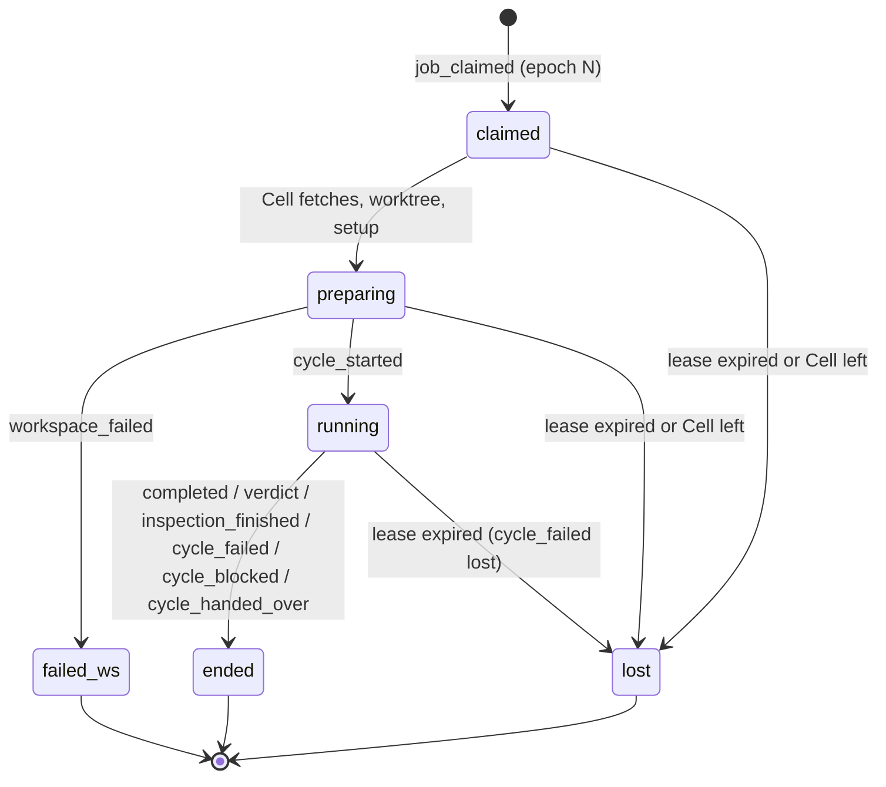

# Protocol: how the parts talk

All request and response bodies are transport-neutral zod schemas in `factory-core/src/contracts/`.
The runtime, server, Cell and both CLIs import the same schemas; there is no hand-written duplicate
of a payload anywhere. Local mode sends the same contracts over the Unix socket to `factory-server`, which
runs the runtime. HTTP routes below are the remote transport, not a requirement for local operation.

## 1. Actors and credentials

| Actor                           | Credential                                                                                  | Reaches                                                 | Scope                                                                           |
| :------------------------------ | :------------------------------------------------------------------------------------------ | :------------------------------------------------------ | :------------------------------------------------------------------------------ |
| Supervisor via `factory`        | Local: operating-system account over the socket; remote: supervisor token (`FACTORY_TOKEN`) | `factory-server` via the socket, or its supervisor API  | everything a Supervisor may do                                                  |
| Cell, enrolling                 | join token (`FACTORY_JOIN_TOKEN`), created by `factory cells token create`                  | Remote `POST /v1/cell/join`                             | obtaining a Cell credential                                                     |
| Cell, enrolled                  | Cell credential, returned once by `join`                                                    | `factory-server` via the socket, or the remote Cell API | writes only to Work orders for which it holds the current epoch; reads any blob |
| Operator via `factory-operator` | per-Cycle local token (`FACTORY_CYCLE_TOKEN`), random, created by the Cell                  | its Cell's unix socket only                             | only its own Cycle                                                              |

Tokens are opaque random strings. The runtime stores only their hashes.

- **Join tokens** are pool-level and reusable until they expire or are revoked. They enroll Cells;
  they cannot claim work.
- **Cell credentials** identify one Cell (`cellId`). A Cell keeps its credential in its config
  directory and reuses it across restarts, so it keeps its identity and its warm worktrees. A Cell
  with no credential, or one rejected with `401`, joins again and becomes a new Cell.
- Revoking a Cell (`factory cells rm <id>`) makes its active leases expire; the next claim, heartbeat or board read reaps them (§5.4).
- In remote mode, the **first supervisor token** is created on the Factory host with
  `factory-server admin token create <name>`, which writes through the runtime to its database.
  There is no network path that creates a supervisor token. Local mode uses the local operating-system
  account and does not create or require a supervisor token.

## 2. Transport

- **Local mode (default):** `factory` and local Cells are clients of `factory-server` over the Unix
  socket `$FACTORY_DATA_DIR/factory.sock` (mode `0600`). The shared zod contracts are the payloads. The
  socket is local IPC, not a network listener, and no supervisor token is required. The local
  operating-system account is the trust boundary. Bun's `fetch` supports the socket through its `unix`
  option.
- **Remote mode (optional, M4R):** the same `factory-server` additionally binds TCP with HTTP/1.1 +
  JSON and SSE, served by Hono. The server binds `127.0.0.1` by default; `FACTORY_BIND` sets another
  address. Remote Cells SHOULD reach it over a private network (WireGuard / Tailscale) or a TLS reverse
  proxy. The server does not terminate TLS itself in v2.0. WebSocket is not used in v2.0.
- Remote Cells open **no inbound port**. Everything the Factory needs to tell a Cell arrives in
  responses to requests the Cell makes (claim long-poll and heartbeat).
- `factory-operator` talks to its Cell over a localhost HTTP endpoint (`$FACTORY_OPERATOR_URL`, `http://127.0.0.1:<port>`), gated by the Cycle token (§3.3).

## 3. APIs

### 3.0 Client adapters

The CLI depends on the transport-neutral `FactoryClient` contract, not on HTTP. Its operations cover
board/order/event/blob reads, Supervisor commands, the task API, project registry, Cell administration,
admin operations and event subscription. The Cell uses the corresponding Cell client operations: initialize, claim,
heartbeat, submit command, and read/write blobs.

- `SocketFactoryClient` (the default) sends the shared request/response schemas to `factory-server`
  over the Unix socket and maps socket errors to the shared error contract. The CLI and local Cells
  use it.
- The in-process fallback is used only for a one-shot CLI write when no server is running. It starts the
  runtime for that command while holding the writer lock (STORAGE §1). It is not a Cell path.
- `RemoteFactoryClient` serializes the shared request/response schemas over the TCP HTTP routes below
  and maps HTTP errors to that same contract.
- Rendering, CLI configuration and storage access are not part of `FactoryClient`. Neither client
  adapter may implement domain decisions or access SQLite directly.
- Event subscription is an async stream in the client contract; the socket client reads the server's
  event feed, remote mode adapts `/v1/stream` SSE.

### 3.1 Supervisor operations (`factory` → runtime)

These operations are available through `FactoryClient` in both modes. In remote mode they map to the
HTTP routes below; local mode sends the same operations over the Unix socket to `factory-server`.

| Method                    | Path                           | Purpose                                                                                                                                                                                                                                                                              |
| :------------------------ | :----------------------------- | :----------------------------------------------------------------------------------------------------------------------------------------------------------------------------------------------------------------------------------------------------------------------------------- |
| `GET`                     | `/v1/board`                    | Queue projection: every open Work order, plus terminal ones updated in the last 7 days (`?all=1` for everything), with status, holder, Station, age                                                                                                                                  |
| `GET`                     | `/v1/orders/:id`               | Work order detail: state summary, Cycles, open question, Andon, checkpoint                                                                                                                                                                                                           |
| `GET`                     | `/v1/orders/:id/events?after=` | The Work order's Traveler                                                                                                                                                                                                                                                            |
| `GET`                     | `/v1/plans`                    | Order Plans of every project: slug, project, phase, member count, plan PR state, Andon (CORE §12). Socket path `supervisor/plans`                                                                                                                                                    |
| `GET`                     | `/v1/plans/:slug?project=`     | One plan: members in chain order, each with board status, base branch, PR link and blocker, plus the plan PR and Andon. Socket path `supervisor/plans/show`                                                                                                                          |
| `GET`                     | `/v1/blobs/:ref`               | A blob (prompt, artifact, log, Handover)                                                                                                                                                                                                                                             |
| `POST`                    | `/v1/orders/:id/answer`        | `Answer`                                                                                                                                                                                                                                                                             |
| `POST`                    | `/v1/orders/:id/resume`        | `Resume` (`--note`, `--from <station>`, `--grant <n>`)                                                                                                                                                                                                                               |
| `POST`                    | `/v1/orders/:id/reopen`        | `Reopen` (`--from <station>`, `--note`)                                                                                                                                                                                                                                              |
| `POST`                    | `/v1/orders/:id/nudge`         | `Nudge`                                                                                                                                                                                                                                                                              |
| `POST`                    | `/v1/orders/:id/cancel`        | `Cancel`                                                                                                                                                                                                                                                                             |
| `POST`                    | `/v1/orders/:id/priority`      | `Reprioritise`                                                                                                                                                                                                                                                                       |
| `POST`                    | `/v1/orders`                   | `createOrder`: a Work order from `projectId`, `todoId`, `title`, `type`, `body` (markdown spec), `line` (a `LineSnapshot`, pinned as sent, hash verified), `priority`, `dependsOn`, optional `plan`, `baseBranch`. Idempotent by `commandId`. Socket path `supervisor/orders/create` |
| `POST`                    | `/v1/plans`                    | `createPlan`: `projectId`, `slug`, optional `baseBranch`, `members[]` (`todoId`, `title`, `type`, `body`, `line`, `priority`) in chain order. Creates the plan, each member's Work order and the chain. Idempotent by `commandId`. Socket path `supervisor/plans/create`             |
| `POST`                    | `/v1/orders/:id/pr-state`      | `recordPrState`: `prUrl`, `state` (`open \| merged \| closed`). Refused as `precondition` while the Work order has no PR. Socket path `supervisor/orders/pr-state`                                                                                                                   |
| `POST`                    | `/v1/plans/:id/pr-state`       | `recordPlanPrState`: `prUrl`, `state`. Refused as `precondition` while the plan has no PR. Socket path `supervisor/plans/pr-state`                                                                                                                                                   |
| `POST`                    | `/v1/webhooks/github`          | GitHub `pull_request` webhook (§3.6): records a PR's state on the Work order or plan holding its URL. Outside bearer auth                                                                                                                                                            |
| `GET`                     | `/v1/cells`                    | Cells, their last heartbeat, busy state, current job                                                                                                                                                                                                                                 |
| `DELETE`                  | `/v1/cells/:id`                | Revoke a Cell                                                                                                                                                                                                                                                                        |
| `POST` / `GET` / `DELETE` | `/v1/join-tokens`              | Create (returns the token once) / list / revoke join tokens                                                                                                                                                                                                                          |
| `GET`                     | `/v1/projects`                 | Project registry: every registered project, with its base branch, max running and dependency policy                                                                                                                                                                                  |
| `POST`                    | `/v1/projects`                 | Register a project: `projectId`, `repoUrl`, `baseBranch`, `maxRunning`, `depPolicy`. Refused as `precondition` when the id exists                                                                                                                                                    |
| `POST`                    | `/v1/projects/:id`             | Change `baseBranch`, `maxRunning` or `depPolicy` (at least one). `repoUrl` cannot change (remove and re-add). Rules below                                                                                                                                                            |
| `DELETE`                  | `/v1/projects/:id`             | Remove a project. Refused as `precondition` while it has any Work order or event                                                                                                                                                                                                     |
| `GET`                     | `/v1/stream`                   | Server-sent events: every stored event from `Last-Event-ID` (= `globalSeq`)                                                                                                                                                                                                          |
| `GET`                     | `/v1/admin/export`             | Remote export endpoint. Import is a local runtime admin operation, never an HTTP route.                                                                                                                                                                                              |

Every `POST` carries a `commandId` generated by the CLI (a ULID per invocation, reused on its own
retries).

**Order Plans.** The board row of a Work order gains `plan`, `baseBranch` and `dependsOn`. The
`resume` and `cancel` routes also accept a `PlanId` (`<projectId>:plan:<slug>`, CORE §2) in place of an
order id and then run `Resume` or `Cancel` on the plan (CORE §12.3); `factory plan status` prints that
id next to an Andon. The plan routes are read-only; a plan is created by `POST /v1/plans`, never by the server itself.
In remote and `--once` mode they are the same operations over the same contracts (RULES §6.5).

Project registry (`/v1/projects`). The socket paths are `supervisor/projects` (list),
`supervisor/projects/add`, `supervisor/projects/set` and `supervisor/projects/remove`; each takes the
same body as its HTTP route, with `projectId` in the body on `set` and `remove`.

- Add: `projectId` is a slug; `repoUrl` is required; `baseBranch` defaults to `main`; `maxRunning` is a
  positive integer (default 2); `depPolicy` is `delivered` or `merged` (default `delivered`). An
  existing `projectId` is refused as `precondition`, so a replayed add is refused too; the registry has
  no `commandId` dedupe (like join-token revoke).
- Set: at least one of `baseBranch`, `maxRunning`, `depPolicy`. A `baseBranch` change is refused as
  `precondition` while the project has a Work order that is not `delivered`, `merged` or `cancelled`
  (running orders must not switch base; v2-21 pins the base per Work order). Setting the same base
  branch is a no-op. `repoUrl` is not accepted (the body is strict): mirrors and Cell checkouts would go
  stale, so remove and re-add the project.
- Remove: refused as `precondition` while the project has any Work order or event. A project
  with history is never deleted, so projections stay rebuildable (STORAGE §4).
- An unknown `projectId` on set or remove answers `not_found`.
- A newly added project is served only by Cells whose config lists it (`projects` in the Cell's
  `config.toml`, §9). The Factory does not push projects to Cells: a Cell's `hello` lists its projects,
  and the queue offers it only Work orders of those projects.

### 3.2 Cell operations (Cell → runtime)

The Cell operation contracts are shared by local and remote adapters. The HTTP routes below are used
only in remote mode.

| Method | Path                            | Purpose                                                                                                                                                                                                                                             |
| :----- | :------------------------------ | :-------------------------------------------------------------------------------------------------------------------------------------------------------------------------------------------------------------------------------------------------- |
| `POST` | `/v1/cell/join`                 | `{ joinToken, name }` → `{ cellId, credential }`. The only call authenticated by a join token.                                                                                                                                                      |
| `POST` | `/v1/cell/hello`                | Announce version, projects, runners, capabilities. Returns runtime config (TTL, intervals).                                                                                                                                                         |
| `POST` | `/v1/cell/claim`                | Long-poll (≤ 25 s) for one job. Returns `Job` or `204`.                                                                                                                                                                                             |
| `POST` | `/v1/cell/heartbeat`            | Extend the leases of all held jobs at once. Returns per-job `ok \| stale` and pending **signals**.                                                                                                                                                  |
| `GET`  | `/v1/blobs/:ref`                | Download a blob named in a `Job` (prompt, inputs).                                                                                                                                                                                                  |
| `PUT`  | `/v1/blobs/:ref`                | Upload a blob. Idempotent; the runtime verifies the hash.                                                                                                                                                                                           |
| `POST` | `/v1/cell/jobs/:jobId/commands` | Every command of §3.4, in one envelope `{ commandId, epoch, command, dryRun? }`. A plan job names its plan instead, `{ planId, commandId, epoch, command, dryRun? }`; the plan variant answers `next: null`. Response: `{ dryRun, events, next? }`. |

With `dryRun: true` the runtime runs `decide` and returns the events it _would_ append, or the error,
and stores nothing (no events, no idempotency record). Cells use it before a checkpoint push (§8.2).

### 3.3 Operator API (`factory-operator` → Cell, localhost HTTP)

Each Cycle gets one endpoint, bound to `127.0.0.1` on an OS-assigned port (`listen(0)`) and closed
when the Cycle ends. `factory-operator` reads its URL from `$FACTORY_OPERATOR_URL`, for example
`http://127.0.0.1:52817`, and sends each verb as one `POST` with a JSON body: the verb is `op`, its
payload sits beside it.

- **Token.** `Authorization: Bearer <token>` from `$FACTORY_CYCLE_TOKEN`, or the body's `token` field
  when no header is sent; the header wins when both are sent. The Cell compares the token in constant
  time. A missing or wrong token is `401`.
- **Status.** `200` for `ok: true`. `400` (`invalid`) for a body that is not JSON or fails the verb
  schema. `401` (`unauthorized`). `405` for any method but `POST`, with `Allow: POST`. `413` for a body
  over 1 MiB. `409` for a refusal the dispatcher returns (`rejected`, `stale_epoch`, `not_live`,
  `precondition`). `500` (`internal`) when the dispatcher throws.
- **Reply.** One `OperatorReply` object: `{ ok: true, result? }` or `{ ok: false, code, message }`.
- **Reach.** Only loopback is bound, so no other host reaches it. Any local process can, though: the
  Cycle token is the only gate, the same trust the old `0600` socket relied on, minus the file mode.

| Verb                                                        | Maps to                                                                      |
| :---------------------------------------------------------- | :--------------------------------------------------------------------------- |
| `factory-operator done`                                     | `CompleteCycle`                                                              |
| `factory-operator verdict pass` / `fail --feedback <file>`  | `SubmitVerdict`                                                              |
| `factory-operator ask "<question>"`                         | `AskQuestion` (blocks until answered or the hold expires)                    |
| `factory-operator tell <station\|supervisor> "<note>"`      | `LeaveNote`                                                                  |
| `factory-operator block --reason "<why>" --handover <file>` | `BlockCycle{source: operator}`                                               |
| `factory-operator context`                                  | Prints the Cycle's inputs, outputs and instructions again (read-only, local) |

Terminal verbs (`done`, `verdict`, `block`) go through the checkpoint procedure of §8.2: validate
locally, upload blobs, commit, dry-run, push, send. Mid-Cycle verbs (`ask`, `tell`) are forwarded
immediately without committing or closing the pane. The Operator gets a clear error and a non-zero
exit code for anything rejected at any stage.

### 3.4 Commands a Cell forwards

`StartCycle`, `ReportWorkspaceFailed`, `CompleteCycle`, `SubmitVerdict`, `ReportInspection`,
`FailCycle`, `BlockCycle`, `HandOverCycle`, `AskQuestion`, `LeaveNote`, `RecordUsage`, `ReleaseJob`,
`ReportDelivery` (CORE §5.2), and for plan jobs `ReportPlanBranch`, `ReportPlanPr`, `ReportPlanReady`,
`ReportPlanJobFailed` and `ReleaseJob` (CORE §12.3).

### 3.5 Errors

| HTTP          | `code`         | Cell reaction                                                                               |
| :------------ | :------------- | :------------------------------------------------------------------------------------------ |
| 401           | —              | The Cell credential is unknown or revoked: stop every job, then `join` again.               |
| 404           | `not_found`    | A bug or a deleted Work order: drop the job.                                                |
| 409           | `stale_epoch`  | **Stop the job now**: close the pane, do not push, keep the worktree for inspection.        |
| 409           | `not_live`     | The Cycle already ended; drop the command.                                                  |
| 409           | `precondition` | Report to the Operator; continue the Cycle.                                                 |
| 422           | `invalid`      | Report to the Operator with the issues; continue the Cycle.                                 |
| 5xx / network | —              | Retry with the same `commandId`, exponential backoff, until the self-fence deadline (§5.3). |

## 4. Jobs

```ts
interface Job {
  jobId: JobId;
  orderId: OrderId | PlanId; // the stream the job belongs to; a PlanId for the three plan_* kinds
  projectId: ProjectId;
  epoch: number;
  kind:
    | 'run_operator_station'
    | 'run_inspection'
    | 'deliver'
    | 'plan_branch'
    | 'plan_pr'
    | 'plan_pr_ready'
    | 'mechanic'; // CORE §14.4: triages one Andon; no workspace, no station; `mechanic` block set
  repo: { url: string; baseBranch: string; branch: string };
  // Work order job: branch = factory/<todoId>; baseBranch = the project's base branch, or for a plan
  //   member the resolved plan base: `feat/<slug>` or `factory/<predecessorTodoId>` (CORE §12.5).
  // plan job: branch = feat/<slug>; baseBranch = the plan's baseBranch.
  base: CommitSha | { branchBase: string }; // CORE 'branch_base' → { branchBase: repo.baseBranch }; resolved by the Cell at fetch time
  workspace?: {
    dir: string;
    sync: string[];
    setup: string[];
    timeoutMs: number;
  }; // dir = <todoId>, relative to the Cell's worktrees/; absent on plan jobs (no worktree)
  station?: {
    stationId;
    cycleId;
    n;
    cause;
    // run_operator_station:
    operator?: {
      profile; // e.g. 'planner', 'builder', 'auditor'
      runner;
      model;
      permission: 'read' | 'write';
      headless: boolean;
      timeoutMs;
    };
    // The Cell renders the Operator prompt from these inputs and the repo's own `.factory/` (its profile,
    // templates, rules and skills). The server sends no rendered prompt and no repo template.
    prompt?: {
      taskId: string; // the todo id, as `{{taskId}}`
      todoBodyBlob: BlobRef; // the spec body
      context: CycleContext; // the Cycle's inputs, notes, feedback, resume and outputs (CORE §7), as blob refs
      budget: { retry: number; max: number };
    };
    inputs?: { blob: BlobRef; path: string }[]; // relative to the worktree
    outputs?: { key: string; path: string; required: boolean }[];
    verdict?: boolean;
    runtimePrompts?: {
      // rendered by the runtime from templates; the Cell only types them
      answer: string; // contains the literal placeholder {{answer}}
      nudge: string; // contains {{text}}
      idleReminder: string;
      silentReminder: string;
      handoverRequest: string;
    };
    // run_inspection:
    exec?: string[];
    inspectionTimeoutMs?: number;
  };
  // deliver: the Cell renders the commit message, the PR title and the PR body from these refs and the repo's
  // `.factory/templates/pr/`. It removes `todos/<taskId>.md` only when that file exists (intake orders have one;
  // API-created orders do not).
  deliver?: {
    taskId: string;
    type: string;
    title: string; // the spec title, the fallback subject of the generated commit
    todoBodyBlob: BlobRef;
    commitBlob?: BlobRef; // the builder's commit artifact, when the Line delivers one
    reportBlob?: BlobRef; // the builder's report artifact
    logCommand: string;
    verification: (
      | { kind: 'inspection'; stationId: string; commands: string[] }
      | { kind: 'operator'; stationId: string; profile: string }
    )[];
  };
  // mechanic: `incident: { reason, detail }`; the Cell renders the incident prompt from it.
  plan?: {
    // plan_* jobs only
    slug: string;
    title: string; // PR title
    bodyBlob?: BlobRef; // plan_pr / plan_pr_ready: the PR body, listing the sub-PRs (CORE §12.7)
    prUrl?: string; // plan_pr_ready: the PR to mark ready
  };
}
```

**Plan jobs.** `plan_branch`, `plan_pr` and `plan_pr_ready` belong to an Order Plan (CORE §12). They
are claimed, leased, heartbeated and fenced like any other job (§5): `job_claimed` with a new epoch on
the plan stream, a lease row, the reaper, `stale_epoch` on a late write. They have no Station, no
Cycle, no worktree and no `workspace` block: the Cell only fetches its mirror and talks to `git` and
the GitHub adapter. A job that cannot finish reports `ReportPlanJobFailed`; two in a row raise the
plan's Andon. All three are **idempotent**, so a retry or a takeover never creates a second branch or
PR.

| Kind            | The Cell…                                                                                                                                                                  | Reports                       | Runs when                                                       |
| :-------------- | :------------------------------------------------------------------------------------------------------------------------------------------------------------------------- | :---------------------------- | :-------------------------------------------------------------- |
| `plan_branch`   | fetches; if `refs/heads/feat/<slug>` is absent, creates it at `origin/<baseBranch>` and pushes it **without force**; if present, uses its current tip                      | `ReportPlanBranch { commit }` | before the root's first job (the root is not claimable earlier) |
| `plan_pr`       | looks for a PR with head `feat/<slug>` and base `<baseBranch>` (open or already merged); if none, opens a **draft** PR with `plan.title` and `plan.bodyBlob` (sub-PR list) | `ReportPlanPr { prUrl }`      | once the root member is `merged`                                |
| `plan_pr_ready` | updates the PR body from `plan.bodyBlob` and marks the PR ready for review; already ready is a success                                                                     | `ReportPlanReady`             | once every member is `merged`                                   |

Before the push of `plan_branch` the Cell dry-runs `ReportPlanBranch` (`dryRun`, §8.2 step 4), so a
fenced Cell never creates the branch. `--force` is never used for a plan branch; a push rejected
because the branch appeared meanwhile is a success if it is the branch the job would have created
(same base), else `ReportPlanJobFailed`.

**Deliver of a plan member.** For a Work order that belongs to a plan, `repo.baseBranch` is the plan
base of CORE §12.5. The Cell uses it as `branch_base` for every Station job and for `deliver`:
rebase the branch onto `origin/<repo.baseBranch>`, squash, remove the todo, push, and open the PR
**with that base** (`gh pr create --base <repo.baseBranch>`), or find the existing open PR for the
branch. If the existing PR targets another base (the predecessor was merged and GitHub retargeted it,
or the reverse), the Cell leaves it: GitHub owns the retarget and the PR is the same PR. A missing
base branch on the remote or a rebase conflict (for example after a reopened predecessor was
rewritten) is `delivery_failed`.

`cycle_started.baseCommit` records the commit the Cell actually resolved, so every later Cycle that
refers to "its base" is exact.



**Continuation.** When a Cell's command ends a job and `nextJob` for the same Work order is another
job that this Cell can run, the runtime claims it for that Cell **in the same transaction** as the
command's events (STORAGE §3) and returns it in `next`. Because the stored idempotent response
includes `next`, a lost response and a retry give the Cell the same job. The worktree stays warm and
the Line keeps moving without a queue round trip. The runtime MAY skip this when a higher-priority
Work order is waiting.

The Cell runs the continuation on the same Cell, before it claims again. A Cell that is stopping or
fenced will not run it: a stopping Cell releases it at once with `ReleaseJob` (§9), a fenced Cell
sends nothing (§5.4) and lets the lease lapse. A `ReleaseJob` never returns a continuation: the Work
order goes back to the queue, not to the Cell that released it.

## 5. Leases and fencing

### 5.1 Numbers

| Setting            | Default                                            |
| :----------------- | :------------------------------------------------- |
| Lease TTL          | 60 s                                               |
| Heartbeat interval | 15 s                                               |
| Reaping            | lazy: on claim, heartbeat and board reads (§5.4)   |
| Cell self-fence    | no successful heartbeat for 45 s                   |
| Factory boot grace | every lease's expiry is set to `now + TTL` on boot |

All four are Factory settings, returned to Cells by `hello`. Self-fence MUST stay below the TTL.
A Factory that is unreachable for longer than the self-fence window costs every in-flight Cycle
(§11); raise TTL and self-fence together if Factory restarts are slow (OPEN-QUESTIONS Q16).

**Test knobs.** `factory-server` reads four environment variables, one per setting above:
`FACTORY_LEASE_TTL_MS`, `FACTORY_HEARTBEAT_MS`, `FACTORY_SELF_FENCE_MS` and
`FACTORY_CLAIM_TICK_MS` (the claim re-read interval, `DEFAULT_CONFIG.claimTickMs`). There is no reaper
or poll interval: the server runs no timer. Each takes a positive
whole number of milliseconds. Unset, the defaults above apply; production sets none of them. The
distributed suite (`pnpm --filter @repo/factory-cell test:distributed`) runs with short timings. A
self-fence that is not below the TTL is refused at start (`apps/server/src/runtime-config.ts`).

**Cut-over flag.** `FACTORY_V2_ONLY` (`1` or `0`, `RuntimeConfig.v2Only`) is a Factory setting, not a
timing knob. Unset means `1`: the Supervisor's todo intake turns only todos with `factory: v2` in their frontmatter into Work
orders and skips the rest silently, because v1 owns them (ROADMAP M9; v1's `pick-todo.ts` skips the
same todos). `0` makes v2 take every todo, and is for after the trial only, once v1 is frozen. Any other
value is refused at start. Trial runbook: [TRIAL.md](TRIAL.md).

### 5.2 Claim

One SQLite transaction (`BEGIN IMMEDIATE`, STORAGE §3):

1. Read the queue projection, run `selectClaimable` for this Cell.
2. For the first candidate: load the Traveler, `evolve`, `nextJob` must be `job`.
3. `decide(ClaimJob)` → `job_claimed{epoch+1}`; append with `expectedSeq`.
4. Insert the lease row `(orderId, jobId, cellId, epoch, expiresAt)`.
5. Render the prompt and the runtime prompts (if an Operator station), store the prompt as a blob,
   build the `Job`.

If step 3 fails on `expectedSeq` (another writer moved the Work order), try the next candidate.

Plan jobs are offered first (§4): the same claim on the plan stream, `ClaimJob` and its lease written in
one transaction, so a claimed plan job always has a lease the reaper can expire. A plan job's
`orderId` is its PlanId; its report is the plan variant of `submitCommand` (§3.2), fenced by the same
lease and epoch.

### 5.3 Fencing, three layers

1. **Database.** Every cell or operator command carries `epoch`. `decide` rejects
   `epoch ≠ activeJob.epoch` with `stale_epoch`. A Cell that comes back from a partition cannot write
   anything. (The one command without an epoch, `RecordUsage`, cannot change what runs next.)
2. **Self-fence.** A Cell that has had no successful heartbeat for 45 s stops its jobs itself (closes
   the pane, no push, no delivery). The runtime expires the lease only at 60 s, so a Cell has
   stopped before another Cell can be given the same Work order, up to clock drift between the two
   machines' monotonic timers.
3. **Git.** A Cell pushes to the Work order branch only after the runtime has confirmed, by a dry
   run, that it still holds the epoch (§8.2). A Cell that lost its lease gets `stale_epoch` and never
   pushes. The branch is therefore always written by the current holder; what a previous holder left
   on it is overwritten, never built upon by accident.

The Traveler, not the branch, says which commits count: a commit matters only if an accepted event
names it.

### 5.4 Reaper

There is no timer. The reaper runs lazily, inside the write transaction of the read or write that asks
for it: `claim` (before the queue is selected), `heartbeat`, and the board and order reads. Each pass
runs, for every lease with `expiresAt < now`, `ExpireLease` through the standard command loop
(`decide(ExpireLease)` → `cycle_failed{lost}` + `job_lost{lease_expired}`, delete the lease, then
evaluate `nextJob` and append `andon_raised` if the restart budget is spent). The Work order returns to
the queue and `nextJob` restarts the Station (CORE §5.3). A dead Cell's lease is back in the queue on the
next claim, heartbeat or board read. Boot grace (§5.1) holds the reaper until one TTL after start.

### 3.6 GitHub webhook

`POST /v1/webhooks/github` takes GitHub's `pull_request` deliveries. It sits outside bearer auth: its
credential is the HMAC of the raw body, `X-Hub-Signature-256: sha256=<hex HMAC-SHA256>` with the secret
in `GITHUB_WEBHOOK_SECRET`, compared in constant time. A missing or wrong signature is `401 unauthorized`;
with no secret configured the route answers `503 not_configured`, and a delivery without an
`X-GitHub-Delivery` id is `422 invalid`. `opened` and `reopened` record the PR as `open`; `closed` records
`merged` when GitHub says `merged: true` and `closed` otherwise. Every other event or action is
acknowledged (`200`) and records nothing. The state is recorded on every Work order and every Order Plan
whose stored `prUrl` is the PR's URL, with the delivery id as the command id, so a redelivery records
nothing new (the body answers `{ recorded }`). A stream already at that state is left alone.

## 6. Idempotency

- Every command carries a `commandId`. The store keeps `(commandId → seq range, response)`; a repeat
  returns the stored response and appends nothing (STORAGE §3).
- Cell-generated ids are derived from content, so they survive a crash and restart of the Cell
  process: `<jobId>:<command kind>:<first 16 hex of sha256(canonical JSON of the command)>`.
- Operator commands get their id the same way when the Cell receives the call. Consequence: an
  Operator that sends the exact same `ask` or `tell` twice in one Cycle gets the first result again.
- Supervisor commands: a ULID per CLI invocation (§3.1).
- Blob uploads are idempotent by construction (content address).

## 7. Signals (Factory → Cell, during a job)

Delivered in heartbeat responses, acknowledged in the next heartbeat (`acked: signalId[]`).
Kept until acknowledged or the job ends. A job that ended on the runtime side (cancel, expiry) is
reported as `stale` in the heartbeat response, which is the Cell's cue to stop it.

| Signal                        | Cause                                                                                         | Cell action                                              |
| :---------------------------- | :-------------------------------------------------------------------------------------------- | :------------------------------------------------------- |
| `answer { questionId, text }` | `question_answered` for an open question                                                      | Type the answer into the pane (`runtimePrompts.answer`). |
| `nudge { text }`              | `nudged` (`factory nudge <order> "<text>"`, or a Mechanic/Supervisor helping a live Operator) | Type the text into the pane (`runtimePrompts.nudge`).    |

## 8. Git: branches and checkpoints

### 8.1 Refs

- One branch per Work order: `factory/<todoId>`, created from `origin/<baseBranch>` at the first job.
  For a plan member the first job creates it from the plan base instead: `origin/feat/<slug>` or
  `origin/factory/<predecessorTodoId>` (CORE §12.5).
- One branch per Order Plan: `feat/<slug>`, created by the `plan_branch` job from
  `origin/<baseBranch>` (§4). The Factory never force-pushes it and never deletes it; the Work order
  PRs merge into it (CORE §12.9). A Work order whose todo contains no `plan` never touches `feat/*`.
- WIP of failed Cycles, for the Supervisor only: `factory-wip/<todoId>/<cycleId>`. (A separate
  namespace: git cannot hold `factory/<todoId>` and `factory/<todoId>/…` at the same time.)
- The Cell's scratch directory `.cell/` in the worktree (inputs, outputs) is excluded through the
  mirror's `info/exclude`, so the target repository needs no `.gitignore` entry.

### 8.2 The checkpoint procedure

Used whenever a Cycle ends with work to keep (`done`, `verdict`, `block`, handover):

1. **Validate** locally: declared outputs exist, are non-empty and are inside the worktree.
2. **Upload** output blobs (and the Handover or feedback).
3. **Commit** everything in the worktree except `.cell/`. Message `wip(<stationId>): cycle <n>`,
   trailers:

   ```text
   Factory-Order: software-factory:add-webhooks
   Factory-Station: build
   Factory-Cycle: 01JD3...
   Factory-Epoch: 7
   Factory-Outcome: passed
   ```

   `Factory-Outcome` is `passed`, `failed` (a failed verdict), `blocked` or `handed_over`.

   `Factory-Outcome: passed` is load-bearing for recovery (STORAGE §8): `admin recover` finds the
   checkpoint of a lost database by that trailer, so a passed Cycle's commit must carry it and be
   pushed before its command is sent.

4. **Dry-run** the command (`dryRun: true`) with the commit sha. `stale_epoch` → stop, no push.
   `precondition` / `invalid` → report to the Operator, drop the local commit (`git reset --soft`),
   continue the Cycle.
5. **Push**: fetch the branch, then `git push --force-with-lease=<branch>:<tip just fetched>` (an
   empty expectation when the branch does not exist yet). If the push is rejected because the tip
   moved, repeat from step 4, at most 3 times, then `FailCycle{crashed}`.
6. **Send** the command for real. Only now does the commit count.

Step 4 before step 5 is what keeps a fenced-off Cell from pushing; the lease in step 5 only makes
sure nothing is overwritten that was pushed between the fetch and the push without a fresh epoch
check.

### 8.3 Per job kind

- **Operator station with write permission**: the checkpoint procedure when the Operator finishes.
- **Operator station with read permission and Inspections**: must leave the tree clean. A dirty tree
  after them is `cycle_failed{crashed, detail: "read-only station changed files"}`. They upload
  blobs and send their command without a commit.
- **Failure** (timed out, stalled): the Cell MAY push the WIP to `factory-wip/<todoId>/<cycleId>`.
  The restart never builds on it.
- **Delivery**: squash the branch into one commit on top of the current `origin/<baseBranch>`
  (`git rebase` then `reset --soft`), message from the Line's `deliver.commit` artifact, remove the
  todo file in the same commit if it is still there, then dry-run `ReportDelivery`, push as in
  §8.2 step 5, open the PR (or find the existing open one), `ReportDelivery`. A rebase conflict is
  `delivery_failed`. For a plan member `<baseBranch>` is the job's `repo.baseBranch` (§4): the PR is
  opened against `feat/<slug>` or `factory/<predecessorTodoId>`, and the todo is removed on that line
  of history, so it leaves the plan branch with the sub-PR and leaves the project's base branch with
  the final plan PR.
- **Plan jobs** (`plan_branch`, `plan_pr`, `plan_pr_ready`): §4. They touch only `feat/<slug>` and the
  plan PR, never a `factory/*` branch, and need no worktree.

After delivery the pre-squash checkpoint commits are no longer reachable from the branch. Their shas
stay in the Traveler as history; a reopened Work order builds on the delivery commit (CORE §4.3
rule 9).

The trailers make a Work order's progress recoverable from git alone until delivery (STORAGE §8).

## 9. Cell internals

```text
~/.config/factory-cell/
└── config.toml                    # Factory URL, join token, projects, runners, capabilities
~/.local/state/factory-cell/
└── credential                     # the Cell credential from `join` (mode 0600)
~/.local/share/factory-cell/       # everything here is a cache: deleting it loses nothing
├── repos/<projectId>.git          # bare mirror, fetched before every job
├── worktrees/<todoId>/            # one per Work order held recently; LRU-evicted
│   └── .cell/                     # inputs, outputs, Cycle scratch (excluded from git)
└── runtime/<cycleId>.jsonl        # runtime journal (CORE §9.3)
```

Deleting the credential makes the Cell join again as a new Cell; nothing else is lost.

Executing `run_operator_station`:

1. Fetch the mirror; create or reset the worktree at `base`; run `sync` + `setup` unless the worktree
   is already prepared at that commit. On failure → `ReportWorkspaceFailed`.
2. `StartCycle`.
3. Download and write `inputs` blobs to their paths; create the Cycle token and start its localhost
   Operator endpoint (§3.3).
4. Open a Herdr pane (or a headless process) with `FACTORY_OPERATOR_URL`, `FACTORY_CYCLE_TOKEN`,
   the runner command and the prompt blob.
5. Loop: heartbeat (shared), observe the pane, `watch` → remind / fail / block; deliver signals.
   When repeated `idle` / `silent` reminders cross the stall-alert threshold before `timeoutMs`, the
   Cell may upload a sanitized pane-tail blob so the Mechanic (M10) can inspect and issue a live
   `nudge` signal without ending the Cycle.
6. On a `factory-operator` call: §3.3. On a terminal result, close the pane.
7. `RecordUsage` if the runner reports usage.

`run_inspection`: steps 1–2, run each command with the timeout, upload the full log as a blob, keep
a cleaned 2 KiB tail (ANSI stripped, v1 logic), `ReportInspection`.

`deliver`: §8.3 delivery.

`plan_branch`, `plan_pr`, `plan_pr_ready`: fetch the mirror, then §4 (Plan jobs). A leaving Cell
lets such a job finish if it ends within 5 min, else `ReleaseJob`, like delivery.

**Leaving** (`SIGTERM`, or the device going away on purpose): stop claiming, then for each job:

| Job state                            | Action                                                                                                                                                  | Result                                                                       |
| :----------------------------------- | :------------------------------------------------------------------------------------------------------------------------------------------------------ | :--------------------------------------------------------------------------- |
| An Operator Cycle is running         | Type `handoverRequest`; wait up to 5 min for the Operator to write its Handover; checkpoint (§8.2 with `Factory-Outcome: handed_over`); `HandOverCycle` | Another Cell continues from the WIP with the Handover. No Supervisor needed. |
| The Operator does not comply in time | `ReleaseJob`                                                                                                                                            | `cycle_failed{lost}` + `job_lost{cell_left}`; restart from the clean base.   |
| An Inspection or delivery is running | Let it finish if it ends within 5 min, else `ReleaseJob`                                                                                                |                                                                              |
| No Cycle started yet                 | `ReleaseJob`                                                                                                                                            | `job_lost{cell_left}`; back to the queue.                                    |

The Cell exits when every job is released. A Cell that simply vanishes is handled by the reaper.

## 10. Supervisor CLI (`factory`)

| Command                                                                                                                                                                                                                                    | Purpose                                                                                                                                                                                          |
| :----------------------------------------------------------------------------------------------------------------------------------------------------------------------------------------------------------------------------------------- | :----------------------------------------------------------------------------------------------------------------------------------------------------------------------------------------------- |
| `factory run`                                                                                                                                                                                                                              | Start the server (core): owns the database, serves the task API and state, listens on the socket                                                                                                 |
| `factory status [--watch] [--all]`                                                                                                                                                                                                         | The board; `--watch` follows the runtime event feed locally or `/v1/stream` remotely                                                                                                             |
| `factory show <order>`                                                                                                                                                                                                                     | Work order detail, Cycles, Andon, Handover                                                                                                                                                       |
| `factory log <order> [-f]`                                                                                                                                                                                                                 | The Traveler, optionally followed                                                                                                                                                                |
| `factory answer <order> "<text>"`                                                                                                                                                                                                          | Answer the open (or abandoned, unanswered) question                                                                                                                                              |
| `factory resume <order> [--note "..."] [--from <station>] [--grant <n>]`                                                                                                                                                                   | Resume an Andon                                                                                                                                                                                  |
| `factory reopen <order> --from <station> [--note "..."]`                                                                                                                                                                                   | Send a delivered, unmerged Work order back for rework                                                                                                                                            |
| `factory nudge <order> "<text>"`                                                                                                                                                                                                           | Type into a live Operator's pane                                                                                                                                                                 |
| `factory cancel <order>` / `factory prio <order> <level>`                                                                                                                                                                                  |                                                                                                                                                                                                  |
| `factory plan ls`                                                                                                                                                                                                                          | List Order Plans: slug, project, member count, plan PR state (CORE §12)                                                                                                                          |
| `factory plan status <slug> [--project <id>]`                                                                                                                                                                                              | The chain in order: board status, base branch, PR link and blocker per member, plus the plan PR                                                                                                  |
| `factory cells [rm <id>]`                                                                                                                                                                                                                  | List or revoke Cells                                                                                                                                                                             |
| `factory cells token create [--ttl <d>] \| ls \| rm <id>`                                                                                                                                                                                  | Manage join tokens                                                                                                                                                                               |
| `factory project ls`                                                                                                                                                                                                                       | List the registered projects                                                                                                                                                                     |
| `factory project add <id> --repo <url> [--base-branch <b>] [--dep-policy delivered\|merged] [--max-running <n>]`                                                                                                                           | Register a project (§3.1). A Cell serves it only if its config lists it                                                                                                                          |
| `factory project set <id> [--base-branch <b>] [--dep-policy delivered\|merged] [--max-running <n>]`                                                                                                                                        | Change a project (§3.1); `--base-branch` is refused while it has an open Work order                                                                                                              |
| `factory project rm <id>`                                                                                                                                                                                                                  | Remove a project with no history (§3.1)                                                                                                                                                          |
| `factory check [--dir <repoRoot>]`                                                                                                                                                                                                         | Offline: validate `<repo>/.factory/` (Operator profiles, Lines, prompt and PR templates) and cross-check `.nitpick/` when present (no Factory needed)                                            |
| `factory init [--dir <repoRoot>] [--force]`                                                                                                                                                                                                | Scaffold `<repo>/.factory/` (`lines/`, `operators/`, `templates/`) from the starter; refuses an existing one unless `--force`                                                                    |
| `factory order create --project <id> --todo-id <slug> --title <text> --type <t> --line <name> [--repo-dir <path>] [--priority ...] [--plan <slug>] [--depends-on <id,…>] [--base-branch <b>] (--file <path> \| --body <text> \| --file -)` | Create a Work order (§3.3). The Line is read and validated from `<repoDir>/.factory/lines/<name>.yml` and pinned as its snapshot                                                                 |
| `factory order pr-state <orderId> <open\|merged\|closed> --pr-url <url>`                                                                                                                                                                   | Set a Work order's PR state by hand: the fallback when no webhook is configured (§3.6). The order must already have a PR                                                                         |
| `factory plan create --project <id> --slug <slug> [--repo-dir <path>] [--base-branch <b>] --members <files…>`                                                                                                                              | Create an Order Plan (§3.3): the members, each a todo file, in chain order; each Line is read from `<repoDir>/.factory/lines/`                                                                   |
| `factory todos migrate [--dir <todos>] [--repo-dir <path>] --project <id> [--dry-run] [--all] [--remove]`                                                                                                                                  | One-time import of a `todos/` folder: plans via `createPlan`, standalone todos via `createOrder`, in dependency order. Idempotent; `--remove` deletes files only after the server confirmed them |
| `factory admin export <file>`                                                                                                                                                                                                              | STORAGE §7                                                                                                                                                                                       |

`factory-server` is the core process: `factory run` is its local start command. It owns the database
through the writer lock, holds tasks and state only (no intake, no git, no gh, no timer), reaps expired
leases lazily (§5.4), and listens on the local Unix
socket by default. Remote deployments add an optional TCP HTTP/SSE listener on the same server.
`factory-cell` runs execution cells as socket clients; they never open the database. A CLI write
while the server runs goes through the socket to that server. If no server runs, the CLI runs
`factory-server --once --data-dir <dir>` as a subprocess: it reads one `{route, request}` JSON object
on stdin, takes the writer lock, runs that route, prints `{ok, response | error}` on stdout and exits
(`0` ok, `1` failed, `2` refused, `3` writer held). The lock is released when the process exits, so
the CLI never opens the database itself. A read with no server runs the same way. `factory run` starts
the long-running server in the foreground and forwards SIGINT and SIGTERM to it.

Local socket routes beyond the HTTP table above: `supervisor/events` is the socket form of
`/v1/stream` (a long-poll: it answers at once with the stored events after `afterGlobalSeq`, else holds
up to 25 s for the next commit); `supervisor/join-tokens` (list), `…/create` (the token is returned once)
and `…/revoke`; `supervisor/admin/export` returns the export archive base64-encoded in JSON. A create
carries its `commandId`: a replay of the same command is refused as `precondition`, so a retry never
makes a second token. There is no intake route: Work orders and plans come in through `POST /v1/orders`
and `POST /v1/plans` (the task API, §3.3), and pull request state through the GitHub webhook (§3.6).

Configuration (`apps/cli`): settings come from the flag, then `FACTORY_DATA_DIR`, then the config file
(`$FACTORY_CONFIG`, else `$XDG_CONFIG_HOME/factory/config.json`, with the keys `dataDir`, `serverBin` and
`color`), then the default `~/.local/share/factory`. `NO_COLOR` set to a non-empty value, `--no-color`
and `"color": false` turn colour off. The config file holds no state; it is never a second database.

Every command above accepts `--json`, and works over the local socket, the one-shot `--once` run and remote
HTTP (`FACTORY_URL` with `FACTORY_TOKEN`) the same way.

Repository setup (`.factory/`, one per repo, next to `.nitpick/`). `factory init` scaffolds it from the
starter this repo ships (`packages/factory-definitions/starter/.factory/`); `factory check` validates it.
Lines are read from `<repo>/.factory/lines/` when a Work order or Order Plan is created: the snapshot is
built client-side, so the server never reads a repo definition (CORE §4.4). `factory todos migrate` keeps
the server the only writer: a file whose OrderId exists is `skipped` before the scan (never `reused_id`),
a plan the server has is skipped with its files, and a dependency is satisfied when its file is `done` or
gone. A todo with no `type` line takes `feat`. Without `--all`, only `factory: v2` todos migrate.

The Cell reads `<repo>/.factory/cell.toml` when it runs inside a repository (`--repo-dir <path>`, else the
repository the working directory is in). Its keys override `~/.config/factory-cell/config.toml` key by key;
`projects` is replaced, not merged. The Cell logs `factory-cell: config from <path>` when it applies one.

`<repo>/.factory-local/cell.toml`, when present, overrides both key by key: the order is
`~/.config/factory-cell/config.toml` < `<repo>/.factory/cell.toml` < `<repo>/.factory-local/cell.toml`.
`.factory-local/` is gitignored. It holds machine-local overrides (`factory_data_dir`, `cell_data_dir`,
`factory_url`) and the machine's runtime state (the software-factory SQLite store, `supervisor.lock`,
`supervisor.log`, `workspaces.json`). `.factory/` holds only the committed repository definitions.

`factory plan ls` and `factory plan status` are read operations (§3.1) and support `--json`. `plan
status` prints one line per member, for example
`wo-1 [merged] -> wo-2 [delivered, PR into factory/wo-1] -> wo-3 [running]`, then the plan PR and the
plan's Andon with the `factory resume|cancel <planId>` command that clears it. `--project` is
optional while the slug is unique across the registered projects, else required. Local, remote and
`--once` modes give the same output (RULES §6.5).

`factory-server admin …` (token create, backup, export, import, rebuild-projections, recover) operates on
the server's database. `admin recover` is the socket and HTTP operation `supervisor/admin/recover`
(`POST /v1/admin/recover`, body `{ projectId? }`); it answers the Work orders it recovered and the
branches it skipped. Like `admin backup`, the offline form needs the writer lock.

## 11. Failure matrix

| Failure                                                      | What happens                                                                                                                                                    | Lost                                        |
| :----------------------------------------------------------- | :-------------------------------------------------------------------------------------------------------------------------------------------------------------- | :------------------------------------------ |
| Cell process crashes mid-Cycle                               | Lease expires (≤ 65 s); `cycle_failed{lost}`; restart on any Cell from the Cycle's base                                                                         | The in-flight Cycle                         |
| Remote Cell partitioned from the runtime, still running      | Self-fences at 45 s; runtime expires at 60 s; late reports get `stale_epoch`; no push without a dry run                                                         | The in-flight Cycle                         |
| Cell leaves on purpose                                       | Handover, then another Cell continues from the WIP (§9)                                                                                                         | Nothing, if the Operator hands over in time |
| Remote runtime restarts within the self-fence window         | Leases persist; boot grace extends them; Cells retry commands idempotently                                                                                      | Nothing                                     |
| Remote runtime unreachable longer than the self-fence window | Every Cell stops its jobs at 45 s; after boot grace, the next claim, heartbeat or board read marks them `lost`; Stations restart, each using one `lost` restart | Every in-flight Cycle                       |
| A response is lost, the Cell retries                         | Same `commandId` returns the stored response, including a continuation job                                                                                      | Nothing                                     |
| Two Cells claim at the same instant                          | One transaction wins; the other gets the next candidate                                                                                                         | Nothing                                     |
| Operator reports after its Cycle timed out                   | Cell rejects locally; if it reached the Factory, `not_live`                                                                                                     | Nothing                                     |
| Todo edited after the first job was claimed                  | `spec_updated` rejected; board shows _spec drift_; the Supervisor may cancel and add a todo under a new name                                                    | Nothing                                     |
| Line YAML edited during a Work order                         | No effect: the Work order uses its pinned snapshot                                                                                                              | Nothing                                     |
| Base branch moves during a Work order                        | Stations keep their base; delivery rebases; a conflict raises an Andon `delivery_failed`                                                                        | Nothing                                     |
| PR closed or changes requested after delivery                | `factory reopen` sends the Work order back to a Station on top of the delivered commit                                                                          | Nothing                                     |
| Cell cache wiped                                             | Mirrors and worktrees are rebuilt on the next job                                                                                                               | Nothing                                     |
| Blob upload interrupted                                      | Hash mismatch → rejected; command referencing a missing blob → `invalid`                                                                                        | Nothing                                     |
