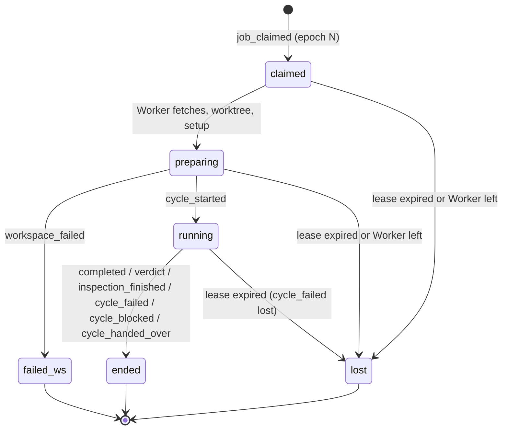

# Protocol: how the parts talk

All request and response bodies are transport-neutral zod schemas in `factory-core/src/contracts/`.
The runtime, server, Worker and both CLIs import the same schemas; there is no hand-written duplicate
of a payload anywhere. Local mode sends the same contracts over the Unix socket to `factory-server`, which
runs the runtime. HTTP routes below are the remote transport, not a requirement for local operation.

## 1. Actors and credentials

| Actor                           | Credential                                                                  | Reaches                                      | Scope                                                                           |
| :------------------------------ | :-------------------------------------------------------------------------- | :------------------------------------------- | :------------------------------------------------------------------------------ |
| Supervisor via `factory`        | Local: operating-system account over the socket; remote: supervisor token (`FACTORY_TOKEN`) | `factory-server` via the socket, or its supervisor API | everything a Supervisor may do                                                  |
| Worker, enrolling                 | join token (`FACTORY_JOIN_TOKEN`), created by `factory workers token create`  | Remote `POST /v1/worker/join`                  | obtaining a Worker credential                                                     |
| Worker, enrolled                  | Worker credential, returned once by `join`                                    | `factory-server` via the socket, or the remote Worker API | writes only to Work orders for which it holds the current epoch; reads any blob |
| Operator via `factory-operator` | per-Cycle local token (`FACTORY_CYCLE_TOKEN`), random, created by the Worker  | its Worker's unix socket only                  | only its own Cycle                                                              |

Tokens are opaque random strings. The runtime stores only their hashes.

- **Join tokens** are pool-level and reusable until they expire or are revoked. They enroll Workers;
  they cannot claim work.
- **Worker credentials** identify one Worker (`workerId`). A Worker keeps its credential in its config
  directory and reuses it across restarts, so it keeps its identity and its warm worktrees. A Worker
  with no credential, or one rejected with `401`, joins again and becomes a new Worker.
- Revoking a Worker (`factory workers rm <id>`) makes its active leases expire at the next reaper pass.
- In remote mode, the **first supervisor token** is created on the Factory host with
  `factory-server admin token create <name>`, which writes through the runtime to its database.
  There is no network path that creates a supervisor token. Local mode uses the local operating-system
  account and does not create or require a supervisor token.

## 2. Transport

- **Local mode (default):** `factory` and local Workers are clients of `factory-server` over the Unix
  socket `$FACTORY_DATA_DIR/factory.sock` (mode `0600`). The shared zod contracts are the payloads. The
  socket is local IPC, not a network listener, and no supervisor token is required. The local
  operating-system account is the trust boundary. Bun's `fetch` supports the socket through its `unix`
  option.
- **Remote mode (optional, M4R):** the same `factory-server` additionally binds TCP with HTTP/1.1 +
  JSON and SSE, served by Hono. The server binds `127.0.0.1` by default; `FACTORY_BIND` sets another
  address. Remote Workers SHOULD reach it over a private network (WireGuard / Tailscale) or a TLS reverse
  proxy. The server does not terminate TLS itself in v2.0. WebSocket is not used in v2.0.
- Remote Workers open **no inbound port**. Everything the Factory needs to tell a Worker arrives in
  responses to requests the Worker makes (claim long-poll and heartbeat).
- `factory-operator` talks to its Worker over a unix socket (`$FACTORY_OPERATOR_SOCKET`, mode `0600`).

## 3. APIs

### 3.0 Client adapters

The CLI depends on the transport-neutral `FactoryClient` contract, not on HTTP. Its operations cover
board/order/event/blob reads, Supervisor commands, intake sync, Worker administration, admin operations
and event subscription. The Worker uses the corresponding Worker client operations: initialize, claim,
heartbeat, submit command, and read/write blobs.

- `SocketFactoryClient` (the default) sends the shared request/response schemas to `factory-server`
  over the Unix socket and maps socket errors to the shared error contract. The CLI and local Workers
  use it.
- The in-process fallback is used only for a one-shot CLI write when no server is running. It starts the
  runtime for that command while holding the writer lock (STORAGE §1). It is not a Worker path.
- `RemoteFactoryClient` serializes the shared request/response schemas over the TCP HTTP routes below
  and maps HTTP errors to that same contract.
- Rendering, CLI configuration and storage access are not part of `FactoryClient`. Neither client
  adapter may implement domain decisions or access SQLite directly.
- Event subscription is an async stream in the client contract; the socket client reads the server's
  event feed, remote mode adapts `/v1/stream` SSE.

### 3.1 Supervisor operations (`factory` → runtime)

These operations are available through `FactoryClient` in both modes. In remote mode they map to the
HTTP routes below; local mode sends the same operations over the Unix socket to `factory-server`.

| Method                    | Path                           | Purpose                                                                                                                                             |
| :------------------------ | :----------------------------- | :-------------------------------------------------------------------------------------------------------------------------------------------------- |
| `GET`                     | `/v1/board`                    | Queue projection: every open Work order, plus terminal ones updated in the last 7 days (`?all=1` for everything), with status, holder, Station, age |
| `GET`                     | `/v1/orders/:id`               | Work order detail: state summary, Cycles, open question, Andon, checkpoint                                                                          |
| `GET`                     | `/v1/orders/:id/events?after=` | The Work order's Traveler                                                                                                                           |
| `GET`                     | `/v1/blobs/:ref`               | A blob (prompt, artifact, log, Handover)                                                                                                            |
| `POST`                    | `/v1/orders/:id/answer`        | `Answer`                                                                                                                                            |
| `POST`                    | `/v1/orders/:id/resume`        | `Resume` (`--note`, `--from <station>`, `--grant <n>`)                                                                                              |
| `POST`                    | `/v1/orders/:id/reopen`        | `Reopen` (`--from <station>`, `--note`)                                                                                                             |
| `POST`                    | `/v1/orders/:id/nudge`         | `Nudge`                                                                                                                                             |
| `POST`                    | `/v1/orders/:id/cancel`        | `Cancel`                                                                                                                                            |
| `POST`                    | `/v1/orders/:id/priority`      | `Reprioritise`                                                                                                                                      |
| `POST`                    | `/v1/intake/sync`              | Run intake now instead of waiting for the next poll                                                                                                 |
| `GET`                     | `/v1/workers`                    | Workers, their last heartbeat, slots, current jobs                                                                                                    |
| `DELETE`                  | `/v1/workers/:id`                | Revoke a Worker                                                                                                                                       |
| `POST` / `GET` / `DELETE` | `/v1/join-tokens`              | Create (returns the token once) / list / revoke join tokens                                                                                         |
| `GET`                     | `/v1/stream`                   | Server-sent events: every stored event from `Last-Event-ID` (= `globalSeq`)                                                                         |
| `GET`                     | `/v1/admin/export`             | Remote export endpoint. Import is a local runtime admin operation, never an HTTP route.                                                             |

Every `POST` carries a `commandId` generated by the CLI (a ULID per invocation, reused on its own
retries).

### 3.2 Worker operations (Worker → runtime)

The Worker operation contracts are shared by local and remote adapters. The HTTP routes below are used
only in remote mode.

| Method | Path                            | Purpose                                                                                                              |
| :----- | :------------------------------ | :------------------------------------------------------------------------------------------------------------------- |
| `POST` | `/v1/worker/join`                 | `{ joinToken, name }` → `{ workerId, credential }`. The only call authenticated by a join token.                       |
| `POST` | `/v1/worker/hello`                | Announce version, projects, runners, capabilities, slots. Returns runtime config (TTL, intervals).                   |
| `POST` | `/v1/worker/claim`                | Long-poll (≤ 25 s) for one job. Returns `Job` or `204`.                                                              |
| `POST` | `/v1/worker/heartbeat`            | Extend the leases of all held jobs at once. Returns per-job `ok \| stale` and pending **signals**.                   |
| `GET`  | `/v1/blobs/:ref`                | Download a blob named in a `Job` (prompt, inputs).                                                                   |
| `PUT`  | `/v1/blobs/:ref`                | Upload a blob. Idempotent; the runtime verifies the hash.                                                            |
| `POST` | `/v1/worker/jobs/:jobId/commands` | Every command of §3.4, in one envelope `{ commandId, epoch, command, dryRun? }`. Response: `{ events, next?: Job }`. |

With `dryRun: true` the runtime runs `decide` and returns the events it _would_ append, or the error,
and stores nothing (no events, no idempotency record). Workers use it before a checkpoint push (§8.2).

### 3.3 Operator API (`factory-operator` → Worker, unix socket)

| Verb                                                        | Maps to                                                                      |
| :---------------------------------------------------------- | :--------------------------------------------------------------------------- |
| `factory-operator done`                                     | `CompleteCycle`                                                              |
| `factory-operator verdict pass` / `fail --feedback <file>`  | `SubmitVerdict`                                                              |
| `factory-operator ask "<question>"`                         | `AskQuestion` (blocks until answered or the hold expires)                    |
| `factory-operator tell <station\|supervisor> "<note>"`      | `LeaveNote`                                                                  |
| `factory-operator block --reason "<why>" --handover <file>` | `BlockCycle{source: operator}`                                               |
| `factory-operator context`                                  | Prints the Cycle's inputs, outputs and instructions again (read-only, local) |

Terminal verbs (`done`, `verdict`, `block`) go through the checkpoint procedure of §8.2: validate
locally, upload blobs, commit, dry-run, push, send. Mid-Cycle verbs (`ask`, `tell`) are forwarded
immediately without committing or closing the pane. The Operator gets a clear error and a non-zero
exit code for anything rejected at any stage.

### 3.4 Commands a Worker forwards

`StartCycle`, `ReportWorkspaceFailed`, `CompleteCycle`, `SubmitVerdict`, `ReportInspection`,
`FailCycle`, `BlockCycle`, `HandOverCycle`, `AskQuestion`, `LeaveNote`, `RecordUsage`, `ReleaseJob`,
`ReportDelivery` (CORE §5.2).

### 3.5 Errors

| HTTP          | `code`         | Worker reaction                                                                               |
| :------------ | :------------- | :------------------------------------------------------------------------------------------ |
| 401           | —              | The Worker credential is unknown or revoked: stop every job, then `join` again.               |
| 404           | `not_found`    | A bug or a deleted Work order: drop the job.                                                |
| 409           | `stale_epoch`  | **Stop the job now**: close the pane, do not push, keep the worktree for inspection.        |
| 409           | `not_live`     | The Cycle already ended; drop the command.                                                  |
| 409           | `precondition` | Report to the Operator; continue the Cycle.                                                 |
| 422           | `invalid`      | Report to the Operator with the issues; continue the Cycle.                                 |
| 5xx / network | —              | Retry with the same `commandId`, exponential backoff, until the self-fence deadline (§5.3). |

## 4. Jobs

```ts
interface Job {
  jobId: JobId;
  orderId: OrderId;
  projectId: ProjectId;
  epoch: number;
  kind: 'run_operator_station' | 'run_inspection' | 'deliver';
  repo: { url: string; baseBranch: string; branch: string }; // branch = factory/<todoId>
  base: CommitSha | { branchBase: string }; // CORE 'branch_base' → { branchBase: baseBranch }; resolved by the Worker at fetch time
  workspace: {
    dir: string;
    sync: string[];
    setup: string[];
    timeoutMs: number;
  }; // dir = <todoId>, relative to the Worker's worktrees/
  station?: {
    stationId;
    cycleId;
    n;
    cause;
    // run_operator_station:
    operator?: {
      profile; // e.g. 'planner', 'builder', 'auditor'
      runner;
      model;
      permission: 'read' | 'write';
      headless: boolean;
      timeoutMs;
    };
    promptBlob?: BlobRef;
    inputs?: { blob: BlobRef; path: string }[]; // relative to the worktree
    outputs?: { key: string; path: string; required: boolean }[];
    verdict?: boolean;
    runtimePrompts?: {
      // rendered by the runtime from templates; the Worker only types them
      answer: string; // contains the literal placeholder {{answer}}
      nudge: string; // contains {{text}}
      idleReminder: string;
      silentReminder: string;
      handoverRequest: string;
    };
    // run_inspection:
    exec?: string[];
    inspectionTimeoutMs?: number;
  };
  deliver?: {
    title: string;
    bodyBlob: BlobRef;
    commitMessage: string;
    removeTodo: string;
  };
}
```

`cycle_started.baseCommit` records the commit the Worker actually resolved, so every later Cycle that
refers to "its base" is exact.



**Continuation.** When a Worker's command ends a job and `nextJob` for the same Work order is another
job that this Worker can run, the runtime claims it for that Worker **in the same transaction** as the
command's events (STORAGE §3) and returns it in `next`. Because the stored idempotent response
includes `next`, a lost response and a retry give the Worker the same job. The worktree stays warm and
the Line keeps moving without a queue round trip. The runtime MAY skip this when a higher-priority
Work order is waiting.

## 5. Leases and fencing

### 5.1 Numbers

| Setting            | Default                                            |
| :----------------- | :------------------------------------------------- |
| Lease TTL          | 60 s                                               |
| Heartbeat interval | 15 s                                               |
| Reaper interval    | 5 s                                                |
| Worker self-fence    | no successful heartbeat for 45 s                   |
| Factory boot grace | every lease's expiry is set to `now + TTL` on boot |

All four are Factory settings, returned to Workers by `hello`. Self-fence MUST stay below the TTL.
A Factory that is unreachable for longer than the self-fence window costs every in-flight Cycle
(§11); raise TTL and self-fence together if Factory restarts are slow (OPEN-QUESTIONS Q16).

### 5.2 Claim

One SQLite transaction (`BEGIN IMMEDIATE`, STORAGE §3):

1. Read the queue projection, run `selectClaimable` for this Worker.
2. For the first candidate: load the Traveler, `evolve`, `nextJob` must be `job`.
3. `decide(ClaimJob)` → `job_claimed{epoch+1}`; append with `expectedSeq`.
4. Insert the lease row `(orderId, jobId, workerId, epoch, expiresAt)`.
5. Render the prompt and the runtime prompts (if an Operator station), store the prompt as a blob,
   build the `Job`.

If step 3 fails on `expectedSeq` (another writer moved the Work order), try the next candidate.

### 5.3 Fencing, three layers

1. **Database.** Every worker or operator command carries `epoch`. `decide` rejects
   `epoch ≠ activeJob.epoch` with `stale_epoch`. A Worker that comes back from a partition cannot write
   anything. (The one command without an epoch, `RecordUsage`, cannot change what runs next.)
2. **Self-fence.** A Worker that has had no successful heartbeat for 45 s stops its jobs itself (closes
   the pane, no push, no delivery). The runtime expires the lease only at 60 s, so a Worker has
   stopped before another Worker can be given the same Work order, up to clock drift between the two
   machines' monotonic timers.
3. **Git.** A Worker pushes to the Work order branch only after the runtime has confirmed, by a dry
   run, that it still holds the epoch (§8.2). A Worker that lost its lease gets `stale_epoch` and never
   pushes. The branch is therefore always written by the current holder; what a previous holder left
   on it is overwritten, never built upon by accident.

The Traveler, not the branch, says which commits count: a commit matters only if an accepted event
names it.

### 5.4 Reaper

Every 5 s: for each lease with `expiresAt < now`, run `ExpireLease` through the standard command
loop (`decide(ExpireLease)` → `cycle_failed{lost}` + `job_lost{lease_expired}`, delete the lease,
then evaluate `nextJob` and append `andon_raised` if the restart budget is spent). Otherwise the Work
order returns to the queue and `nextJob` restarts the Station (CORE §5.3).

## 6. Idempotency

- Every command carries a `commandId`. The store keeps `(commandId → seq range, response)`; a repeat
  returns the stored response and appends nothing (STORAGE §3).
- Worker-generated ids are derived from content, so they survive a crash and restart of the Worker
  process: `<jobId>:<command kind>:<first 16 hex of sha256(canonical JSON of the command)>`.
- Operator commands get their id the same way when the Worker receives the call. Consequence: an
  Operator that sends the exact same `ask` or `tell` twice in one Cycle gets the first result again.
- Supervisor commands: a ULID per CLI invocation (§3.1).
- Blob uploads are idempotent by construction (content address).

## 7. Signals (Factory → Worker, during a job)

Delivered in heartbeat responses, acknowledged in the next heartbeat (`acked: signalId[]`).
Kept until acknowledged or the job ends. A job that ended on the runtime side (cancel, expiry) is
reported as `stale` in the heartbeat response, which is the Worker's cue to stop it.

| Signal                        | Cause                                                                             | Worker action                                              |
| :---------------------------- | :-------------------------------------------------------------------------------- | :------------------------------------------------------- |
| `answer { questionId, text }` | `question_answered` for an open question                                          | Type the answer into the pane (`runtimePrompts.answer`). |
| `nudge { text }`              | `nudged` (`factory nudge <order> "<text>"`, a Supervisor helping a live Operator) | Type the text into the pane (`runtimePrompts.nudge`).    |

## 8. Git: branches and checkpoints

### 8.1 Refs

- One branch per Work order: `factory/<todoId>`, created from `origin/<baseBranch>` at the first job.
- WIP of failed Cycles, for the Supervisor only: `factory-wip/<todoId>/<cycleId>`. (A separate
  namespace: git cannot hold `factory/<todoId>` and `factory/<todoId>/…` at the same time.)
- The Worker's scratch directory `.worker/` in the worktree (inputs, outputs) is excluded through the
  mirror's `info/exclude`, so the target repository needs no `.gitignore` entry.

### 8.2 The checkpoint procedure

Used whenever a Cycle ends with work to keep (`done`, `verdict`, `block`, handover):

1. **Validate** locally: declared outputs exist, are non-empty and are inside the worktree.
2. **Upload** output blobs (and the Handover or feedback).
3. **Commit** everything in the worktree except `.worker/`. Message `wip(<stationId>): cycle <n>`,
   trailers:

   ```text
   Factory-Order: software-factory:add-webhooks
   Factory-Station: build
   Factory-Cycle: 01JD3...
   Factory-Epoch: 7
   Factory-Outcome: passed
   ```

   `Factory-Outcome` is `passed`, `failed` (a failed verdict), `blocked` or `handed_over`.

4. **Dry-run** the command (`dryRun: true`) with the commit sha. `stale_epoch` → stop, no push.
   `precondition` / `invalid` → report to the Operator, drop the local commit (`git reset --soft`),
   continue the Cycle.
5. **Push**: fetch the branch, then `git push --force-with-lease=<branch>:<tip just fetched>` (an
   empty expectation when the branch does not exist yet). If the push is rejected because the tip
   moved, repeat from step 4, at most 3 times, then `FailCycle{crashed}`.
6. **Send** the command for real. Only now does the commit count.

Step 4 before step 5 is what keeps a fenced-off Worker from pushing; the lease in step 5 only makes
sure nothing is overwritten that was pushed between the fetch and the push without a fresh epoch
check.

### 8.3 Per job kind

- **Operator station with write permission**: the checkpoint procedure when the Operator finishes.
- **Operator station with read permission and Inspections**: must leave the tree clean. A dirty tree
  after them is `cycle_failed{crashed, detail: "read-only station changed files"}`. They upload
  blobs and send their command without a commit.
- **Failure** (timed out, stalled): the Worker MAY push the WIP to `factory-wip/<todoId>/<cycleId>`.
  The restart never builds on it.
- **Delivery**: squash the branch into one commit on top of the current `origin/<baseBranch>`
  (`git rebase` then `reset --soft`), message from the Line's `deliver.commit` artifact, remove the
  todo file in the same commit if it is still there, then dry-run `ReportDelivery`, push as in
  §8.2 step 5, open the PR (or find the existing open one), `ReportDelivery`. A rebase conflict is
  `delivery_failed`.

After delivery the pre-squash checkpoint commits are no longer reachable from the branch. Their shas
stay in the Traveler as history; a reopened Work order builds on the delivery commit (CORE §4.3
rule 9).

The trailers make a Work order's progress recoverable from git alone until delivery (STORAGE §8).

## 9. Worker internals

```text
~/.config/factory-worker/
└── config.toml                    # Factory URL, join token, slots, projects, runners, capabilities
~/.local/state/factory-worker/
└── credential                     # the Worker credential from `join` (mode 0600)
~/.local/share/factory-worker/       # everything here is a cache: deleting it loses nothing
├── repos/<projectId>.git          # bare mirror, fetched before every job
├── worktrees/<todoId>/            # one per Work order held recently; LRU-evicted
│   └── .worker/                     # inputs, outputs, Cycle scratch (excluded from git)
└── runtime/<cycleId>.jsonl        # runtime journal (CORE §9.3)
```

Deleting the credential makes the Worker join again as a new Worker; nothing else is lost.

Executing `run_operator_station`:

1. Fetch the mirror; create or reset the worktree at `base`; run `sync` + `setup` unless the worktree
   is already prepared at that commit. On failure → `ReportWorkspaceFailed`.
2. `StartCycle`.
3. Download and write `inputs` blobs to their paths; create the Cycle socket token.
4. Open a Herdr pane (or a headless process) with `FACTORY_OPERATOR_SOCKET`, `FACTORY_CYCLE_TOKEN`,
   the runner command and the prompt blob.
5. Loop: heartbeat (shared), observe the pane, `watch` → remind / fail / block; deliver signals.
6. On a `factory-operator` call: §3.3. On a terminal result, close the pane.
7. `RecordUsage` if the runner reports usage.

`run_inspection`: steps 1–2, run each command with the timeout, upload the full log as a blob, keep
a cleaned 2 KiB tail (ANSI stripped, v1 logic), `ReportInspection`.

`deliver`: §8.3 delivery.

**Leaving** (`SIGTERM`, or the device going away on purpose): stop claiming, then for each job:

| Job state                            | Action                                                                                                                                                  | Result                                                                       |
| :----------------------------------- | :------------------------------------------------------------------------------------------------------------------------------------------------------ | :--------------------------------------------------------------------------- |
| An Operator Cycle is running         | Type `handoverRequest`; wait up to 5 min for the Operator to write its Handover; checkpoint (§8.2 with `Factory-Outcome: handed_over`); `HandOverCycle` | Another Worker continues from the WIP with the Handover. No Supervisor needed. |
| The Operator does not comply in time | `ReleaseJob`                                                                                                                                            | `cycle_failed{lost}` + `job_lost{worker_left}`; restart from the clean base.   |
| An Inspection or delivery is running | Let it finish if it ends within 5 min, else `ReleaseJob`                                                                                                |                                                                              |
| No Cycle started yet                 | `ReleaseJob`                                                                                                                                            | `job_lost{worker_left}`; back to the queue.                                    |

The Worker exits when every job is released. A Worker that simply vanishes is handled by the reaper.

## 10. Supervisor CLI (`factory`)

| Command                                                                  | Purpose                                                                                  |
| :----------------------------------------------------------------------- | :--------------------------------------------------------------------------------------- |
| `factory run`                                                            | Start the server (core): owns the database, intake, scheduling, reaper, listens on the socket |
| `factory status [--watch] [--all]`                                       | The board; `--watch` follows the runtime event feed locally or `/v1/stream` remotely     |
| `factory show <order>`                                                   | Work order detail, Cycles, Andon, Handover                                               |
| `factory log <order> [-f]`                                               | The Traveler, optionally followed                                                        |
| `factory answer <order> "<text>"`                                        | Answer the open (or abandoned, unanswered) question                                      |
| `factory resume <order> [--note "..."] [--from <station>] [--grant <n>]` | Resume an Andon                                                                          |
| `factory reopen <order> --from <station> [--note "..."]`                 | Send a delivered, unmerged Work order back for rework                                    |
| `factory nudge <order> "<text>"`                                         | Type into a live Operator's pane                                                         |
| `factory cancel <order>` / `factory prio <order> <level>`                |                                                                                          |
| `factory sync`                                                           | Run intake now                                                                           |
| `factory workers [rm <id>]`                                                | List or revoke Workers                                                                     |
| `factory workers token create [--ttl <d>] \| ls \| rm <id>`                | Manage join tokens                                                                       |
| `factory check`                                                          | Offline: validate Operator profiles, Lines and templates (no Factory needed)             |
| `factory admin export <file>`                                            | STORAGE §7                                                                               |

`factory-server` is the core process: `factory run` is its local start command. It owns the database
through the writer lock, runs intake, scheduling, the reaper and leases, and listens on the local Unix
socket by default. Remote deployments add an optional TCP HTTP/SSE listener on the same server.
`factory-worker` runs execution workers as socket clients; they never open the database. A CLI write
while the server runs goes through the socket to that server. If no server runs, a one-shot write takes
the writer lock and runs the runtime in-process for that command. `factory-server admin …` (token create,
backup, import, rebuild-projections) operates on the server's database.

## 11. Failure matrix

| Failure                                                      | What happens                                                                                                                      | Lost                                        |
| :----------------------------------------------------------- | :-------------------------------------------------------------------------------------------------------------------------------- | :------------------------------------------ |
| Worker process crashes mid-Cycle                               | Lease expires (≤ 65 s); `cycle_failed{lost}`; restart on any Worker from the Cycle's base                                           | The in-flight Cycle                         |
| Remote Worker partitioned from the runtime, still running      | Self-fences at 45 s; runtime expires at 60 s; late reports get `stale_epoch`; no push without a dry run                           | The in-flight Cycle                         |
| Worker leaves on purpose                                       | Handover, then another Worker continues from the WIP (§9)                                                                           | Nothing, if the Operator hands over in time |
| Remote runtime restarts within the self-fence window         | Leases persist; boot grace extends them; Workers retry commands idempotently                                                        | Nothing                                     |
| Remote runtime unreachable longer than the self-fence window | Every Worker stops its jobs at 45 s; after boot grace the reaper marks them `lost`; Stations restart, each using one `lost` restart | Every in-flight Cycle                       |
| A response is lost, the Worker retries                         | Same `commandId` returns the stored response, including a continuation job                                                        | Nothing                                     |
| Two Workers claim at the same instant                          | One transaction wins; the other gets the next candidate                                                                           | Nothing                                     |
| Operator reports after its Cycle timed out                   | Worker rejects locally; if it reached the Factory, `not_live`                                                                       | Nothing                                     |
| Todo edited after the first job was claimed                  | `spec_updated` rejected; board shows _spec drift_; the Supervisor may cancel and add a todo under a new name                      | Nothing                                     |
| Line YAML edited during a Work order                         | No effect: the Work order uses its pinned snapshot                                                                                | Nothing                                     |
| Base branch moves during a Work order                        | Stations keep their base; delivery rebases; a conflict raises an Andon `delivery_failed`                                          | Nothing                                     |
| PR closed or changes requested after delivery                | `factory reopen` sends the Work order back to a Station on top of the delivered commit                                            | Nothing                                     |
| Worker cache wiped                                             | Mirrors and worktrees are rebuilt on the next job                                                                                 | Nothing                                     |
| Blob upload interrupted                                      | Hash mismatch → rejected; command referencing a missing blob → `invalid`                                                          | Nothing                                     |
