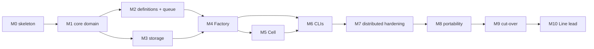

# Roadmap

v1 builds v2. The milestone tables below list **work items** (`factory-<milestone>-<slug>`). Items
are grouped into larger todos in `todos/` (v1 format: `status`, `priority`, `depends_on`,
`workflow`), each a complete, testable slice targeting only v2 paths (see [Todo files](#todo-files)).
v1's quality gate (`pnpm check-types`, `pnpm lint`, `pnpm test`) runs on the whole repo, so v1
stays green throughout.

v1 treats a `depends_on` entry whose todo file is absent as satisfied, so all todo files must exist
before v1 starts picking them, and a dependency is named by its exact file name.

## Todo files

| Todo                                      | Depends on | Work items                                                                       |
| :---------------------------------------- | :--------- | :------------------------------------------------------------------------------- |
| `v2-01-workspace-skeleton`                | —          | all of M0                                                                        |
| `v2-02-core-events-state`                 | 01         | `factory-m1-ids-result`, `-events`, `-ports`, `-state-evolve`                    |
| `v2-03-core-decide-next-job`              | 02         | `factory-m1-decide`, `-next-job`, `-context`                                     |
| `v2-04-core-harness-scenarios-properties` | 03         | `factory-m1-harness`, `-scenarios`, `-properties`                                |
| `v2-05-definitions`                       | 02         | `factory-m2-definitions-port`, `-line-v2`, `-todo-parse`                         |
| `v2-06-queue-selection`                   | 02         | `factory-m2-queue`                                                               |
| `v2-07-storage-event-store`               | 04         | `factory-m3-contract`, `-tx-spike`, `-sqlite`, `-projection`                     |
| `v2-08-storage-leases-blobs-export`       | 07         | `factory-m3-leases-blobs`, `-export`                                             |
| `v2-09-factory-http-command-loop`         | 05, 06, 08 | `factory-m4-http`, `-command-loop`, `-claim-reaper`, `-prompts`                  |
| `v2-10-factory-intake-stream-admin-e2e`   | 09         | `factory-m4-intake`, `-stream`, `-admin`, `-e2e-fake-cell`                       |
| `v2-11-cell-foundation`                   | 10         | `factory-m5-adapters-port`, `-client-loops`, `-workspace`, `-inspection`         |
| `v2-12-cell-operator-stations`            | 11         | `factory-m5-headless-station`, `-operator-socket`, `-pane-runtime`, `-leave`     |
| `v2-13-cell-delivery`                     | 12         | `factory-m5-deliver` + the M5 end-to-end run                                     |
| `v2-14-clis`                              | 10, 12     | all of M6                                                                        |
| `v2-15-distributed-hardening`             | 13, 14     | all of M7                                                                        |
| `v2-16-portability`                       | 15         | all of M8                                                                        |
| `v2-17-cut-over`                          | 16         | M9 preparation (the v1/v2 todo split); the trial itself is run by the Supervisor |

M10 gets its todos when it is specified.

The order front-loads the core: up to M3 nothing needs a network, Herdr or a real runner.

`factory-m6-cli` needs only M4; `factory-m6-operator-cli` needs `factory-m5-operator-socket`.

## M0. Workspace skeleton

| Todo                    | Depends on             | Scope                                                                                                                                                                                        |
| :---------------------- | :--------------------- | :------------------------------------------------------------------------------------------------------------------------------------------------------------------------------------------- |
| `factory-m0-adr`        | —                      | `decisions/` entry: v2 architecture, link to `docs/`                                                                                                                                         |
| `factory-m0-workspace`  | `factory-m0-adr`       | `apps/*` in the workspace; empty `factory-core`, `factory-db`, `factory-definitions`, `apps/{server,cell,cli,operator-cli}` with `check-types`, `lint`, `test` scripts and a smoke test each |
| `factory-m0-boundaries` | `factory-m0-workspace` | Dependency rules of STRUCTURE §3–4, purity test, `no-restricted-imports`                                                                                                                     |
| `factory-m0-catalog`    | `factory-m0-workspace` | Add `hono`, `fast-check` to the catalog with decision entries                                                                                                                                |

**Done when:** `pnpm turbo check-types lint test` is green; a test import of `@repo/software-factory`
from a v2 package fails lint; `bun:sqlite` imported in core fails lint.

## M1. Core domain

| Todo                      | Depends on                                  | Scope                                                                                                                                                      |
| :------------------------ | :------------------------------------------ | :--------------------------------------------------------------------------------------------------------------------------------------------------------- |
| `factory-m1-ids-result`   | M0                                          | `ids.ts`, `result.ts`                                                                                                                                      |
| `factory-m1-events`       | `factory-m1-ids-result`                     | Event catalogue + envelope + zod; machine-independence schema test (I2)                                                                                    |
| `factory-m1-ports`        | `factory-m1-events`                         | `ports/` interfaces (`EventStore`, `BlobStore`, `LeaseStore`, `Clock`, `Ids`)                                                                              |
| `factory-m1-state-evolve` | `factory-m1-events`                         | `state.ts`, `evolve.ts`, `status.ts`, `projection.ts`                                                                                                      |
| `factory-m1-decide`       | `factory-m1-state-evolve`                   | `commands.ts`, `decide.ts`, every row of CORE §5.2 and every error                                                                                         |
| `factory-m1-next-job`     | `factory-m1-state-evolve`                   | `next-job.ts`, every row of CORE §6                                                                                                                        |
| `factory-m1-context`      | `factory-m1-next-job`                       | `context.ts` (CORE §7)                                                                                                                                     |
| `factory-m1-harness`      | `factory-m1-decide`, `factory-m1-ports`     | `testing/`: given/when/then harness, Line builder, fakes                                                                                                   |
| `factory-m1-scenarios`    | `factory-m1-harness`, `factory-m1-next-job` | Rewrite every v1 scenario; add Andon → resume for each `AndonReason`, `restart_from`, `reopen`, lost → restart, handover, question abandoned then answered |
| `factory-m1-properties`   | `factory-m1-scenarios`                      | fast-check generators; I1, I3–I9, I11                                                                                                                      |

**Done when:** all invariants green with ≥ 10 000 generated runs; every v1 scenario name has a v2
counterpart or a written reason it no longer applies.

## M2. Definitions and queue

| Todo                          | Depends on                    | Scope                                                                                                                                                                         |
| :---------------------------- | :---------------------------- | :---------------------------------------------------------------------------------------------------------------------------------------------------------------------------- |
| `factory-m2-definitions-port` | M0                            | Copy v1 definitions, roles → `operators/`, templates, workflows → `lines/` into `factory-definitions`; tests pass                                                             |
| `factory-m2-line-v2`          | `factory-m2-definitions-port` | Schema v2 (`sync`/`setup` become per-job workspace preparation, not a phase; Station `requires`; `maxRestarts`, `maxLostRestarts`), runtime prompt templates, snapshot + hash |
| `factory-m2-queue`            | M1                            | `core/queue/select.ts` (CORE §8) with ordering, capability and dependency tests                                                                                               |
| `factory-m2-todo-parse`       | `factory-m2-definitions-port` | Todo frontmatter parsing ported from v1 `pick-todo.ts` into `factory-definitions`, `OrderId` derivation, the missing-dependency rule, diagnostics                             |

**Done when:** `factory check` logic (as a function) validates the shipped definitions; snapshot hash
is stable across machines (fixture test).

## M3. Storage

| Todo                      | Depends on              | Scope                                                                                                |
| :------------------------ | :---------------------- | :--------------------------------------------------------------------------------------------------- |
| `factory-m3-contract`     | M1                      | Store contract suite in `core/testing` (append, conflict, replay, feed, leases, blobs, transactions) |
| `factory-m3-tx-spike`     | `factory-m3-contract`   | Prove the write mutex over `bun:sqlite` (STORAGE §3.1): concurrent appenders, slow transaction body  |
| `factory-m3-sqlite`       | `factory-m3-tx-spike`   | `factory-db`: migrations `0001_init.sql`, event store, append transaction (STORAGE §3)               |
| `factory-m3-projection`   | `factory-m3-sqlite`     | `orders` projection writes + rebuild + identical-rebuild test                                        |
| `factory-m3-leases-blobs` | `factory-m3-sqlite`     | Lease store, blob store, sweep                                                                       |
| `factory-m3-export`       | `factory-m3-projection` | Export/import file format (STORAGE §7.3), round-trip test                                            |

**Done when:** fake and SQLite pass the same contract suite, including 2 concurrent appenders.

## M4. Factory

| Todo                       | Depends on                             | Scope                                                                                                                                              |
| :------------------------- | :------------------------------------- | :------------------------------------------------------------------------------------------------------------------------------------------------- |
| `factory-m4-http`          | M3                                     | Hono app, auth (supervisor tokens, join tokens, Cell credentials), `admin token create`, error mapping, `/v1/board`, `/v1/orders/*`, `/v1/blobs/*` |
| `factory-m4-command-loop`  | `factory-m4-http`                      | `handle-command.ts`: decide, append, conflict retry, Andon decision event, dry run, continuation in one transaction                                |
| `factory-m4-claim-reaper`  | `factory-m4-command-loop`, M2          | Join, hello, claim (long-poll), heartbeat + signals, reaper, boot grace                                                                            |
| `factory-m4-prompts`       | M2                                     | Port v1 prompt rendering to blobs and relative paths; runtime prompts into the `Job`                                                               |
| `factory-m4-intake`        | M2, `factory-m4-command-loop`          | Git mirror, todos → `CreateOrder` / `UpdateSpec` / `Cancel`, PR state polling, v2 todo filter (M9)                                                 |
| `factory-m4-stream`        | `factory-m4-http`                      | `/v1/stream` SSE                                                                                                                                   |
| `factory-m4-admin`         | `factory-m4-http`, `factory-m3-export` | `factory-server admin backup \| export \| import \| rebuild-projections`                                                                           |
| `factory-m4-e2e-fake-cell` | all above                              | A scripted fake Cell drives a `feature` Work order to delivered through HTTP only                                                                  |

**Done when:** the e2e test passes; killing and restarting the Factory mid-Work-order loses nothing.

## M5. Cell

| Todo                          | Depends on                    | Scope                                                                                                     |
| :---------------------------- | :---------------------------- | :-------------------------------------------------------------------------------------------------------- |
| `factory-m5-adapters-port`    | M0                            | Port v1 adapters (herdr, git, github, process, runners) with tests                                        |
| `factory-m5-client-loops`     | M4                            | Factory client, join + credential storage, hello, claim loop, heartbeat loop, idempotency ids, self-fence |
| `factory-m5-workspace`        | `factory-m5-adapters-port`    | Mirror, worktree at base, sync/setup cache, LRU, `.cell/` excluded                                        |
| `factory-m5-inspection`       | `factory-m5-workspace`        | `run-inspection.ts`                                                                                       |
| `factory-m5-headless-station` | `factory-m5-workspace`        | `run-operator-station.ts` for headless runners first (no Herdr), checkpoint procedure (PROTOCOL §8.2)     |
| `factory-m5-operator-socket`  | `factory-m5-headless-station` | Unix socket, Cycle tokens, local validation, blob upload                                                  |
| `factory-m5-pane-runtime`     | `factory-m5-operator-socket`  | Herdr panes + `core/cycle` watch + signals + question hold                                                |
| `factory-m5-leave`            | `factory-m5-pane-runtime`     | `SIGTERM` handling: Handover request, `HandOverCycle`, `ReleaseJob` fallback                              |
| `factory-m5-deliver`          | `factory-m5-workspace`        | Squash, rebase, PR create-or-find                                                                         |

**Done when:** a real fixture repo Work order is delivered end to end with a scripted fake runner,
and once manually with a real runner.

## M6. CLIs

| Todo                      | Depends on                   | Scope                                                                          |
| :------------------------ | :--------------------------- | :----------------------------------------------------------------------------- |
| `factory-m6-operator-cli` | `factory-m5-operator-socket` | `factory-operator` verbs; startup < 100 ms test                                |
| `factory-m6-cli`          | M4                           | `factory` commands (PROTOCOL §10), board and Traveler rendering ported from v1 |

## M7. Distributed hardening (R2, R3, R8)

| Todo                      | Depends on           | Scope                                                                                                                                   |
| :------------------------ | :------------------- | :-------------------------------------------------------------------------------------------------------------------------------------- |
| `factory-m7-harness`      | M6                   | Test harness: one Factory, N Cell processes, fake runner, a TCP proxy that can drop or delay traffic                                    |
| `factory-m7-takeover`     | `factory-m7-harness` | `kill -9` a Cell mid-Cycle → another Cell restarts the Station; no double work                                                          |
| `factory-m7-partition`    | `factory-m7-harness` | Partition a Cell → self-fence, stale epoch rejected, no push from the fenced Cell                                                       |
| `factory-m7-duplicates`   | `factory-m7-harness` | Drop responses → retries produce no duplicate events, continuation job delivered once                                                   |
| `factory-m7-andon-resume` | `factory-m7-harness` | Operator blocks on Cell A; A takes another Work order at once; resume runs on Cell B from the WIP checkpoint, passed Stations not rerun |
| `factory-m7-leave`        | `factory-m7-harness` | `SIGTERM` a Cell mid-Cycle → Handover; Cell B continues from the WIP without the Supervisor                                             |
| `factory-m7-race`         | `factory-m7-harness` | 10 Cells, 50 Work orders, Cells joining and leaving: every Work order delivered exactly once                                            |

**Done when:** all of the above run in CI, repeated 20× without a flake.

## M8. Portability (R1)

| Todo                      | Depends on              | Scope                                                                                                   |
| :------------------------ | :---------------------- | :------------------------------------------------------------------------------------------------------ |
| `factory-m8-backup`       | M4                      | Litestream example in `deploy/`, restore runbook                                                        |
| `factory-m8-move`         | `factory-m8-backup`, M7 | Test: export from Factory A mid-run, import into Factory B, Cells re-joined, every Work order completes |
| `factory-m8-git-recovery` | M7                      | `order_recovered` (CORE amendment) + rebuild from git (STORAGE §8)                                      |

## M9. Cut-over

- v1 and v2 never take the same todo. During the trial, v2's intake only takes todos with
  `factory: v2` in their frontmatter; v1 skips those (a one-line filter in v1's `pick-todo.ts`,
  the only v1 edit this plan makes, with its own `decisions/` entry).
- Run v2 against this repository in parallel with v1 for one week on non-critical todos.
- Exit criteria: no lost or duplicated Work order; every Andon resumed successfully; board parity
  with v1.
- Then: v2 takes every todo, v1 is frozen (kept for reference), `sf` scripts point at `factory`.

## M10. Line lead (incidents)

Reintroduce v1's on-call operator as the **Line lead**, a separate module: an `incident` sub-entity
with a `triage` job kind, its own budget, and the decision whether to resume, restart from a Station
or escalate to the Supervisor. It may also answer Operator questions addressed to it. Specified in
CORE when M10 starts; nothing before M10 depends on it.

## Requirement coverage

| Requirement              | Proven by                                                                                                                             |
| :----------------------- | :------------------------------------------------------------------------------------------------------------------------------------ |
| R1 portable queue        | `factory-m3-export`, `factory-m8-move`, `factory-m8-git-recovery`, I1–I2                                                              |
| R2 no double work        | `factory-m3-contract` (concurrency), `factory-m7-takeover`, `factory-m7-partition`, `factory-m7-duplicates`, `factory-m7-race`, I4–I5 |
| R3 non-blocking Andons   | `factory-m1-scenarios` (Andon → resume), `factory-m7-andon-resume`, I6–I7, I9                                                         |
| R4 deterministic control | `factory-m0-boundaries` (purity), I1, I9                                                                                              |
| R5 auditable             | prompt blobs in `cycle_started`, `nudged` events, `factory log`                                                                       |
| R6 runner-agnostic       | `factory-m5-adapters-port`                                                                                                            |
| R7 declarative Lines     | `factory-m2-*`                                                                                                                        |
| R8 replaceable Cells     | `factory-m5-leave`, `factory-m7-leave`, `factory-m7-race`, I11                                                                        |
