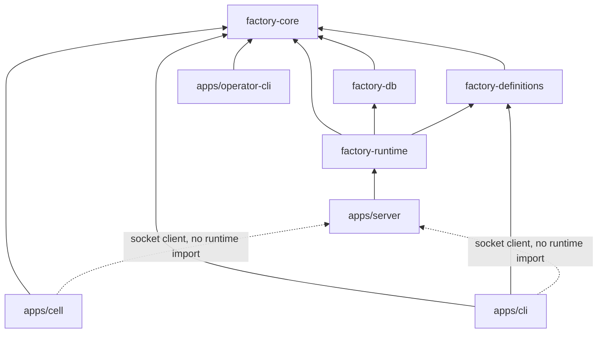

# Structure

## 1. Repository layout

```text
software-factory/
├── pnpm-workspace.yaml            # packages: [apps/*, packages/*]
├── turbo.json
├── docs/                          # this design (v2)
├── decisions/                     # ADRs, shared by v1 and v2
├── todos/                         # the queue v1 executes (it builds v2)
├── deploy/                        # systemd units, Litestream config example (v2)
│
├── apps/
│   ├── server/                    # @repo/factory-server        bin: factory-server   (the core process; socket, optional TCP HTTP)
│   │   └── src/
│   │       ├── main.ts            # config, open db under writer lock, start socket listener and runtime loops; optional TCP HTTP
│   │       ├── socket/            # Unix socket listener (factory.sock, 0600), contract-typed routes
│   │       ├── admin/             # admin commands
│   │       └── http/              # optional TCP: Hono transport, auth and error mapping (PROTOCOL §3.5)
│   │           ├── app.ts
│   │           ├── supervisor.ts  # supervisor routes
│   │           ├── cell.ts        # Cell routes
│   │           └── blobs.ts       # blob routes
│   │
│   ├── cell/                      # @repo/factory-cell          bin: factory-cell     (a Cell)
│   │   └── src/
│   │       ├── main.ts            # config, select local/remote client, slots, claim/heartbeat loops, leave
│   │       ├── factory-client.ts  # socket client to factory-server + remote HTTP adapter, retries, idempotency ids
│   │       ├── workspace/         # mirror, worktree, sync/setup cache, LRU eviction
│   │       ├── jobs/
│   │       │   ├── run-operator-station.ts
│   │       │   ├── run-inspection.ts
│   │       │   └── deliver.ts
│   │       ├── cycle/             # runtime loop: observe → core/cycle.watch → act; signals; handover on leave
│   │       ├── operator-socket.ts # unix socket for factory-operator; Cycle tokens
│   │       ├── checkpoint.ts      # PROTOCOL §8.2: commit + trailers + dry run + push --force-with-lease
│   │       └── adapters/          # carried over from v1: herdr, git, github, process, runners/*
│   │
│   ├── cli/                       # @repo/factory-cli           bin: factory          (the Supervisor CLI)
│   │   └── src/
│   │       ├── cli.ts             # citty, lazy subcommands
│   │       ├── client/            # FactoryClient port, socket and remote adapters, one-shot fallback, config
│   │       ├── render/            # board, Work order, Traveler views (picocolors)
│   │       └── commands/          # run, status, show, log, answer, resume, reopen, nudge, cancel, prio, sync, cells, check, admin
│   │
│   └── operator-cli/              # @repo/factory-operator-cli  bin: factory-operator (called by Operators)
│       └── src/
│           ├── cli.ts             # citty; no yaml, no git, no db
│           ├── socket-client.ts
│           └── commands/          # done, verdict, ask, tell, block, context
│
└── packages/
    ├── software-factory/          # v1 — frozen, not edited by v2
    ├── factory-core/              # @repo/factory-core       (CORE.md)
    ├── factory-runtime/           # @repo/factory-runtime    application use cases, scheduling (run inside factory-server)
    │   └── src/                   # composition, commands, claims, intake, prompts, admin, event feed
    ├── factory-db/                # @repo/factory-db         (STORAGE.md)
    │   ├── migrations/
    │   └── src/                   # sqlite event store, blob store, lease store, export/import
    ├── factory-definitions/       # @repo/factory-definitions
    │   ├── operators/             # Operator profiles, copied from v1 roles/, then evolved
    │   ├── lines/                 # Line definitions, copied from v1 workflows/, schema v2
    │   ├── templates/             # prompts, runtime prompts, PR templates
    │   ├── schemas/line.schema.json
    │   └── src/                   # load, validate, todo frontmatter, snapshot + hash
    ├── nitpick/
    ├── eslint-config/
    └── typescript-config/
```

Conventions inherited from the repo and v1: `kebab-case.ts`, arrow functions only, no `index.ts`
barrels (packages expose subpaths through `exports`), tests in `__tests__/` next to the code,
versions from the pnpm catalog.

## 2. Package responsibilities

| Package               | Runtime deps                                           | Contains                                                                                                            | Must not contain                                                      |
| :-------------------- | :----------------------------------------------------- | :------------------------------------------------------------------------------------------------------------------ | :-------------------------------------------------------------------- |
| `factory-core`        | `zod`                                                  | Domain, projection fold, transport-neutral contracts and port interfaces, pure Cycle policy, test fakes and harness | I/O of any kind; hashing; `bun:*`, `node:*` imports                   |
| `factory-definitions` | `zod`, `yaml`, core                                    | Definition files and their parser; todo frontmatter parsing and `OrderId` derivation; Line snapshot + hash          | Runtime state; network                                                |
| `factory-db`          | `drizzle-orm`, core                                    | Store implementations, migrations, export/import file format                                                        | Domain decisions (`decide`, `nextJob`, `toProjection` calls)          |
| `factory-runtime`     | core, db, definitions                                  | Shared application use cases, orchestration, intake, prompts, event feed; run inside `factory-server`               | Transport (socket or HTTP); Cell execution                          |
| `apps/server`         | `hono`, runtime                                        | Core process: writer lock, Unix socket listener, optional TCP HTTP listener, auth, server lifecycle, admin entrypoints | Own application decisions or a second runtime implementation          |
| `apps/cell`         | core, socket client contracts (adapters use Bun APIs)  | Job execution, adapters, Cycle runtime, Operator socket, checkpoints; socket client to `factory-server` or remote FactoryClient | `factory-db`, `factory-definitions`, the runtime library (everything arrives in the `Job`) |
| `apps/cli`            | `citty`, `picocolors`, core, definitions, socket client | Supervisor client selection (socket or remote), config and rendering                                                | `factory-db`, the runtime library, HTTP details, Cell code           |
| `apps/operator-cli`   | `citty`, core (contracts only)                         | The Operator verbs                                                                                                  | Anything else; must start in < 100 ms                                 |

Hashing (blob refs, Line hash) happens only where I/O is allowed: `factory-definitions` for Line
snapshots, the runtime and the Cell for blobs.

## 3. Dependency rules



Allowed imports (row imports column):

|                       |      core      | core/cycle | definitions | runtime |  db   | v1  |
| :-------------------- | :------------: | :--------: | :---------: | :-----: | :---: | :-: |
| `factory-core`        |       ✓        |     ✓      |      ✗      |    ✗    |   ✗   |  ✗  |
| `factory-definitions` |       ✓        |     ✗      |      ✓      |    ✗    |   ✗   |  ✗  |
| `factory-db`          |       ✓        |     ✗      |      ✗      |    ✗    |   ✓   |  ✗  |
| `factory-runtime`     |       ✓        |     ✗      |      ✓      |    ✓    |   ✓   |  ✗  |
| `apps/server`         |       ✓        |   **✗**    |      ✗      |    ✓    | **✗** |  ✗  |
| `apps/cell`         |       ✓        |     ✓      |    **✗**    | ✗ (socket client only) | **✗** |  ✗  |
| `apps/cli`            |       ✓        |     ✗      |      ✓      | ✗ (socket client only) | **✗** |  ✗  |
| `apps/operator-cli`   | contracts only |     ✗      |      ✗      |    ✗    |   ✗   |  ✗  |

`apps/cell` and `apps/cli` reach the runtime only through the socket client over the contracts in
`factory-core`; they import no `factory-runtime` code. `apps/server` (`factory-server`) is the only
process that runs the runtime and opens the database. The Operator socket is per Cell and is
separate from the server socket.

## 4. Enforcement

- Each package lists only its allowed workspace dependencies in `package.json`; pnpm strict
  resolution then makes a forbidden import fail to resolve.
- ESLint `no-restricted-imports` per package for subpaths (`@repo/factory-core/cycle/*` in the
  server, `bun:*` / `node:*` in core, `@repo/software-factory` everywhere in v2).
- A purity test in `factory-core` (as v1's `purity.test.ts`) scans sources for `Date.now`,
  `Math.random`, `process.`, `fetch(`, `crypto`.

## 5. Workspace changes (M0)

- `pnpm-workspace.yaml`: add `apps/*`.
- Catalog additions (each with a `decisions/` entry, per the v1 rule on dependencies):
  `hono` (optional TCP HTTP listener, M4R), `fast-check` (dev, property tests).
  ULIDs are generated by a 20-line helper behind the `Ids` port, no dependency.
- Add `packages/factory-runtime` to the workspace; root scripts include `factory`, `factory-server`, and `factory-cell` next to the existing `sf`.

## 6. Carried over from v1

v2 **copies** code from v1 and adapts it. It never imports v1. Paths are relative to
`packages/software-factory/`.

| v1 source                                                                                                                   | v2 destination                                    | Treatment                                                                                            |
| :-------------------------------------------------------------------------------------------------------------------------- | :------------------------------------------------ | :--------------------------------------------------------------------------------------------------- |
| `src/engine/next-action.ts`                                                                                                 | `core/order/next-job.ts`                          | Same decision-table style; new rows (CORE §6)                                                        |
| `src/engine/reduce.ts`                                                                                                      | `core/order/evolve.ts`                            | Rewrite against the v2 state; keep the liveness guard                                                |
| `src/engine/events.ts`, `state.ts`, `actions.ts`                                                                            | `core/order/events.ts`, `state.ts`, `commands.ts` | Rewrite (CORE §3–5)                                                                                  |
| `src/engine/context.ts`                                                                                                     | `core/order/context.ts`                           | Port; blobs and relative paths instead of absolute paths; add resume, restart, handover, Q&A         |
| `src/engine/watch.ts`                                                                                                       | `core/cycle/watch.ts`                             | Port 1:1                                                                                             |
| `src/engine/__tests__/scenarios.test.ts`, `harness.ts`                                                                      | `core/order/__tests__/`, `core/testing/`          | Each scenario rewritten on v2 events; the list of names is the checklist                             |
| `src/definitions/*`                                                                                                         | `factory-definitions/src/`                        | Port; add snapshot + hash, `schemaVersion: 2`, Station `requires`                                    |
| `roles/`                                                                                                                    | `factory-definitions/operators/`                  | Copy. `operator.md` (v1's on-call role) stays behind until M10; `cell.md` is renamed `builder.md`  |
| `workflows/`                                                                                                                | `factory-definitions/lines/`                      | Copy; move to schema v2                                                                              |
| `templates/`                                                                                                                | `factory-definitions/templates/`                  | Copy; add runtime prompts (answer, nudge, reminders, Handover request)                               |
| `src/prompts/*`                                                                                                             | `packages/factory-runtime/src/prompts/`           | Port; relative paths, blob inputs                                                                    |
| `src/adapters/herdr`, `git`, `github`, `system`, `runners/*`                                                                | `apps/cell/src/adapters/`                         | Port with their tests                                                                                |
| `src/supervisor/headless.ts`, `launch.ts`, `gate.ts`, `trust-prompt.ts`, `names.ts`                                         | `apps/cell/src/jobs/`, `apps/cell/src/cycle/`     | Port the logic; drop the store calls                                                                 |
| `src/supervisor/deliver.ts`, `delivery-commit.ts`, `validate-pr.ts`, `format-pr-body.ts`                                    | `apps/cell/src/jobs/deliver.ts`                   | Port the logic; PR body arrives rendered as a blob                                                   |
| `src/supervisor/pick-todo.ts` (frontmatter parsing, dependency rule)                                                        | `factory-definitions/src/`                        | Port the parsing; selection moves to `core/queue`                                                    |
| `src/testing/fake-*.ts`, `store.contract.ts`                                                                                | `core/testing/`, `factory-db` tests               | Port the pattern                                                                                     |
| `src/supervisor/blocked-work.ts`                                                                                            | —                                                 | Replaced by checkpoints on the Work order branch and `factory-wip/*` refs. Read for edge cases.      |
| `src/supervisor/workspace-registry.ts`, `notify.ts`                                                                         | —                                                 | Replaced by the Cell's worktree cache; Herdr toasts are dropped (the board and `/v1/stream` notify). |
| `src/supervisor/run.ts`, `execute.ts`, `reconcile.ts`, `observe.ts`, `operator.ts`, `lock.ts`, `wire.ts`, `task-context.ts` | —                                                 | **Not carried over.** Read them for edge cases only.                                                 |
| `src/paint.ts`                                                                                                              | `apps/cli/src/render/paint.ts`                    | Port 1:1: the `Paint` interface, plain and coloured implementations, `NO_COLOR`                      |
| `src/cli/board.ts`, `src/cli/log-view.ts`, `console-lines.ts`                                                                | `apps/cli/src/render/`                            | Port the board and Traveler layout and colours (v2-14); rendering only, never stored                 |
| `src/cli/*` (the rest)                                                                                                      | —                                                 | Not carried over; the new CLIs are thin clients                                                       |
