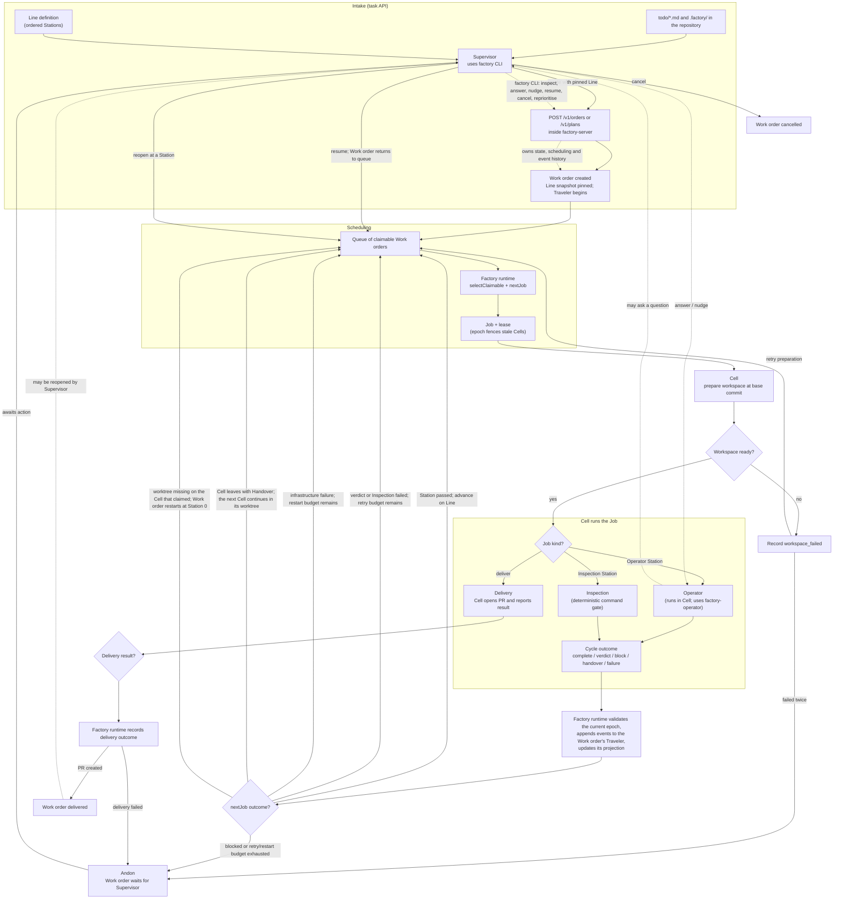

# End-to-end workflow

This is the overview of how a todo becomes a delivered Work order. Names follow the glossary in
[PLAN.md](PLAN.md): **the factory** is the whole system; the **Factory runtime** creates and schedules
Work orders; a **Cell** executes Jobs; a **Work order** travels through its pinned **Line**. A Cell
claims a Job for a Work order—it does not choose the Line or decide which Station comes next.

## Read the flow

1. The Supervisor creates a **Work order** through the task API (`POST /v1/orders`, or `POST /v1/plans`
   for an Order Plan). The server holds no git and reads no repository: the request carries the spec and
   the **Line** the repository's own `.factory/` defines. The Work order pins a snapshot of that Line, so
   later definition changes do not silently change work already in flight. Repository definitions live in
   each repository's `.factory/` (`lines/`, `operators/`, `templates/`), and the Cell renders prompts from them.
2. The **Factory runtime** selects a claimable Work order and computes its next **Job**. A **Cell**
   claims that Job under a time-limited lease and epoch, prepares its workspace, and executes it.
3. A Station Job runs either an **Operator** Station or an **Inspection** Station. Each execution is a
   **Cycle**. The Cell reports outcomes to the runtime; the runtime records accepted events in the
   Work order's append-only **Traveler** and decides what comes next.
4. Passing a Station advances the Work order along its Line. Failed verdicts or Inspections may retry;
   infrastructure failures may restart; a Cell leaving with a Handover makes the same Station
   claimable by another Cell. These paths return to scheduling, usually with the relevant feedback,
   checkpoint, or Handover as context.
5. A block, exhausted retry/restart budget, repeated workspace failure, or failed delivery raises an
   **Andon**. The Cell is released. The **Mechanic** triages the stop first: it resumes the Work
   order or answers the question itself, or escalates to the **Supervisor**, who decides (resume,
   cancel, reopen). A resumed Work order returns to the queue.
6. Once all Stations on the Line are complete, the runtime schedules a delivery Job. The Cell opens
   the PR and reports the result; a successful delivery finishes the Work order. A Supervisor may
   reopen a delivered Work order at a Station if it has not been merged.

In local mode, the `factory` CLI and Cells talk to `factory-server` over its Unix socket. In optional
distributed mode, remote clients and Cells use the server's HTTP/SSE API. The same Factory runtime
and workflow apply in both modes. A completed Job may continue on the same Cell without a queue
round trip when the runtime can safely do so.

## Order Plan

Todos that declare `plan: <slug>` and chain with `depends_on` form an **Order Plan**: a stack of Work
orders `WO_1 -> WO_2 -> WO_3`, each delivered as a small PR on the plan branch `feat/<slug>`, plus one
PR `feat/<slug> -> main` that the Factory opens itself. The Factory creates the branch first, builds
each Work order on its predecessor's branch as soon as that one is delivered, opens a draft plan PR
once the root is merged, and marks it ready when every member is merged. Each Work order still
travels through its own Line as described above. The end-to-end flow and the GitHub settings it
needs (merge commits for sub-PRs, delete head branches on merge) are in
[ORDER-PLAN.md](ORDER-PLAN.md); the contracts are [CORE.md](CORE.md) §12.

For the detailed contracts and edge cases, see [PLAN.md](PLAN.md) (architecture and end-to-end flows),
[CORE.md](CORE.md) (Work order state and `nextJob`), and [PROTOCOL.md](PROTOCOL.md) (Cell Jobs,
leases, and communication).
