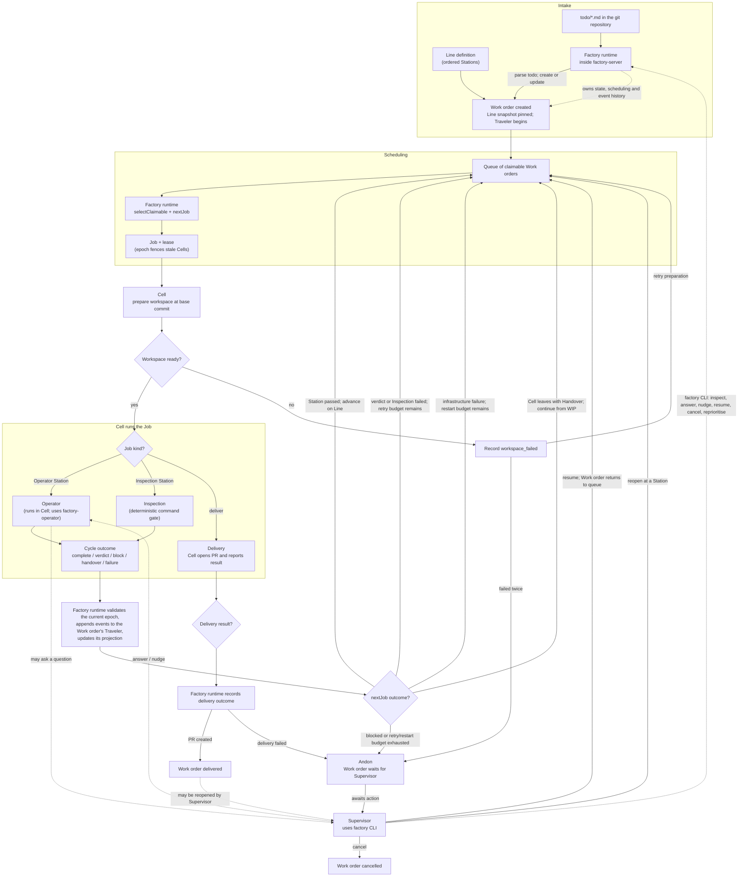

# End-to-end workflow

This is the overview of how a todo becomes a delivered Work order. Names follow the glossary in
[PLAN.md](PLAN.md): **the factory** is the whole system; the **Factory runtime** creates and schedules
Work orders; a **Cell** executes Jobs; a **Work order** travels through its pinned **Line**. A Cell
claims a Job for a Work order—it does not choose the Line or decide which Station comes next.

## Read the flow

1. Intake reads todo files from the repository and creates a **Work order**. The Work order pins a
   snapshot of its **Line** so later definition changes do not silently change work already in flight.
2. The **Factory runtime** selects a claimable Work order and computes its next **Job**. A **Cell**
   claims that Job under a time-limited lease and epoch, prepares its workspace, and executes it.
3. A Station Job runs either an **Operator** Station or an **Inspection** Station. Each execution is a
   **Cycle**. The Cell reports outcomes to the runtime; the runtime records accepted events in the
   Work order's append-only **Traveler** and decides what comes next.
4. Passing a Station advances the Work order along its Line. Failed verdicts or Inspections may retry;
   infrastructure failures may restart; a Cell leaving with a Handover makes the same Station
   claimable by another Cell. These paths return to scheduling, usually with the relevant feedback,
   checkpoint, or Handover as context.
5. A block, exhausted retry/restart budget, repeated workspace failure, or failed delivery raises an
   **Andon**. The Cell is released. The **Mechanic** triages the stop first: it resumes the Work
   order or answers the question itself, or escalates to the **Supervisor**, who decides (resume,
   cancel, reopen). A resumed Work order returns to the queue.
6. Once all Stations on the Line are complete, the runtime schedules a delivery Job. The Cell opens
   the PR and reports the result; a successful delivery finishes the Work order. A Supervisor may
   reopen a delivered Work order at a Station if it has not been merged.

In local mode, the `factory` CLI and Cells talk to `factory-server` over its Unix socket. In optional
distributed mode, remote clients and Cells use the server's HTTP/SSE API. The same Factory runtime
and workflow apply in both modes. A completed Job may continue on the same Cell without a queue
round trip when the runtime can safely do so.

For the detailed contracts and edge cases, see [PLAN.md](PLAN.md) (architecture and end-to-end flows),
[CORE.md](CORE.md) (Work order state and `nextJob`), and [PROTOCOL.md](PROTOCOL.md) (Cell Jobs,
leases, and communication).
