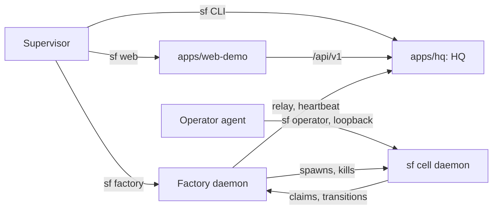

# Architecture

Terms: [glossary](./README.md#glossary).

## Apps and packages

| Path                          | Role                                                                             |
| :---------------------------- | :------------------------------------------------------------------------------- |
| `apps/sf`                     | `sf` CLI: Supervisor commands, Cell daemon, `sf operator` client                 |
| `apps/factory`                | Factory daemon (`@repo/factory`): supervises Cell daemons, relays Cell traffic to HQ |
| `apps/hq`                | HQ: HTTP server and SQLite storage                                               |
| `apps/web-demo`               | Web UI served by `sf web start`                                                  |
| `packages/hq-contracts`  | HQ wire contracts (Zod), shared by HQ, `sf` and web                              |
| `packages/zod-contract-kit`   | Helpers to define Zod contracts                                                  |
| `packages/bun-sqlite-kit`     | Shared `bun:sqlite` + Drizzle plumbing                                           |
| `packages/nitpick`            | Rules and skills engine; generates `.agents/` from `.nitpick/`                   |
| `packages/prompt`             | Prompt building blocks                                                           |
| `packages/eslint-config`      | Shared ESLint config                                                             |
| `packages/typescript-config`  | Shared tsconfig presets                                                          |

## Who calls whom

- Supervisor runs `sf` against HQ (`/api/v1`, supervisor token).
- `sf cell start` (Cell daemon) runs under the Factory daemon and talks to HQ through its relay: claims, heartbeats, job transitions.
- `sf operator` runs inside a Job's agent and talks only to its own Cell over loopback. The Cell forwards verbs to HQ through the Factory relay.
- `sf cell` and `sf factory` call the local Factory daemon on `127.0.0.1:7072`, which spawns and kills Cell daemons.
- The Factory daemon talks to HQ with its own credential: enroll, heartbeat, Cell relay, gone Cells. Outbound only.
- `apps/web-demo` is a read-mostly client of the HQ API. No state of its own.

HQ is the single control point. Cells are replaceable and can disconnect without losing finished work.

Cell internals, which code runs a Cell, and the Factory daemon: [cell.md](./cell.md).
