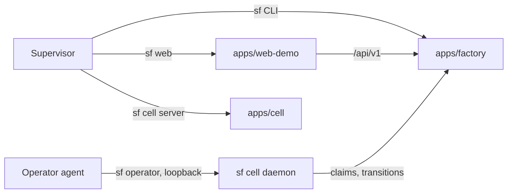

# Architecture

Terms: [glossary](./README.md#glossary).

## Apps and packages

| Path                         | Role                                                              |
| :--------------------------- | :---------------------------------------------------------------- |
| `apps/sf`                    | `sf` CLI: Supervisor commands, Cell daemon, `sf operator` client  |
| `apps/factory`               | Factory HTTP server and SQLite storage                            |
| `apps/cell`                  | Cell server: runs Cell slots for a Factory (`sf cell server`)     |
| `apps/web-demo`              | Web UI served by `sf web start`                                   |
| `packages/nitpick`           | Rules and skills engine; generates `.agents/` from `.nitpick/`    |
| `packages/prompt`            | Prompt building blocks                                            |
| `packages/eslint-config`     | Shared ESLint config                                              |
| `packages/typescript-config` | Shared tsconfig presets                                           |

## Who calls whom

- Supervisor runs `sf` against the Factory (`/api/v1`, supervisor token).
- `sf cell start` (Cell daemon) enrolls and talks to the Factory: claims, heartbeats, job transitions.
- `sf operator` runs inside a Job's agent and talks only to its own Cell over loopback. The Cell forwards verbs to the Factory.
- `sf` calls the `apps/cell` HTTP API for projects, factories, settings and cells.
- `apps/web-demo` is a read-mostly client of the Factory API. No state of its own.

Factory is the single control point. Cells are replaceable and can disconnect without losing finished work.

Cell internals, which code runs a Cell, and the cell-server slot model: [cell.md](./cell.md).
