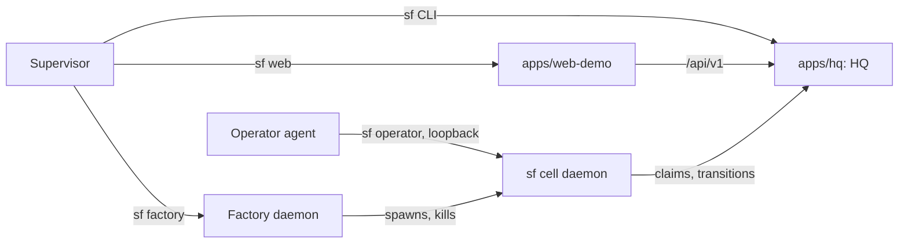

# Architecture

Terms: [glossary](./README.md#glossary).

## Apps and packages

| Path                         | Role                                                              |
| :--------------------------- | :---------------------------------------------------------------- |
| `apps/sf`                    | `sf` CLI: Supervisor commands, Cell daemon, Factory daemon, `sf operator` client |
| `apps/hq`                    | HQ HTTP server and SQLite storage                                 |
| `apps/web-demo`              | Web UI served by `sf web start`                                   |
| `packages/nitpick`           | Rules and skills engine; generates `.agents/` from `.nitpick/`    |
| `packages/prompt`            | Prompt building blocks                                            |
| `packages/eslint-config`     | Shared ESLint config                                              |
| `packages/typescript-config` | Shared tsconfig presets                                           |

## Who calls whom

- Supervisor runs `sf` against the Factory (`/api/v1`, supervisor token).
- `sf cell start` (Cell daemon) runs under the Factory daemon and talks to HQ through its relay: claims, heartbeats, job transitions.
- `sf operator` runs inside a Job's agent and talks only to its own Cell over loopback. The Cell forwards verbs to the Factory.
- `sf cell` and `sf factory` call the local Factory daemon on `127.0.0.1:7072`, which spawns and kills Cell daemons.
- `apps/web-demo` is a read-mostly client of the Factory API. No state of its own.

HQ is the single control point. Cells are replaceable and can disconnect without losing finished work.

Cell internals, which code runs a Cell, and the Factory daemon: [cell.md](./cell.md).
