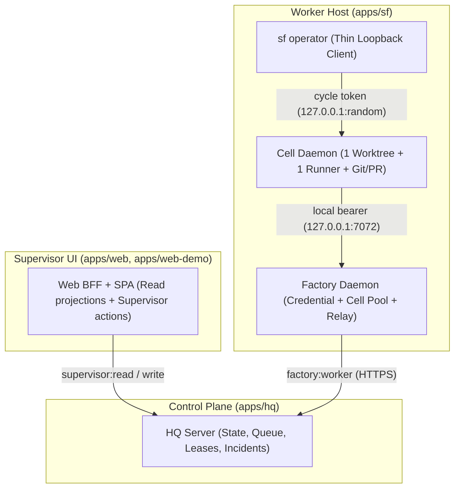

# Business Boundaries

Strict ownership matrix across apps and packages. Terms: [glossary](../README.md#glossary).

## App Boundaries

| App / Runtime | Owns (Source of Truth) | Never Owns (Forbidden) | Talks To | Auth / Trust |
| :--- | :--- | :--- | :--- | :--- |
| **`apps/hq`** (Control Plane) | Persistent state (`hq.db` / Postgres), `OrderPlan`/`WorkOrder`/`OrderStep`/`Job`/`Incident` state machines, lease epochs, Safe Tokens, SSE transition bus | Git worktrees, LLM runner processes, GitHub CLI/API calls, local target repo filesystem | Inbound HTTP (`/api/v1/*`) only | Verifies SHA-256 Safe Tokens (`sf_sup_`, `sf_factory_`, `sf_join_`) |
| **`apps/sf` Factory daemon** (`sf factory`) | Machine credential (`factory.json`), local Cell process supervision, scale convergence, `/relay/*` proxy to HQ, self-fencing (45s) | Queue scheduling rules, prompt assembly, git commits, persistent DB (until `--local` plan) | Outbound to `apps/hq`; loopback `127.0.0.1:7072` for CLI & Cells | Holds `factory_session`; issues ephemeral local bearers to Cells |
| **`apps/sf` Cell daemon** (`sf cell`) | Single active Job execution, `<repo>/.worktrees/<slug>/` isolation, `.cell/<step-id>/` artifacts, spawning LLM runner, per-job loopback listener, `git push` + `gh pr` on `deliver` | HQ credentials, persistent identity in HQ, multi-job concurrency, queue ordering | Local Factory `/relay/*`; child runner process; git remote on `deliver` | Ephemeral `cell-<8 hex>` id + local bearer from Factory |
| **`apps/sf` Operator client** (`sf operator`) | Parsing agent verb (`done`, `verdict`, `block`, `context`, `read`, `incident`), reading local report/feedback files, single POST to Cell | State transitions, retry loops, reading `.factory/` config, HQ network calls | Local Cell loopback (`$FACTORY_OPERATOR_URL`) only | Per-job in-memory `$FACTORY_CYCLE_TOKEN` |
| **`apps/sf` Supervisor CLI** (`sf hq\|project\|order\|queue\|plan\|incident\|watch`) | CLI arg validation, reading `orders/*.md` / `todos/*.md` on import, table/JSON formatting, local daemon start/stop | Direct SQLite reads of `hq.db`, business state rules | `apps/hq` (`/api/v1/*`); local Factory daemon (`127.0.0.1:7072`) | `supervisor` token (`.factory-local/supervisor.token` or `$HQ_TOKEN`) |
| **`apps/web` & `apps/web-demo`** | Supervisor dashboard projections, BFF session rotation, CSRF `Origin` check, manual order/queue triggers | Direct DB access, local daemon spawning, domain state transitions | `apps/hq` (`/api/v1/*`, `/api/v1/stream`) | Single-use `web-demo.join` -> in-memory `web_session` token |

## Boundary Rules

1. **Zero GitHub coupling in HQ**: `apps/hq` never runs `git` or `gh`. Only Cell runs `git` and `gh` during `deliver` station.
2. **One HQ credential per worker machine**: Only Factory daemon holds `factory_session`. Cells and LLM agents never see HQ tokens.
3. **Contracts at every wire edge**:
   - HQ <-> CLI / Factory / Web: `@repo/hq-contracts` (`packages/hq-contracts`).
   - Agent <-> Cell loopback: `apps/sf/src/contracts/operator.contract.ts`.
4. **Kill before requeue**: Factory daemon confirms Cell process death (`SIGTERM` -> `SIGKILL`) before notifying HQ (`/factories/cells/:id/gone`), preventing two Cells from touching one worktree.
