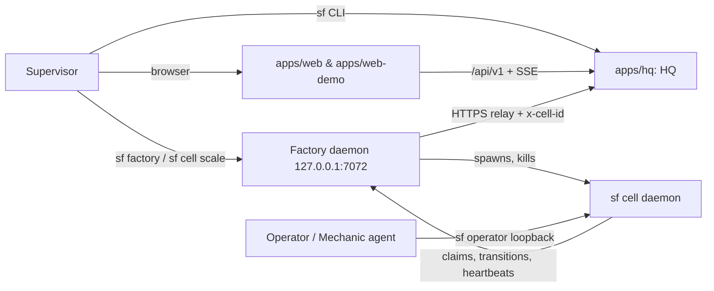

# Architecture Overview

Terms: [glossary](../README.md#glossary). Business ownership: [boundaries.md](./boundaries.md). Feature flows: [features/README.md](../features/README.md).

## Apps and packages

| Path | Role |
| :--- | :--- |
| `apps/hq` | HQ control plane: HTTP API (`/api/v1`), SQLite/Postgres storage, leases, queue, incidents |
| `apps/sf` | `sf` single binary: Supervisor CLI, Factory daemon, Cell daemon, `sf operator` client |
| `apps/web` | Reference EDA Supervisor SPA + Astro SSR BFF (`/api/work-orders*`, `/api/stream`) |
| `apps/web-demo` | Minimal zero-JS Astro SSR web UI served by `sf web start` |
| `packages/hq-contracts` | HQ wire contracts (Zod), shared by `apps/hq`, `apps/sf`, `apps/web`, `apps/web-demo` |
| `packages/zod-contract-kit` | Helpers to define HTTP Zod contracts |
| `packages/bun-sqlite-kit` | Shared `bun:sqlite` + Drizzle WAL plumbing |
| `packages/nitpick` | Rules/skills generator (`.nitpick/` -> `.agents/`, `AGENTS.md`, `CLAUDE.md`) |
| `packages/prompt` | Prompt building blocks |
| `packages/eslint-config` | Shared ESLint config |
| `packages/typescript-config` | Shared tsconfig presets |

## Who calls whom

- **Supervisor** runs `sf` CLI or web UI against HQ (`/api/v1`, `supervisor` or `web_session` token).
- **Factory daemon** (`sf factory start`, `127.0.0.1:7072`) holds machine credential (`factory_session`). Talks outbound to HQ: enroll, heartbeat, Cell relay, gone Cells. Spawns and kills local Cell processes.
- **Cell daemon** (`sf cell start`) runs inside target repo under Factory daemon. Holds only local in-memory bearer. Calls HQ exclusively through Factory relay (`claims`, `heartbeats`, `jobs/:id/transitions`, `incidents/:id/resolve`).
- **Operator / Mechanic agent** runs inside Job worktree and calls `sf operator` against local Cell loopback (`FACTORY_OPERATOR_URL`). Zero HQ credentials.
- **Web UIs** (`apps/web`, `apps/web-demo`) call HQ `/api/v1` with `web_session` token (auto-registered on loopback via `web-demo.join`).

HQ is single control point. Cells are disposable and stateless across runs; finished station commits survive Cell loss.
