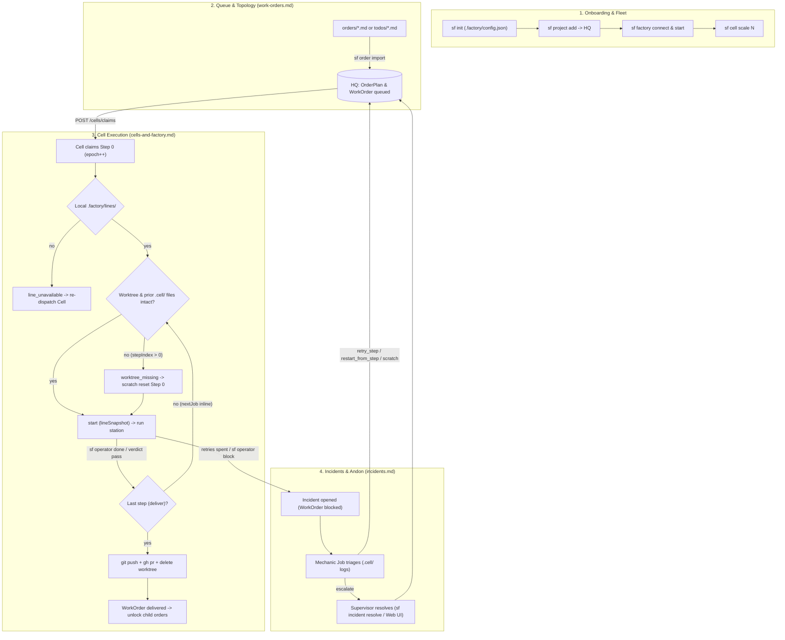

# Feature Map

End-to-end feature map across apps and contracts. Terms: [glossary](../README.md#glossary). App boundaries: [boundaries.md](../architecture/boundaries.md).

## 1. Cross-App Capability Matrix

| Feature Domain | `apps/hq` (Control Plane) | `apps/sf` (Factory / Cell / CLI) | `apps/web` & `apps/web-demo` | Wire Contract | Spec |
| :--- | :--- | :--- | :--- | :--- | :--- |
| **Project Onboarding** | Register project (`POST /projects`), mint Safe Tokens | `sf init`, `sf setup`, `sf doctor`, `sf project add` | Project filter (`HQ_PROJECT_ID`) | `@repo/hq-contracts` | [sf.md](../apps/sf.md) |
| **Queue & Work Orders** | Parse/export `todos/*.md`, DAG validation, `OrderPlan` & `WorkOrder` state machine | `sf order import\|export\|show\|resume\|cancel`, `sf queue`, `sf plan` | List orders, state filter, detail panel, `pause`/`unpause`/`resume`/`cancel` | `@repo/hq-contracts` | [work-orders.md](./work-orders.md) |
| **Factory & Cell Fleet** | Enroll Factory (`/factories/enroll`), track heartbeats, reap expired leases (60s) | `sf factory connect\|start\|stop`, `sf cell scale\|list`, relay `/relay/*`, self-fence (45s) | `/factories` online status & project counts | `@repo/hq-contracts` | [cells-and-factory.md](./cells-and-factory.md) |
| **Station Execution** | Claim lock, materialize `lineSnapshot`, inline `nextJob` handoff, `epoch` fencing | Worktree setup, spawn runner, `sf operator` loopback (`done`, `verdict`, `block`), `deliver` git push + PR | Live step/job status via `/api/v1/stream` (SSE) | `@repo/hq-contracts`, `operator.contract.ts` | [cells-and-factory.md](./cells-and-factory.md), [operator.md](../apps/operator.md) |
| **Incidents (Andon)** | Open incident on block/exhausted retries, dispatch Mechanic, apply resolution | `sf operator read\|incident` (Mechanic), `sf incident list\|resolve` (Supervisor) | `/incidents` list & order incident details | `@repo/hq-contracts`, `operator.contract.ts` | [incidents.md](./incidents.md) |

## 2. End-to-End Lifecycle Diagram

## 3. Feature Specs

- **[work-orders.md](./work-orders.md)**: Markdown format, import/export, queue actions, `OrderPlan` vs standalone branch stacking, `stale_base` rules.
- **[cells-and-factory.md](./cells-and-factory.md)**: Factory daemon supervision, Cell claim/heartbeat loop, start-to-finish ownership, `line_unavailable`, `worktree_missing` scratch reset, worktree layout.
- **[incidents.md](./incidents.md)**: Andon triggers, Mechanic triage state machine, resolution actions (`retry_step`, `restart_from_step`, `restart_from_scratch`, `escalate`, `cancel`).
