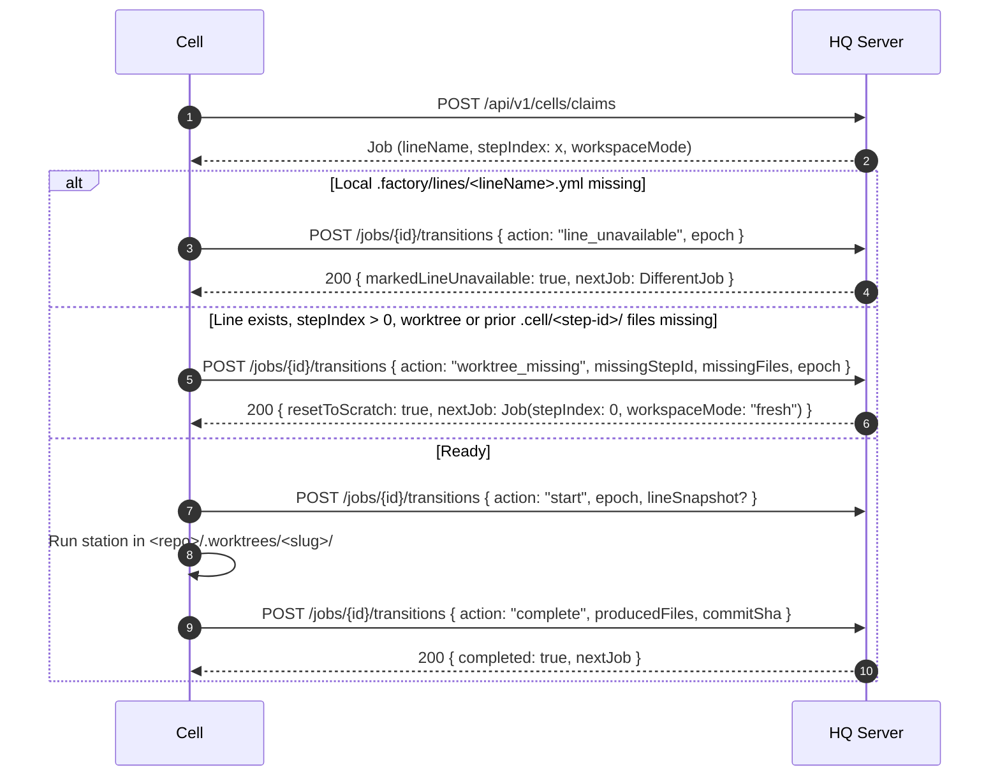

# Cells & Factory Daemon

Terms: [glossary](../README.md#glossary). CLI commands: [sf.md](../apps/sf.md). Server endpoints: [hq.md](../apps/hq.md).

## 1. Roles & Process Hierarchy

- **Factory daemon** (`sf factory start`, `127.0.0.1:7072`): One per PC. Holds the only HQ credential (`$XDG_CONFIG_HOME/sf/factory.json`, `0600`). Supervises Cell processes and relays Cell traffic to HQ.
- **Cell daemon** (`sf cell start`): Disposable worker child of Factory daemon, cwd = repo root. One Job at a time. Random id `cell-<8 hex>` per run, never stored in HQ table.
- **Operator endpoint**: Per-Job loopback HTTP server opened by Cell on `127.0.0.1:0` for `sf operator` calls from the LLM agent ([operator.md](../apps/operator.md)).

| Piece | Code | Runs as | Talks to |
| :--- | :--- | :--- | :--- |
| Factory daemon | `apps/sf/src/factory/*`, `adapters/cli/factory.command.ts` | detached `sf factory start` (`127.0.0.1:7072`) | HQ `/api/v1/factories/*`, `/api/v1/cells/*`; spawns/kills Cells |
| Factory client | `application/procedures/cell/factory-cells.ts`, `adapters/http/factory.adapter.ts` | inside `sf cell scale\|list` | Factory loopback API |
| Cell daemon | `application/procedures/cell/*`, `cell/*`, `adapters/cli/cell.command.ts` | `sf cell start` (Factory child only) | Factory `/relay/api/v1/*`; per-Job loopback operator endpoint |

## 2. Factory Daemon Supervision (`127.0.0.1:7072`)

### Loopback API

| Route | Reply |
| :--- | :--- |
| `GET /health` | `{ pid }` |
| `GET /status` | `{ pid, hq, url, factoryId, cells }` |
| `GET /scale` | `{ projects: [{ projectId, repoRoot, desired, running, crashLoop, cells }] }` |
| `PUT /scale` `{ repoRoot, count, lines? }` | `{ projectId }` |
| `POST /cells/:cellId/activity` `{ state, writes, since }` | `{ cellId }` (drives scale-down kill order) |
| `ALL /relay/*` | Relays Cell `claims`, `heartbeats`, `jobs/:id/transitions`, `incidents/:id/resolve` with Factory credential + `x-cell-id` |

### Lifecycle & Safety Rules

- **Scale up (`sf cell scale N`)**: Reads `.factory/config.json` in repo, spawns `sf cell start --name <hostname-N>` with `HQ_URL` (relay), `HQ_TOKEN` (ephemeral local bearer), `FACTORY_CELL_ID`, `CELL_LINES`, `SF_FACTORY_PID`.
- **Scale down order**: Idle Cells first -> read-only/inspection stations -> writing (`build`) stations (newest first).
- **Kill before gone**: `SIGTERM` -> wait 10s -> `SIGKILL` -> confirm pid exit -> call HQ `POST /api/v1/factories/cells/:id/gone`. Ensures dying Cell never overlaps new Cell in same worktree.
- **Parent watch**: Each Cell checks `SF_FACTORY_PID` every 1s. If Factory dies (`kill -9`), Cells abort within ~2s.
- **Self-fence**: 45s without HQ answer -> Factory kills all Cells. HQ reaps silent Factory leases at 60s.

## 3. Start-to-Finish Cell Ownership & Step Loop

1. **Single-Cell Ownership**: Claiming Step 0 locks `work_orders.active_cell_id`, `active_job_id`, and `pinned_factory_id` to that Cell and Factory from Step 0 through `deliver`.
2. **Dynamic Step Materialization (Step 0 `start`)**: Cell parses `.factory/lines/<lineName>.yml` and sends `lineSnapshot` in `POST /jobs/{id}/transitions` (`action: 'start'`). HQ inserts `order_steps[0..N-1]`.
3. **Inline Step Handoff (`nextJob`)**: When Step `k` completes (or rewinds on retry), HQ returns `nextJob` (`stepIndex: k+1`, `workspaceMode: 'reuse'`) inline in the transition reply. Zero re-queue between steps.
4. **Disconnect Takeover**: Only on Cell kill (`gone`) or lease expiry (`60s`) does HQ release `active_cell_id`, bump `epoch`, and return `WorkOrder` to `queued` (still pinned to `pinned_factory_id` unless Factory is silent).

## 4. Local Checks: `line_unavailable` & `worktree_missing`



- **`line_unavailable`**: HQ records Factory in `unavailable_line_factories_json`, releases lock, keeps order `queued` if another online Factory supports the line (else marks `line_unavailable` + opens Incident), and returns a different `nextJob` inline.
- **`worktree_missing` (Scratch Reset)**: HQ increments `worktree_resets` (if `> 2`, blocks order with `worktree_reset_limit` Incident), rewinds `current_step_index = 0` and all `order_steps`, keeps `active_cell_id` locked, and returns fresh Step 0 `nextJob` (`workspaceMode: 'fresh'`, `epoch + 1`).

## 5. Timing Constants

| Constant | Value | Purpose |
| :--- | :--- | :--- |
| `claimWaitMs` | `25_000` (25s) | Long-poll claim timeout (under 30s proxy timeout; max 5 parked waiters in HQ) |
| `heartbeatIntervalMs` | `10_000` (10s) | Cell heartbeat interval; carries `signals: ['abort']` back |
| `selfFenceMs` | `45_000` (45s) | Factory kills all Cells after 45s without HQ response (Cell aborts after 4 failed beats) |
| `leaseTtlMs` | `60_000` (60s) | HQ lease expiry (`leaseTtlMs > selfFenceMs` gives 15s safety margin before takeover) |

## 6. Worktree & Local Data Layout

```text
<repo>/.worktrees/<order-slug>/               # Created at Step 0; DELETED after "deliver" pushes & publishes PR
├── .factory/                                 # Repo config, lines/*.yml, operators/*.md, templates/**
├── .cell/                                    # Excluded via .git/info/exclude
│   ├── worktree.json                         # { projectId, orderId, planId, lineName, baseBranch, baseCommitSha, cellId }
│   └── <step-id>/                            # state.json, step.log, station output artifacts (plan.md, report.md, gate.json)
└── src/                                      # Only builder station commits code
```

| Path | Written by | Content |
| :--- | :--- | :--- |
| `$XDG_DATA_HOME/sf/factory.pid` | `sf factory start` | Factory daemon pid |
| `$XDG_DATA_HOME/sf/factory.log` | Factory daemon | Factory stdout/stderr |
| `$XDG_DATA_HOME/sf/cells/<cellId>.log` | Factory daemon | Cell daemon stdout/stderr |
| `$XDG_CONFIG_HOME/sf/factory.json` | `sf factory connect` | Factory HQ credential (`0600`) |
| `$XDG_CONFIG_HOME/sf/config.json` | `sf` | Saved HQ targets |
| `<repo>/.factory-local/cells/<name>.pid` | Cell daemon | Local Cell name lock |
