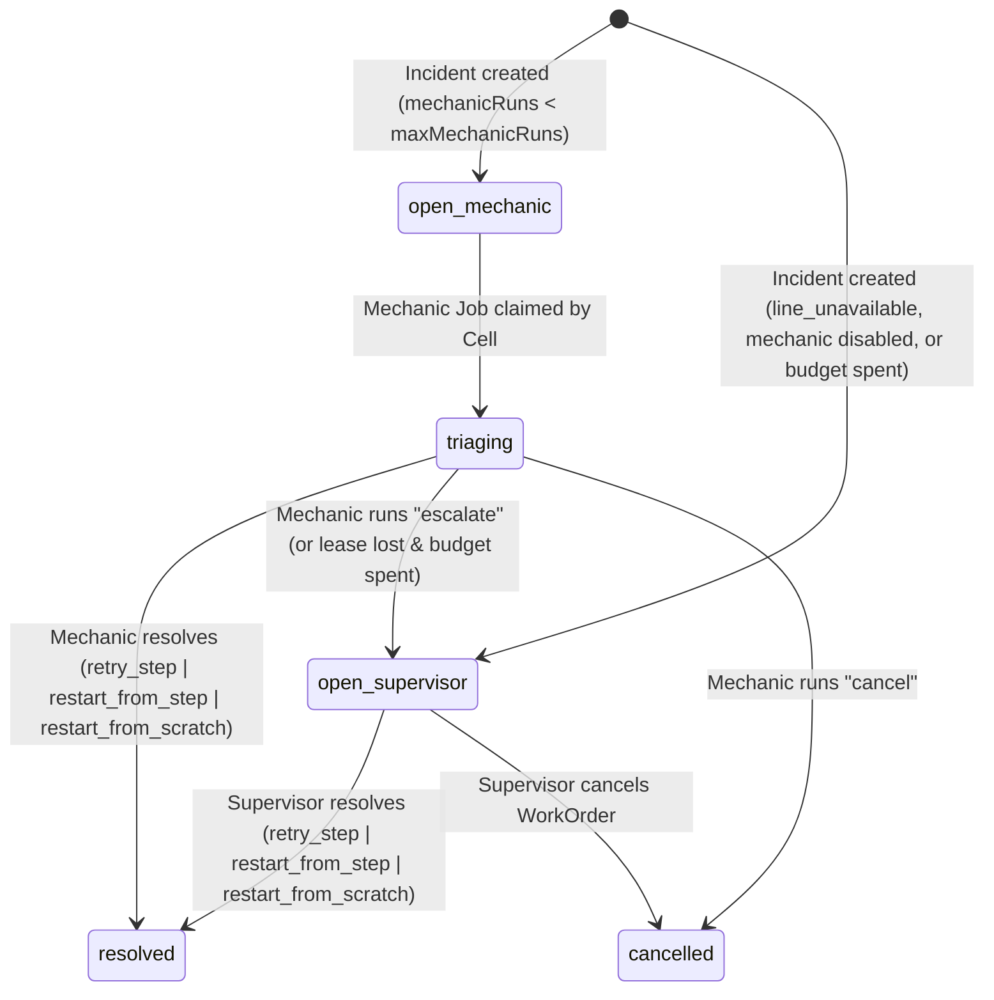

# Incidents (Andon, Triage & Recovery)

Terms: [glossary](../README.md#glossary). Operator/Mechanic verbs: [operator.md](../apps/operator.md). Server rules: [hq.md](../apps/hq.md).

## 1. Incident Triggers

An **Incident** (Andon) opens when a `WorkOrder` hits a block that normal station retries (`maxAttempts` / `onFailRetryStationId`) cannot resolve. Opening an Incident releases the Cell lease immediately while keeping `<repo>/.worktrees/<slug>/` intact on the pinned Factory for triage.

| Incident Reason | Trigger Condition | Lease & Worktree Effect |
| :--- | :--- | :--- |
| `line_unavailable` | Cell reports missing `.factory/lines/<line>.yml` and no other online Factory serves it | Lease released; `WorkOrder.state = 'line_unavailable'`; Cell gets different `nextJob` |
| `step_retries_exhausted` | Station (`operator` or `inspection`) fails with `attempts_used >= max_attempts` | Lease closed; `WorkOrder.state = 'blocked'`; worktree & `.cell/<step-id>/` kept on `pinned_factory_id` |
| `operator_blocked` | Operator agent runs `sf operator block --reason ... --handover <file>` | Saves `.cell/<step-id>/handover.md`; lease closed; `WorkOrder.state = 'blocked'` |
| `workspace_failed` | Cell fails `git fetch` / worktree setup 2 times in a row | Lease closed; Cell placed in `avoid_cells` cooldown (10m); `WorkOrder.state = 'blocked'` |
| `worktree_reset_limit` | `worktree_missing` reset-to-scratch exceeds `maxWorktreeResets` (2) | Lease closed; `WorkOrder.state = 'blocked'` (prevents infinite scratch loop) |
| `delivery_failed` | Final `deliver` step fails (git rebase/push/PR error) | Worktree kept intact for triage; `WorkOrder.state = 'blocked'` |
| `parent_rebased` | Parent `WorkOrder` re-delivers new `head_commit_sha` after child started/delivered | Child `stale_base = 1`, `WorkOrder.state = 'blocked'` |

## 2. State Machine

## 3. Resolution Actions (`POST /api/v1/incidents/{id}/resolve`)

Triggered by Mechanic (`sf operator incident --action ...`) or Supervisor (`sf incident resolve <id> --action ...`):

1. **`retry_step` (Continue at Failed Step `x`)**:
   - Grants `+grantRetries` (default `1`) to Step `x` (clears `unavailable_line_factories_json` if resolving `line_unavailable`).
   - Keeps `current_step_index = x` and `pinned_factory_id` so Cell reuses `.cell/<step-0..x-1>/` (`workspaceMode: 'reuse'`).
2. **`restart_from_step` (Rewind to Earlier Step `k < x`)**:
   - Requires `--step <step-id>` (mapped to `stepIndex: k`).
   - Rewinds `current_step_index = k`, resets Steps `k..N-1` to `ready`/`pending`, keeps Steps `0..k-1` artifacts, queues Step `k` (`workspaceMode: 'reuse'`).
3. **`restart_from_scratch` (Full Reset to Step 0)**:
   - Resets `current_step_index = 0`, `worktree_resets = 0`, clears `unavailable_line_factories_json`, resets all `order_steps`, queues Step 0 (`workspaceMode: 'fresh'`).
   - Next claiming Cell wipes `.worktrees/<order-slug>` and starts from `baseBranch`.
4. **`escalate` (Mechanic only)**:
   - Mechanic attaches diagnosis report (`## What happened`, `## What he tried`, `## Potential fix`) and hands Incident to `open_supervisor`.
5. **`cancel`**:
   - Cancels Incident and transitions `WorkOrder` to `cancelled`.
