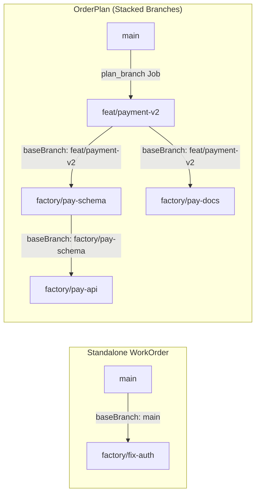

# Work Orders, Queue & Branch Topology

Terms: [glossary](../README.md#glossary). Server rules: [hq.md](../apps/hq.md). CLI commands: [sf.md](../apps/sf.md).

## 1. Hierarchy (`Project` -> `OrderPlan` -> `WorkOrder` -> `OrderStep` / `Job`)

- **Project**: Repo identifier in `<repo>/.factory/config.json` (`"project": "<project-id>"`). Pins every `OrderPlan`, `WorkOrder`, and `Job`.
- **`OrderPlan`** _(optional)_: Groups stacked `WorkOrder`s under integration branch `feat/<plan-slug>` branched from `baseBranch` (`main`).
- **`WorkOrder`**: Deliverable unit owning branch `factory/<order-slug>` and referencing `line: <name>` (`.factory/lines/<name>.yml`). Stacks on at most 1 parent (`parent_order_id`).
- **`OrderStep` & `Job`**: Steps materialized dynamically from local `.factory/lines/<line>.yml` when Cell starts Step 0. `Job` is one execution attempt claimed by a Cell.

## 2. Canonical Markdown Format (`orders/<slug>.md` or `todos/<slug>.md`)

```markdown
---
status: queued
priority: high
line: feature
plan: payment-v2
depends_on: pay-schema
type: feat
---

# pay-api: Implement payment endpoints

Build `/api/v1/payments` endpoints on top of `pay-schema`.
```

- **`line`**: Local `.factory/lines/<line>.yml` checked by Cell on claim.
- **Standalone order**: Omit `plan` and `depends_on` -> runs `main -> factory/<slug>`.
- **Plan root order**: `plan: payment-v2`, no `depends_on` -> creates/links `OrderPlan` (`feat/payment-v2`), sets `base_branch: feat/payment-v2`.
- **Stacked child order**: `depends_on: pay-schema` -> sets `parent_order_id`, waits in `waiting_parent` until parent reaches `delivered | completed`, sets `base_branch: factory/pay-schema` and `base_commit_sha = parent.head_commit_sha`.

## 3. Queue Import, Export & Actions

### Import (`POST /api/v1/queue/import` / `sf order import`)

1. **Pinning**: Pins every `OrderPlan`, `WorkOrder`, `Job` to `projectId` and `line_name`.
2. **`dry_run` vs `apply`**: `dry_run` validates frontmatter and single-parent DAG (rejecting cycles/multi-parent), returning `{ created, updated, skipped, errors }` without DB writes.
3. **New `slug` (`created`)**: Creates `OrderPlan` (if `plan:` set) and `WorkOrder`, wakes `/cells/claims` waiters.
4. **Existing `slug` in `waiting_parent | queued | paused | line_unavailable` (`updated`)**: Updates `title`, `description`, `priority`, `parentOrderId`, `line_name` in place (clears `unavailable_line_factories_json` if line changed).
5. **Existing `slug` in `running | delivering | delivered | completed` (`skipped`)**: Preserves in-flight/finished work; applies `priority` change or `status: cancelled`.

### Export (`GET /api/v1/queue/export` / `sf order export`)

Returns matching `WorkOrder`s for `projectId` (optional `planSlug`, `states`) as `{ files: [{ filename, slug, orderId, line, planSlug, state, priority, markdown }] }`.

### Direct Queue Control (`POST /api/v1/queue/actions` / `sf queue ...`)

- `pause` / `unpause`: Hold or release `queued` / `waiting_parent` orders.
- `reprioritise`: Set `priority: 'high' | 'medium' | 'low'` on `orderIds`.
- `reset_to_scratch`: Reset `orderIds` to Step 0 (`workspaceMode: 'fresh'`, clears `unavailable_line_factories_json`).
- `cancel`: Cancel `orderIds` and release active leases.

## 4. Branching & Execution Topology



### Base Branch Resolution (`resolveBaseBranch`)

| Scenario | `planId` | `parentOrderId` | Readiness Precondition | `Job.baseBranch` | `Job.targetBranch` |
| :--- | :--- | :--- | :--- | :--- | :--- |
| **0. Plan Branch Init** | `<planId>` | — | `OrderPlan.state === 'branching'` | `OrderPlan.baseBranch` (`main`) | `OrderPlan.branch` (`feat/<slug>`) |
| **1. Standalone** | `null` | `null` | `queued` | `WorkOrder.baseBranch` (`main`) | `factory/<slug>` |
| **2. Standalone Chained** | `null` | `<parentOrderId>` | Parent `delivered \| completed` | `factory/<parent>` | `factory/<slug>` |
| **3. OrderPlan Root** | `<planId>` | `null` | `OrderPlan.state === 'active'` | `feat/<plan-slug>` | `factory/<slug>` |
| **4. OrderPlan Chained** | `<planId>` | `<parentOrderId>` | Parent `delivered \| completed` | `factory/<parent>` | `factory/<slug>` |

### Delivery & Parent Rebase (`stale_base`)

1. **Delivery**: On final `deliver` step, Cell pushes `factory/<slug>` to `origin`, publishes PR, deletes `<repo>/.worktrees/<slug>/`, and reports `complete` with `commitSha`. HQ transitions order to `delivered` and unlocks `waiting_parent` children to `queued`.
2. **Parent Rebase Detection**: If parent `A` is reopened/reset and delivers new `head_commit_sha !== child.base_commit_sha`, started/delivered child `B` is marked `stale_base = 1`, transitioned to `blocked`, and opens a `parent_rebased` Incident ([incidents.md](./incidents.md)).
