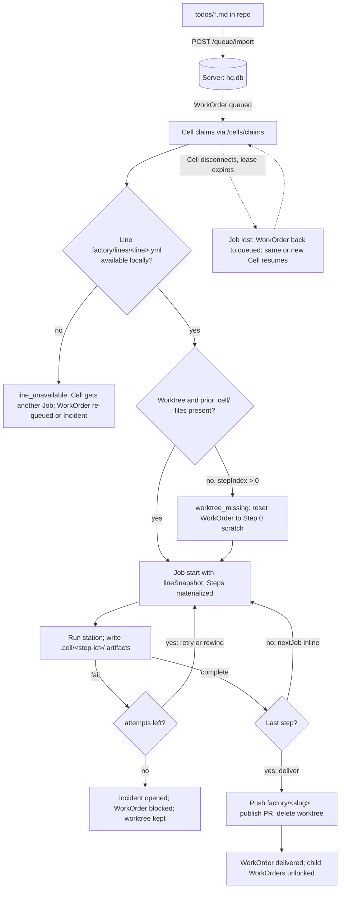
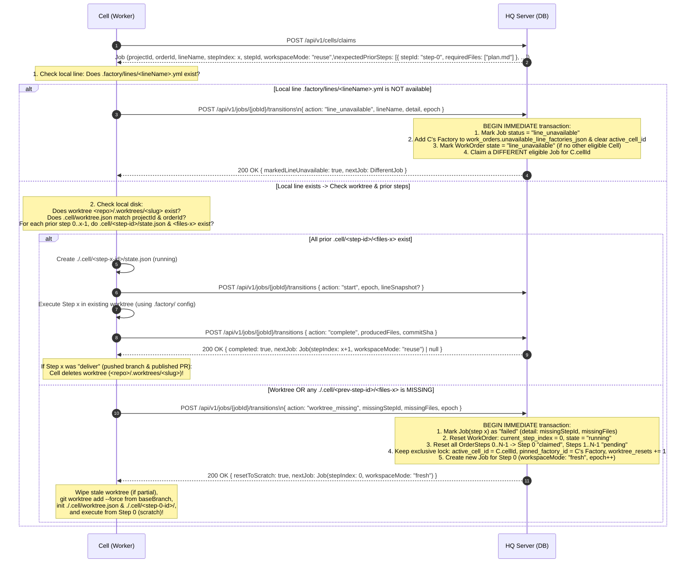
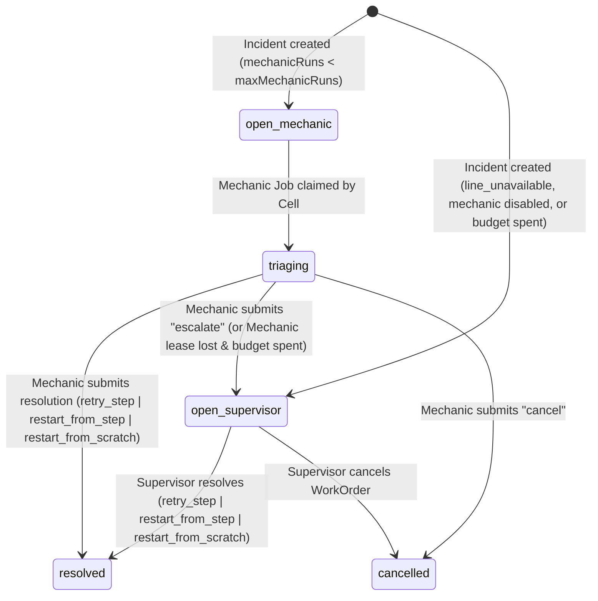
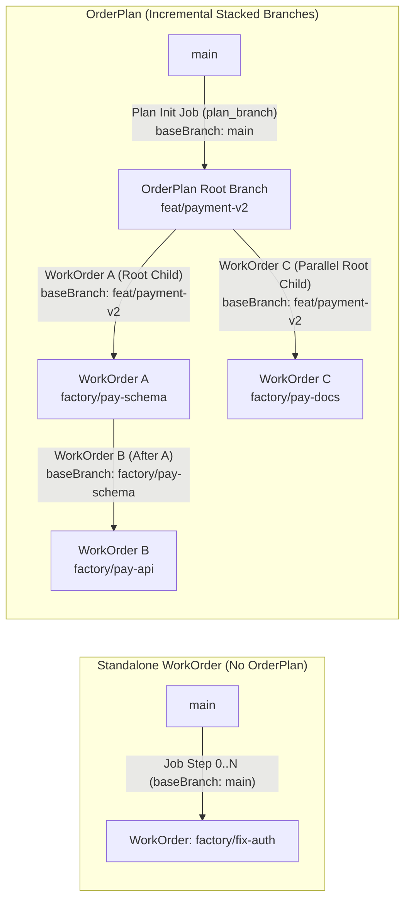

# `@repo/hq` — Backend State Management, Cell Worktree & Incident Plan

## 0. Abstract Flow (At a Glance)

This section is the high-level summary. Sections 1–9 and 11 give the detailed rules, and [engineering.md](./engineering.md) defines hard code-shape rules.



1. **Queue in**: Tasks are written as `todos/<slug>.md` (`status`, `priority`, `line`, optional `plan` and `depends_on`) and imported into the server. The server pins each `WorkOrder` to the repo's `projectId` from `.factory/config.json`.
2. **Dispatch**: A Cell whose `projectId` and `allowedLines` match long-polls `/cells/claims`. The server claims one `WorkOrder` for it under a `BEGIN IMMEDIATE` transaction. Parent-stacked orders wait until the parent is `delivered`.
3. **Ownership**: The claiming Cell keeps the `WorkOrder` from Step 0 through `deliver`. Each completed step returns the next `Job` inline, so no re-queue happens between steps.
4. **Local checks**: Before running a step, the Cell checks that the Line file exists locally (else `line_unavailable`) and that the worktree and prior step files exist (else `worktree_missing`, which resets to scratch).
5. **Execution**: The Cell runs each station in `<repo>/.worktrees/<slug>/` and writes its artifacts to `.cell/<step-id>/`. Failed steps retry, or rewind to `on_fail_retry_station_id`, until `max_attempts` is spent.
6. **Incidents**: Blocks that retries cannot fix open an Incident. A Mechanic triages it first, then the Supervisor. The resolution is `retry_step`, `restart_from_step`, `restart_from_scratch`, `escalate`, or `cancel`.
7. **Delivery**: The `deliver` step pushes the branch and publishes the PR, then the Cell deletes the worktree. The server marks the `WorkOrder` `delivered` and unlocks its children. The server never talks to GitHub itself.
8. **Failure recovery**: If a Cell disconnects, its lease expires after 60s and the `WorkOrder` returns to `queued`. The same Cell can resume its warm worktree on reconnect. Otherwise another eligible Cell takes over at the same step, with an `epoch` fence rejecting stale messages.

---

## 1. Core Principles & Nomenclature

This backend (`apps/hq`) is a standalone, stateful control plane built on **Bun + Hono + Drizzle ORM (`bun:sqlite` WAL) + Zod**.

### Hard Architectural Rules

1. **Repository Project Identity (`<repo>/.factory/config.json`)**:
   - Every repository defines its canonical project identifier in `.factory/config.json` via `"project": "<project-id>"` (e.g., `"project": "software-factory"`).
   - **Every `OrderPlan`, `WorkOrder`, and `Job` has a pinned `projectId`**.
   - **Cells** read `.factory/config.json` on startup and send that `project` with every claim, optionally declaring **`allowedLines`** (e.g., `["feature", "fast"]`) to restrict which Lines that Cell is allowed to execute.
2. **3-Level HQ Hierarchy (`OrderPlan` → `WorkOrder` → `OrderStep` / `Job`)**:
   - **`OrderPlan`** _(optional)_: Groups related `WorkOrder`s under a shared incremental integration branch (`feat/<plan-slug>` branched from `baseBranch`, e.g., `main`), pinned to `projectId`.
   - **`WorkOrder`**: A deliverable unit of work pinned to `projectId`, owning a target feature branch (`factory/<order-slug>`) and referencing a `line` (`feature`, `standard`, `fast`). Can run **standalone** (`main → factory/<order-slug>`) or **inside an `OrderPlan`** (starting from the `OrderPlan` root branch `feat/<plan-slug>` or stacked on **at most 1 parent `WorkOrder`** via `parent_order_id`).
   - **`OrderStep` (Station) & `Job`**: A `WorkOrder`'s steps come from its **Line** definition in the repo's local `.factory/lines/<line>.yml` (e.g., `plan → plan-review → build → quality-gate → audit → deliver`). A **`Job`** is a concrete execution attempt of a step (or of `OrderPlan` branch initialization) claimed by a **`Cell`**. **Every `Job` always carries its pinned `projectId`, `lineName`, `baseBranch`, `targetBranch`, and `baseCommitSha`.**
3. **1 Cell per `WorkOrder` From Start to Finish (Unless Disconnected)**:
   - **A `WorkOrder` can be executed by at most ONE `Cell` at the same time, and the Cell that starts a `WorkOrder` must finish all of its steps (`0..deliver`).**
   - A `WorkOrder` can **only** be reassigned to a different Cell if the executing Cell **disconnects** (its heartbeat lease expires and the task becomes abandoned).
   - Enforced simultaneously by:
     - **SQLite Partial Unique Indexes** (`UNIQUE(order_id) WHERE status IN ('claimed', 'running')` and `UNIQUE(claimed_by_cell_id) WHERE status IN ('claimed', 'running')`),
     - **Serialized `BEGIN IMMEDIATE` Claim Transactions** (`work_orders.active_cell_id`, `work_orders.active_job_id`, and `work_orders.pinned_factory_id`),
     - **Inline Step-to-Step Handoff (`nextJob`)** so the same Cell runs Steps `0..deliver` back-to-back without ever releasing `active_cell_id`, and
     - **Monotonic `epoch` Lease Fencing** (any late message from a disconnected Cell with a stale `epoch` is rejected with `409 StaleLeaseEpoch`).
4. **Worktree Lifecycle & Cleanup Only After `deliver` (Push + PR Publish)**:
   - While a `WorkOrder` is in progress (or blocked for inspection), the Cell keeps `<repo>/.worktrees/<order-slug>/` and its `.cell/<step-id>/` artifacts intact on disk.
   - **Only when the final `deliver` step pushes the branch and publishes the PR** does the publishing **Cell immediately delete the local worktree** (`git worktree remove --force <repo>/.worktrees/<order-slug>`).
5. **Lines Live Locally in Repo `.factory/` Config & Cell Materializes Steps on Step 0**:
   - Todo `.md` files never inline step definitions; they only declare `line: <name>` (e.g., `line: feature`).
   - Line definitions (`.factory/lines/*.yml`), Operator profiles (`.factory/operators/*.md`), and templates (`.factory/templates/**`) live locally in the repository's `.factory/` directory alongside `.factory/config.json`.
   - When a **Cell** receives a task (`Job`), it checks whether `.factory/lines/<lineName>.yml` is available and allowed locally in its repo/worktree.
   - **If the local line is available on Step 0**, the Cell sends the parsed stations list (`lineSnapshot`) in `action: "start"`, and the server dynamically materializes `order_steps[0..N-1]`.
   - **If the local line is NOT available**, the Cell reports `action: "line_unavailable"` → the server **marks the `Job` and `WorkOrder` (`line_unavailable`)**, records that this Cell cannot run that task, and immediately dispatches a **different eligible `Job`** to the Cell.
6. **Zero GitHub Coupling on the Server**:
   - The server **never** connects to GitHub (`gh` CLI, REST/GraphQL APIs, or webhooks are absent on the server).
   - It stores only job, step, order, plan, incident, and git ref/commit states reported directly by connected **Cells** (the Cell itself performs `git push` / PR publish during `deliver` and then cleans up its worktree).
7. **Dual-Layer State Storage (Server SQLite DB + Cell Worktree `./.cell/<step-id>/`)**:
   - **Server DB (`hq.db`)**: Single source of truth for workflow orchestration, step states, Cell pinning (`pinned_factory_id`), leases, incidents, and audit transitions.
   - **Cell Worktree (`<repo>/.worktrees/<order-slug>/.cell/<step-id>/`)**: Holds the physical uncommitted code in the git worktree plus per-step local state and artifacts under `.cell/<step-id>/<files-x>` until `deliver` finishes and deletes the worktree.
8. **Worktree Verification & Automatic Reset-to-Scratch**:
   - When a Cell picks up an abandoned task (after the prior Cell disconnected) at Step `x` (`stepIndex > 0`), it verifies that the worktree and all required prior step files (`.cell/<prev-step-id>/<files-x>`) exist on disk.
   - If the worktree or step files are missing, the Cell reports `worktree_missing` → the server **resets the `WorkOrder` DB state back to Step 0 (`scratch`)** and returns a fresh Step 0 `Job` so the Cell resumes cleanly from the beginning.
9. **Queue Management & Markdown Round-Trip (`export` / `import`)**:
   - REST endpoints (`GET /api/v1/queue/export`, `POST /api/v1/queue/import`, `POST /api/v1/queue/actions`) export and import clean `todos/<slug>.md` files (with `project` from `.factory/config.json` and `line: <name>` in frontmatter).
10. **Safe Token Security**:
    - Opaque 256-bit tokens (`sf_sup_...`, `sf_join_...`, `sf_cell_...`) are hashed with SHA-256 at rest, verified via `timingSafeEqual`, scoped by role/permission, bounded by `expiresAt`, rotatable with grace windows, and revocable immediately.

---

## 2. How State is Stored (Server DB vs. Cell Worktree)

### 2.1 Repository `.factory/config.json`

Each repository roots its factory configuration in `.factory/config.json`, which binds the repository to its `project` identifier on the server:

```json
{
  "project": "software-factory",
  "rules": "./.nitpick/rules",
  "skills": "./.nitpick/skills",
  "herdr": {
    "tabPerRun": true,
    "closePreviousOperatorTabs": true
  },
  "logs": {
    "store": "files",
    "dir": ".factory-local/logs"
  },
  "mechanic": {
    "rootRecordDir": ".evidences"
  }
}
```

### 2.2 Server Database State (`hq.db`)

The server stores structured relational state in SQLite (WAL mode, `BEGIN IMMEDIATE` transactions, no event-replay folding required). Columns and enums live in `apps/hq/src/db/schema`, not here:

- **Plans, orders, steps**: `order_plans`, `work_orders` (owning Cell and lease `epoch`), `order_steps` (one row per Line station).
- **Execution**: `jobs` (one attempt per step, with lease fencing; `claimed_by_cell_id` is plain text, no Cell table), `factories` (enrolled Factories, last seen, projects).
- **Triage and audit**: `incidents`, and `state_transitions` as history for the SSE stream. Retries never read history.

#### Storage engines (`HQ_DATABASE_URL`)

- **Default: SQLite.** `HQ_DB_PATH` (or `FACTORY_DB_PATH`) picks the file; `HQ_DATA_DIR` holds the file and `web-demo.join`.
- **Postgres.** Set `HQ_DATABASE_URL` (or `FACTORY_DATABASE_URL`) to `postgres://...` and HQ connects with Bun SQL. Embedded migrations (`apps/hq/src/db/pg/migrations`) apply on connect under an advisory lock, so parallel starts are safe. `HQ_DB_PATH` is ignored. The three partial unique indexes match SQLite (`idx_jobs_one_active_per_order`, `idx_jobs_one_active_per_cell`, `idx_work_orders_one_active_per_cell`), and claims lock rows with `FOR UPDATE`.
- Both adapters implement the same `StoragePort` and run one contract suite (`apps/hq/test/db/storage-port.contract.ts`). Postgres tests run when `TEST_POSTGRES_URL` is set.

### 2.3 Cell Worktree State (`./.cell/<step-id>/`) & Post-Deliver Cleanup

Inside the target repository, the Cell creates an isolated git worktree per `WorkOrder`, reads `.factory/` definitions from the worktree, stores all step-level state under `.cell/` (excluded via `.git/info/exclude`), and **deletes the entire `<repo>/.worktrees/<order-slug>/` directory once `deliver` pushes the branch and publishes the PR**:

```text
<repo>/.worktrees/<order-slug>/               # Created at Step 0; DELETED by Cell right after "deliver" pushes & publishes PR
├── .factory/                                 # Repo-owned local config (read by Cell)
│   ├── config.json                           # Contains "project": "software-factory"
│   ├── lines/
│   │   ├── feature.yml                       # Defines workspace setup, operators, stations, and deliver rules
│   │   ├── standard.yml
│   │   └── fast.yml
│   ├── operators/                            # Operator profiles (planner.md, plan-reviewer.md, builder.md, doctor.md, mechanic.md)
│   └── templates/                            # Prompt & PR templates
├── .cell/
│   ├── worktree.json                         # { projectId, orderId, planId, lineName, baseBranch, baseCommitSha, cellId }
│   ├── <step-0-id>/                          # Station "plan" (stepIndex: 0)
│   │   ├── state.json                        # { stepId, stationId: "plan", stepIndex: 0, jobId, epoch, status: "passed" }
│   │   ├── plan.md                           # Station output artifact (<step-id>/<file-x>)
│   │   └── step.log                          # Runner execution log
│   ├── <step-1-id>/                          # Station "build" (stepIndex: 1)
│   │   ├── state.json                        # { stepId, stationId: "build", stepIndex: 1, jobId, epoch, status: "passed" }
│   │   ├── report.md                         # Builder report artifact
│   │   └── commit.md                         # Builder commit message artifact
│   └── <step-2-id>/                          # Station "quality-gate" (stepIndex: 2)
│       ├── state.json                        # { stepId, stationId: "quality-gate", stepIndex: 2, status: "running" }
│       └── gate.json                         # Per-command exit codes and failure tails
└── src/                                      # Code. Only the builder station commits (one commit per build attempt)
```

---

## 3. How the Cell Works: Start-to-Finish Ownership, Line Checks, Disconnect Takeover & Scratch Reset

### 3.1 Start-to-Finish Single-Cell Ownership & Disconnect Takeover

1. **Cell Claims (`POST /api/v1/cells/claims`, Factory credential + `x-cell-id`)**:
   - A Cell has no enrollment and no token of its own. The Factory daemon picks its id (`cell-<8 hex>`, random per run) and relays with the Factory credential. HQ creates no row for a Cell.
   - The claim body reports `projectId` (from `<repo>/.factory/config.json`), `allowedLines` (e.g. `["feature", "fast"]` or `["*"]`) and `runners` (e.g. `["claude", "opencode", "cursor"]`).
2. **Start-to-Finish Single-Cell Ownership**:
   - **A `WorkOrder` is executed by 1 Cell at a time, and once a Cell starts a `WorkOrder`, that Cell executes every step (`0 → 1 → ... → deliver`) until the `WorkOrder` finishes.**
   - Inside a `BEGIN IMMEDIATE` SQLite transaction, a `WorkOrder` is eligible to be claimed by a Cell **only if**:
     - `work_order.state === 'queued'` and `work_order.active_cell_id IS NULL` and `work_order.active_job_id IS NULL`,
     - `work_order.project_id === body.projectId`,
     - `work_order.line_name` is in `body.allowedLines` (or it contains `"*"`),
     - the Cell's Factory is not in `work_order.unavailable_line_factories_json`, **and**
     - Either `work_order.pinned_factory_id IS NULL`, `work_order.pinned_factory_id === caller factory`, or the pinned Factory is **silent** (`last_seen_at + LEASE_TTL_MS <= now`).
   - Upon claim, the server atomically sets:
     - `work_order.state = 'running'`,
     - `work_order.active_cell_id = <x-cell-id>`,
     - `work_order.active_job_id = job.job_id`,
     - `work_order.pinned_factory_id = caller factory`,
     - `work_order.epoch = work_order.epoch + 1` (copied onto `job.epoch`),
     - `job.claimed_by_cell_id = <x-cell-id>`, `job.claimed_by_factory_id = caller factory`.
   - As each step completes (`action: "complete"`), the server **never releases `active_cell_id`**—it immediately returns `nextJob` for Step `k + 1` in the response so the same Cell continues uninterrupted through `deliver`.
3. **Only on Cell Loss Can a Task Move to Another Cell**:
   - A Cell is lost when its process is gone (the Factory daemon confirms the kill, then calls `POST /api/v1/factories/cells/:id/gone`) or its lease expires without a heartbeat.
     - The lease reaper marks the expired `Job` as `lost`, clears `active_cell_id = null` and `active_job_id = null`, increments `epoch`, and returns the abandoned `WorkOrder` (at Step `x`) to `queued`. The `job` row keeps `claimed_by_cell_id`, so history still shows which Cell ran it.
     - A new Cell of the **same Factory** claims the `WorkOrder` (pinned to that Factory) and dispatches Step `x` (`workspaceMode = 'reuse'`), triggering the worktree check in §3.3. A Cell of another Factory may claim it only once the pinned Factory is silent.
     - A silent Factory (no request for `LEASE_TTL_MS`) loses all its active jobs and unpins its orders at the reaper.

### 3.2 Cell Local Line Check & Automatic Re-Dispatch (`line_unavailable`)

Because Lines are configured locally in `<repo>/.factory/lines/<lineName>.yml`, a `WorkOrder` in the queue may reference a `line` that does not exist in the Cell's checked-out repo/worktree (or is not available on that Cell):

1. **Cell Checks Local `.factory/lines/<lineName>.yml` Upon Receiving a Job**:
   - As soon as the Cell receives a `Job` (`lineName: "<name>"`), it checks whether `.factory/lines/<name>.yml` exists in the repo/worktree and is valid.
2. **If Local Line is NOT Available (`action: "line_unavailable"`)**:
   - The Cell does **not** run the job. Instead, it calls `POST /api/v1/jobs/{jobId}/transitions`:
     ```json
     {
       "action": "line_unavailable",
       "lineName": "experimental-line",
       "detail": "Missing .factory/lines/experimental-line.yml in local repository",
       "epoch": 1
     }
     ```
   - **Server Transaction (`BEGIN IMMEDIATE`)**:
     1. **Marks the `Job`**: Sets `jobs.status = 'line_unavailable'` and stores `error_detail`.
     2. **Records Factory on `WorkOrder` & Releases Lock**: Appends the Cell's Factory id to `work_orders.unavailable_line_factories_json` and clears `pinned_factory_id = null`, `active_job_id = null`, and `active_cell_id = null`.
     3. **Marks the `WorkOrder`**:
        - If another online Cell for `projectId` allows `lineName` and has not rejected it, keeps `WorkOrder.state = 'queued'` so the other Cell can exclusively claim it.
        - Otherwise, transitions **`WorkOrder.state = 'line_unavailable'`** and opens an **Incident** (`reason = 'line_unavailable'`) so the queue clearly highlights that this task has an unavailable line.
     4. **Assigns a Different Job Immediately**: Selects the next eligible `Job` for `cellId` (skipping the `line_unavailable` task) and returns `{ markedLineUnavailable: true, nextJob: Job | null }` so the Cell immediately moves on to another task.

### 3.3 Cell Worktree Check & Automatic DB Reset to Scratch (`worktree_missing`)

When a Cell receives a `Job` (and the local line check in §3.2 passes), if it is for Step `x` (`stepIndex > 0`, or a resumed/retried step with `workspaceMode = 'reuse'`):



Resume in an intact worktree: the Cell hard resets to the Job's `headCommitSha` (base commit before the first build, last build commit after) and cleans, then reruns the step. Reset fails or commit missing: worktree deleted, start from scratch. Step files are written atomically, `state.json` last, so an existing `state.json` means the step finished.

### 3.4 Exact Server Reset-to-Scratch Rules (`worktree_missing`)

When the server receives `action: "worktree_missing"` from the Cell holding the current `Job` lease:

1. **Loop Guard**: Increments `work_orders.worktree_resets`. If `worktree_resets > maxWorktreeResets` (default `2`), the server does **not** loop again—it transitions `WorkOrder.state → 'blocked'`, clears `active_cell_id` and `active_job_id`, and opens an **Incident** (`reason = 'worktree_reset_limit'`).
2. **State Rewind (in one SQLite transaction)**:
   - `work_orders.current_step_index = 0`
   - `work_orders.pinned_factory_id` = the caller's Factory and `work_orders.active_cell_id = cellId` (exclusively locked to the Cell that will now run it from scratch)
   - `order_steps`:
     - Step `0`: `state = 'claimed'`, `last_commit_sha = null`, `last_output_json = null` (`attempts_used` reset to `0`)
     - Steps `1..N-1`: `state = 'pending'`, `last_commit_sha = null`, `last_output_json = null`, `produced_files_json = '[]'`
   - Issues a new `Job` for **Step 0** with `workspaceMode = 'fresh'` and returns it directly in the response (`nextJob`) so the same Cell starts immediately from Step 0 without another queue round-trip.

### 3.5 Dynamic `order_steps` Materialization (Step 0 `start`), Inline Handoff (`nextJob`) & Post-`deliver` Worktree Deletion

1. **Dynamic Step Materialization from Local `.factory/lines/<line>.yml`**:
   - Because `.factory/lines/<line>.yml` lives in the local repository (not hardcoded on the server), a newly created/imported `WorkOrder` starts with `current_step_index = 0` and `0` rows in `order_steps`.
   - When a Cell claims the `WorkOrder` at Step 0, the server issues a bootstrap Step 0 `Job` (`workspaceMode: 'fresh'`).
   - After checking out the worktree and validating `.factory/lines/<lineName>.yml`, the Cell calls `POST /api/v1/jobs/{jobId}/transitions` with `action: "start"` and includes `lineSnapshot` (the ordered list of stations and `deliver` step parsed from `.factory/lines/<lineName>.yml`):
     ```json
     {
       "action": "start",
       "epoch": 1,
       "lineSnapshot": {
         "name": "feature",
         "stations": [
           {
             "id": "plan",
             "kind": "operator",
             "requiredFiles": ["plan.md"],
             "maxAttempts": 2
           },
           {
             "id": "build",
             "kind": "operator",
             "requiredFiles": ["report.md", "commit.md"],
             "maxAttempts": 3
           },
           {
             "id": "quality-gate",
             "kind": "inspection",
             "requiredFiles": ["gate.json"],
             "maxAttempts": 3,
             "onFailRetryStationId": "build"
           },
           {
             "id": "deliver",
             "kind": "deliver",
             "requiredFiles": ["deliver.json"],
             "maxAttempts": 1
           }
         ]
       }
     }
     ```
   - The server atomically inserts `order_steps[0..N-1]` (or refreshes them if resetting from scratch), binds `job.step_id = order_steps[0].step_id`, and transitions Step 0 to `running`.
2. **Back-to-Back Step Handoff (`nextJob` Returned Inline Until Finish)**:
   - When the Cell completes Step `k` (`action: "complete"`) or fails Step `k` where `on_fail_retry_station_id` rewinds to an earlier step (e.g., `quality-gate` fails → rewinds to `build` while retry budget remains):
     - The server **keeps `active_cell_id = cellId` and `pinned_factory_id` (the caller's Factory) locked** (never dropping the `WorkOrder` back to `queued` between steps).
     - In the same transaction, the server creates the `Job` for the next step (`k + 1` or the retry target step) with `workspaceMode = 'reuse'`, sets `active_job_id = nextJob.job_id`, and returns `{ completed: true, nextJob }` directly in the response.
3. **Final `deliver` Step (Push Branch, Publish PR, and Delete Local Worktree)**:
   - During the final `deliver` step, the Cell pushes the builder's commits on `factory/<order-slug>` to `origin`, and publishes/updates the PR.
   - **Immediately after `deliver` pushes and publishes the PR, the Cell deletes `<repo>/.worktrees/<order-slug>/` (`git worktree remove --force`)** and reports `action: "complete"` with `{ commitSha }` to the server.
   - The server transitions `WorkOrder.state = 'delivered'`, clears `active_cell_id = null`, `active_job_id = null`, and `pinned_factory_id = null`, and unlocks any dependent child `WorkOrder` (`waiting_parent → queued`).

### 3.6 Cell Restart

- A restarted Cell process gets a new id from its Factory daemon. There is no hello and no `resumedJob`.
- Its old `active_job_id` stays locked until the Factory confirms the old process is dead (`gone`) or the lease expires. Then the Job is requeued and the new Cell claims it at the same step (`workspaceMode = 'reuse'`) when the worktree is intact (§3.3).

### 3.7 Cell ↔ HQ Connection & Timing Constants (`≤ 5 Cells + 1 Server`)

For up to **5 Cells and 1 web server (`Bun.serve` + Hono + `bun:sqlite`)**, the transport layer uses **HTTP Keep-Alive REST + In-Memory Long-Polling (`waitMs`) + Piggybacked `nextJob`**:

1. **Idle State (`0` SQLite queries, `< 2 KB` RAM, `< 1ms` dispatch)**:
   - Up to 5 idle Cells call `POST /api/v1/cells/claims` with `{ waitMs: 25000 }`.
   - If the queue is empty, the server does **not** poll SQLite—it parks a lightweight resolver in an in-memory `Set<() => void>()` (max 5 callbacks).
   - The millisecond a task is imported or queued, the server wakes the parked promise, runs 1 `BEGIN IMMEDIATE` transaction, and returns the `Job` in `< 1ms`.
2. **Busy State (`0.5 req/sec` total across all 5 Cells)**:
   - While executing a step, each busy Cell sends `POST /api/v1/cells/heartbeats` every `10s`.
   - At 5 Cells, that is 1 request every 2 seconds (`~50 µs` of `bun:sqlite` work).
   - Server-to-Cell control (`signals: ["abort"]`) rides back in the heartbeat response body—no second socket needed.
3. **Step-to-Step Transition (`0` extra round-trips)**:
   - Every `POST /api/v1/jobs/{id}/transitions` (`complete`, `worktree_missing`, `line_unavailable`, or `fail` with retry) returns `nextJob` inline in the same HTTP response.
   - A Cell runs `Step 0 → Step 1 → ... → deliver` without calling `/claims` again.
4. **Single TCP Socket per Cell (`Connection: keep-alive`) + Zero Reconnect State Machine**:
   - Bun's HTTP keep-alive reuses 1 TCP connection per Cell (same wire cost as a WebSocket).
   - If the web server restarts during a 15-minute LLM build step, the Cell's next HTTP heartbeat/transition simply retries (`200ms → 400ms → 800ms`) with the same `epoch`—nothing drops or desyncs. A step the server already applied answers `already_applied` (§11.4).

Waiters are capped at 5 (`MAX_CLAIM_WAITERS`, all Factories together). A 6th idle Cell gets an empty reply at once and claims again. See [gaps](./hq-factory-cell-plan.md#gaps).

| Parameter                 | Value                              | Why                                                                                                                   |
| :------------------------ | :--------------------------------- | :-------------------------------------------------------------------------------------------------------------------- |
| **`claimWaitMs`**         | `25_000` (25s)                     | Stays safely under 30s reverse-proxy/NAT idle timeouts while keeping idle traffic to `0.2 req/sec` across all 5 Cells |
| **`heartbeatIntervalMs`** | `10_000` (10s)                     | Max `0.5 req/sec` total load on the server; fast enough for abort signals                                             |
| **`selfFenceMs` (Factory)** | `45_000` (45s)                   | Factory kills all its Cells after 45 s without an HQ answer. A Cell also aborts after 4 failed heartbeats (about 40 s) |
| **`leaseTtlMs` (Server)** | `60_000` (60s)                     | Server guarantees `leaseTtlMs > selfFenceMs` (15s safety margin) before another Cell can take over an abandoned task  |
| **HTTP Retry**            | 3 attempts (`200ms, 400ms, 800ms`) | Idempotent by state: same `epoch`, outcome already applied answers `already_applied` (§11.4)                                             |

---

## 4. What Happens with Incidents (Andon, Triage & Recovery)

An **Incident** (Andon) is created whenever a `WorkOrder` or `OrderPlan` hits a failure or block that normal step retries (configured in `.factory/lines/<line>.yml` `onFail`) cannot resolve automatically.

### 4.1 Triggers that Open an Incident

| Incident Reason              | Trigger Condition                                                                                                  | What Happens to Active Lease & Worktree                                                                                           |
| :--------------------------- | :----------------------------------------------------------------------------------------------------------------- | :-------------------------------------------------------------------------------------------------------------------------------- |
| **`line_unavailable`**       | Cell checks local `.factory/lines/<lineName>.yml` and reports `line_unavailable` (and no other Cell supports it)   | `Job.status = 'line_unavailable'`; `WorkOrder.state = 'line_unavailable'`; Cell is immediately given a different `Job`            |
| **`step_retries_exhausted`** | A step (`operator` or `inspection`) fails and `attempts_used >= max_attempts`                                      | Lease is closed; `WorkOrder.state = 'blocked'`; worktree & `.cell/<step-id>/` logs stay intact on `pinned_factory_id` for inspection |
| **`operator_blocked`**       | Runner/Operator inside the Cell explicitly calls `block` (ambiguous spec, missing dependency, or question timeout) | Cell saves `.cell/<step-id>/handover.md`; lease is closed; `WorkOrder.state = 'blocked'`                                          |
| **`workspace_failed`**       | Cell fails `git fetch` / worktree setup `2` times in a row                                                         | Lease is closed; failing Cell is placed in `avoid_cells` cooldown (10 min); `WorkOrder.state = 'blocked'`                         |
| **`worktree_reset_limit`**   | `worktree_missing` reset-to-scratch happened `> maxWorktreeResets` (2) times without delivery                      | Lease is closed; `WorkOrder.state = 'blocked'` to prevent infinite scratch restarts                                               |
| **`delivery_failed`**        | Final `deliver` step fails (e.g., git rebase/push/PR failure)                                                      | Worktree stays intact on Cell for triage; `WorkOrder.state = 'blocked'`                                                           |
| **`parent_rebased`**         | Parent `WorkOrder` was reopened/reset and delivered a new `head_commit_sha` after child already started/delivered  | Child `WorkOrder.stale_base = 1` and transitions to `blocked` so Supervisor/Mechanic can rebase or restart it                     |

### 4.2 Incident State Machine & Resolution Paths



### 4.3 Three Ways an Incident is Resolved (`POST /api/v1/incidents/{id}/resolve`)

1. **`retry_step` (Continue at Failed Step `x`)**:
   - Grants `+grantRetries` (default `1`) to Step `x` (and clears `unavailable_line_factories_json` if resolving a `line_unavailable` incident after adding the line or changing `line_name`).
   - Keeps `current_step_index = x` and keeps `pinned_factory_id` so the Cell reuses `.cell/<step-0..x-1>/` and retries Step `x` (`workspaceMode = 'reuse'`).
   - _(If the Cell later discovers `.cell/<step-0..x-1>/` is gone, its automatic check in §3.3 will safely fall back to `worktree_missing` → scratch reset!)_
2. **`restart_from_step` (Rewind to Earlier Step `k < x`)**:
   - Rewinds `current_step_index = k`, resets Steps `k..N-1` to `ready`/`pending`, keeps Steps `0..k-1` and their `.cell/<step-id>/` files, and queues Step `k` (`workspaceMode = 'reuse'`).
3. **`restart_from_scratch` (Full DB + Worktree Reset to Step 0)**:
   - Resets `current_step_index = 0`, resets `worktree_resets = 0`, clears `unavailable_line_factories_json`, resets all `order_steps` `0..N-1`, and queues Step 0 with `workspaceMode = 'fresh'`.
   - The next Cell that claims Step 0 wipes `.worktrees/<order-slug>` (including `.cell/`) and starts cleanly from `baseBranch`.

---

## 5. Queue Management & Markdown Import/Export (`todos/*.md` + `.factory/config.json`)

Task `.md` files stay lightweight and human-editable—they reference **`line: <line-name>`** (which the Cell resolves locally from `<repo>/.factory/lines/<line-name>.yml`), while the `projectId` is resolved from `<repo>/.factory/config.json` (`"project": "software-factory"`).

### 5.1 Canonical Task Markdown Format (`todos/<slug>.md`)

Each `WorkOrder` maps 1:1 to a `<slug>.md` file and stacks on **at most 1 parent `WorkOrder`** (`depends_on: <parent-slug>` or single-element `[<parent-slug>]`) so its git `base_branch` is always unambiguous:

```markdown
---
status: queued
priority: high
line: feature
plan: payment-v2
depends_on: pay-schema
type: feat
---

# pay-api: Implement payment endpoints

Build the `/api/v1/payments` endpoints on top of `pay-schema`.
```

- **`line: feature`**: Refers to `<repo>/.factory/lines/feature.yml` checked locally by the Cell.
- **Standalone task**: Omit `plan` (or `plan: null`) and omit `depends_on` → runs directly from `main → factory/<slug>`.
- **OrderPlan Root task**: `plan: payment-v2`, no `depends_on` → server creates/links `OrderPlan` `payment-v2` (`branch: feat/payment-v2`) and sets `base_branch: feat/payment-v2`.
- **Stacked Child task**: `depends_on: pay-schema` → sets `parent_order_id = "software-factory:pay-schema"`, waits in `waiting_parent` until `pay-schema` reaches `delivered | completed`, and sets `base_branch: factory/pay-schema` (and `base_commit_sha = pay-schema.head_commit_sha`).

### 5.2 Export Endpoint (`GET /api/v1/queue/export`)

Returns all matching `WorkOrder`s for a `projectId` rendered as clean Markdown strings (`line: <line_name>`, `status`, `priority`, `plan`, `depends_on`, `type`) so a shell script can write them directly to `todos/<slug>.md`:

- **Query parameters**: `projectId` _(required, e.g. read from `jq -r .project .factory/config.json`)_, `planSlug` _(optional)_, `states` _(optional)_.
- **Response (`200 OK`)**:
  ```json
  {
    "projectId": "software-factory",
    "exportedAt": 1794934800000,
    "files": [
      {
        "filename": "pay-api.md",
        "slug": "pay-api",
        "orderId": "software-factory:pay-api",
        "projectId": "software-factory",
        "line": "feature",
        "planSlug": "payment-v2",
        "state": "queued",
        "priority": "high",
        "markdown": "---\nstatus: queued\npriority: high\nline: feature\nplan: payment-v2\ndepends_on: pay-schema\ntype: feat\n---\n\n# pay-api: Implement payment endpoints\n..."
      }
    ]
  }
  ```
- **Shell one-liner to export server queue to `./todos/*.md`**:
  ```bash
  PROJECT_ID=$(jq -r '.project' .factory/config.json)
  curl -sH "Authorization: Bearer $HQ_TOKEN" \
    "$HQ_URL/api/v1/queue/export?projectId=$PROJECT_ID" | \
    jq -r '.files[] | @base64' | while read -r item; do
      file=$(echo "$item" | base64 -d | jq -r '.filename')
      echo "$item" | base64 -d | jq -r '.markdown' > "todos/$file"
    done
  ```

### 5.3 Import Endpoint (`POST /api/v1/queue/import`)

The caller (shell script or CLI running in the repository) reads `"project"` from `.factory/config.json` and sends `todos/*.md` (no `.factory/lines/*.yml` upload is required—the Cell checks `.factory/lines/<line>.yml` locally when it claims the task):

- **Request Payload**:
  ```json
  {
    "commandId": "import-20261117-01",
    "projectId": "software-factory",
    "mode": "apply",
    "files": [
      {
        "filename": "pay-schema.md",
        "markdown": "---\npriority: high\nline: feature\nplan: payment-v2\n..."
      },
      {
        "filename": "pay-api.md",
        "markdown": "---\npriority: high\nline: feature\nplan: payment-v2\ndepends_on: pay-schema\n..."
      }
    ]
  }
  ```
- **Import / Upsert Rules**:
  1. **Project & Line Name Pinning**: Every created/updated `OrderPlan`, `WorkOrder`, and `Job` is pinned to `projectId` and `line_name` (from `line:` frontmatter). When a Cell claims Step 0 (`start`), it checks local `.factory/lines/<line_name>.yml` and registers the Line's `stations` into `order_steps` (or reports `line_unavailable` if missing).
  2. **`mode: "dry_run"` vs `"apply"`**: `dry_run` validates frontmatter and single-parent dependency chains (rejecting cycles or multi-parent ambiguity), returning `{ created, updated, skipped, errors }` without writing to SQLite.
  3. **New `slug` (`created`)**: Creates the `OrderPlan` (if `plan:` is present), creates the `WorkOrder` with `projectId` and `line_name`, and sets initial `baseBranch` (waking any long-polling `/claims` waiters immediately).
  4. **Existing `slug` in `waiting_parent | queued | paused | line_unavailable` (`updated`)**: Updates `title`, `description`, `priority`, `parentOrderId`, and `line_name` in place (and clears `unavailable_line_factories_json` if `line_name` changed).
  5. **Existing `slug` in `running | delivering | delivered | completed` (`skipped`)**: Preserves in-flight/finished work; applies `priority` change or `status: cancelled` if requested in frontmatter.

### 5.4 Direct Queue Control (`POST /api/v1/queue/actions`)

Allows quick queue manipulation without exporting/importing files:

- `pause` / `unpause`: Hold or release `queued` / `waiting_parent` orders while reorganizing the queue.
- `reprioritise`: Set `priority: 'high' | 'medium' | 'low'` on selected `orderIds`.
- `reset_to_scratch`: Reset selected `orderIds` back to Step `0` (`workspaceMode: 'fresh'`, clearing `unavailable_line_factories_json`).
- `cancel`: Cancel selected `orderIds` and release any active leases.

---

## 6. Branching & Execution Topology (`OrderPlan` vs Standalone)



### 6.1 Base Branch Resolution Rules (`resolveBaseBranch`)

Every `Job` dispatched to a `Cell` includes an explicit, non-null `projectId`, `lineName`, and `baseBranch` (plus `baseCommitSha` when stacking on a parent branch):

| Scenario                            | `WorkOrder.planId` | `WorkOrder.parentOrderId` | Readiness Precondition                                  | Resolved `Job.baseBranch`                 | Resolved `Job.targetBranch`           |
| :---------------------------------- | :----------------- | :------------------------ | :------------------------------------------------------ | :---------------------------------------- | :------------------------------------ |
| **0. Plan Branch Init**             | `<planId>`         | —                         | `OrderPlan.state === 'branching'`                       | `OrderPlan.baseBranch` (e.g. `main`)      | `OrderPlan.branch` (`feat/<slug>`)    |
| **1. Standalone WorkOrder**         | `null`             | `null`                    | Immediate (`queued`)                                    | `WorkOrder.baseBranch` (e.g. `main`)      | `WorkOrder.branch` (`factory/<slug>`) |
| **2. Standalone Chained WorkOrder** | `null`             | `<parentOrderId>`         | Parent `WorkOrder.state === 'delivered' \| 'completed'` | `ParentOrder.branch` (`factory/<parent>`) | `WorkOrder.branch` (`factory/<slug>`) |
| **3. OrderPlan Root WorkOrder**     | `<planId>`         | `null`                    | `OrderPlan.state === 'active'` (root branch created)    | `OrderPlan.branch` (`feat/<plan-slug>`)   | `WorkOrder.branch` (`factory/<slug>`) |
| **4. OrderPlan Step WorkOrder**     | `<planId>`         | `<parentOrderId>`         | Parent `WorkOrder.state === 'delivered' \| 'completed'` | `ParentOrder.branch` (`factory/<parent>`) | `WorkOrder.branch` (`factory/<slug>`) |

### 6.2 Post-Deliver Remote Push, Worktree Cleanup & Parent Rebase Rules

1. **Push + PR Publish + Immediate Worktree Deletion on `deliver`**:
   - When a Cell executes the final `deliver` step of `WorkOrder A`, it pushes `factory/<parent>` to the git remote, publishes the PR, and **immediately deletes its local `<repo>/.worktrees/<parent>/` worktree**.
   - Because `factory/<parent>` is pushed to the remote before `WorkOrder A` transitions to `delivered`, any eligible Cell can subsequently claim child `WorkOrder B` (`parent_order_id = A`) and `git fetch origin factory/<parent>`.
2. **Parent Reopen / Rebase Detection (`stale_base`)**:
   - When parent `WorkOrder A` delivers `head_commit_sha = sha1`, child `WorkOrder B` records `base_commit_sha = sha1`.
   - If `WorkOrder A` is later reopened/reset and delivers a new `head_commit_sha = sha2` (`sha2 !== sha1`), any child `WorkOrder B` that had already started or delivered on `sha1` is automatically marked `stale_base = 1` and transitioned to `blocked` with an Incident (`reason = 'parent_rebased'`).

---

## 7. Database Schema

The schema lives in `apps/hq/src/db/schema` (Drizzle on `bun:sqlite`). It is not copied here.

Exclusivity (1 Cell per `WorkOrder` at a time) is backed by three partial unique indexes in that schema:

- At most one `claimed` or `running` Job per WorkOrder.
- At most one `claimed` or `running` Job per Cell.
- At most one WorkOrder locked to a Cell through `active_cell_id`.

The indexes are a backstop. A second active claim fails at write time even if application code misses the check.

---

## 8. Safe Token Integration Design

| Token Kind         | Prefix     | Issued By                                      | Default TTL                                | Allowed Scopes                                        | Purpose                                                                                        |
| :----------------- | :--------- | :--------------------------------------------- | :----------------------------------------- | :---------------------------------------------------- | :--------------------------------------------------------------------------------------------- |
| **`supervisor`**   | `sf_sup_`  | CLI Admin (`admin token create`) or Rotate API | Configurable (e.g. 30d) or local ephemeral | `supervisor:read`, `supervisor:write`, `admin:tokens` | Manage `OrderPlan`s, `WorkOrder`s, `Incident`s, Queue Import/Export, mint join tokens          |
| **`factory_join`** | `sf_join_` | Supervisor (`POST /api/v1/tokens`)             | Short-lived (15m – 24h)                    | `factory:enroll`                                      | Enrolls a Factory at `POST /api/v1/factories/enroll`; exchanged once for a `factory_session` |
| **`factory_session`** | `sf_factory_` | Server on Factory enrollment or rotation    | Rolling TTL (7d, rotatable)                | `factory:worker`                                      | Used by the Factory daemon for `factories/heartbeat`, Cell `claims`, `heartbeats`, `jobs/{id}/transitions`, `incidents/{id}/resolve`, `factories/cells/{id}/gone`. Cells carry no token of their own |

| **`web_join`** | `sf_join_` | HQ on start, file `web-demo.join` (`0600`) | Until used (single-use) | none | Exchanged once at `POST /api/v1/tokens/join` (loopback only) for a `web_session`. See [web-demo.md](./web-demo.md) §2 |
| **`web_session`** | `sf_sup_` | HQ on web join, or rotation | 24 h, rotatable | `supervisor:read`, `supervisor:write` | Web demo calls to HQ. No `admin:tokens` |

There is no Cell token kind and no Cell scope. Cells are identified by the `x-cell-id` header the Factory daemon adds.

---

## 9. API Endpoints

Routes live in `apps/hq/src/adapters/hono/routes`. Request and reply shapes live in `packages/hq-contracts/src`, one file per resource. Token kinds and their scopes are in §8.

---

## 11. Agent Reporting (Operator & Mechanic via the Cell)

### 11.1 Scope

An LLM agent running inside a Job reports back through a localhost endpoint of its Cell. The server never sees the agent's token or its HTTP calls. The Cell turns each agent verb into a server call from the contracts in `packages/hq-contracts/src`: `POST /api/v1/jobs/{id}/transitions` for station jobs, `POST /api/v1/incidents/{id}/resolve` for Mechanic jobs.

Two roles use the endpoint:

- **Operator:** the agent of a `run_operator` job (`plan`, `build`, `plan-review`, ...).
- **Mechanic:** the agent of a `mechanic` job, dispatched for an open incident.

Other job kinds (`plan_branch`, `run_inspection`, `deliver`) run Cell commands, not agents. They get no token and no endpoint.

### 11.2 Endpoint and per-job token

- **Lifecycle.** The Cell opens a listener on `127.0.0.1` with an OS-assigned port when it claims a job, and closes it when the job reaches any end state: `complete` with no `nextJob` for this Cell, `fail`, `block`, `line_unavailable`, `worktree_missing` (reset), lease loss, or Cell kill. A `stale_epoch` or `not_live` reply from the server also closes it.
- **Environment.** The runner receives `FACTORY_OPERATOR_URL` (base URL) and `FACTORY_CYCLE_TOKEN` (one token per job). Names are provisional (§11.6).
- **Token.** 256-bit random, lives only in Cell memory, never sent to the server, never written to disk. The Cell compares it in constant time. A missing or wrong token answers `401` before the verb is read.
- **Token map.** The Cell maps each token to `{ jobId, role, epoch, incidentId? }`. `epoch` is the value the claim returned. The map is dropped with the listener.
- **Not a Safe Token.** The per-job token is not a §8 Safe Token and is not stored in the server DB. The server authenticates the Cell by the Factory credential and `x-cell-id`, as for every other Cell call.
- **HTTP shape.** Request: `POST /` with JSON `{ verb, ...fields }` plus the token. Any other method answers `405`; any other path answers `404`; a body over 1 MiB answers `413`.

#### Role mapping

| `job.kind`          | Role       | Verbs the Cell accepts              |
| :------------------ | :--------- | :---------------------------------- |
| `run_operator`      | `operator` | `done`, `verdict`, `block`, `context` |
| `mechanic`          | `mechanic` | `read`, `incident`                  |
| `plan_branch`, `run_inspection`, `deliver` | none | no token, no endpoint |

A verb sent with the wrong role, or in a state where the server would refuse it, answers `409 rejected`. The Cell checks the role locally; the server still checks the transition itself (§3, §4).

### 11.3 Verb to server call

Contract references are to `packages/hq-contracts/src/`. A mismatch with a contract is a gap, listed in the last column.

| Role | Verb | Cell does locally | Server call | Gap |
| :--- | :--- | :--- | :--- | :--- |
| Operator | `done` | Checks `requiredFiles` in `.cell/<step-id>/`; commits and pushes the checkpoint | `POST /jobs/{id}/transitions` `action: complete` with `epoch`, `producedFiles`, `commitSha` | none |
| Operator | `verdict pass` | Same as `done` | `complete` with `output: { verdict: 'pass' }` | Server does not yet refuse a verdict on a non-review station (§11.6 q1) |
| Operator | `verdict fail --feedback <file>` | Copies the feedback to `.cell/<step-id>/feedback.md` | `fail` with `detail` (first line of feedback), `output: { verdict: 'fail', feedbackFile }` | `fail` has no `reason`, so `verdict_failed` cannot be sent (§11.6 q1) |
| Operator | `block --reason <why> --handover <file>` | Writes `.cell/<step-id>/handover.md` | `block` with `detail: <why>`, `handoverFile` | contract field is `detail`, not `reason` (the doc name) |
| Operator | `context` | Prints the job's inputs and outputs | none | none |
| Mechanic | `read` | Prints the incident, step states, `.cell/` files and logs | none | Mechanic reads the incident locally (§11.6 q2) |
| Mechanic | `incident --action retry_step` | Attaches the report | `POST /incidents/{id}/resolve` `action: retry_step`, `stepIndex`, `epoch` | report fields missing (below) |
| Mechanic | `incident --action restart_from_step --step <step-id>` | Maps `step-id` to `stepIndex` from the job's expected steps | same, `action: restart_from_step`, `stepIndex` | as above |
| Mechanic | `incident --action restart_from_scratch \| cancel` | Attaches the report | same, no extra fields | as above |
| Mechanic | `incident --action escalate` | Attaches the report | same, `action: escalate` | as above |

Gaps the server must close before the Mechanic path is complete:

- **`resolveIncidentContract` does not require `epoch`.** Make it required on this path, so a stale Mechanic cannot resolve a newer incident. A repeat of a resolved incident with the same action answers `200 already_applied` (§11.4).
- **No report fields.** The contract has no `report`, `diagnosis` or `outcome`. §11.5 requires them, so the contract must accept them and store them with the incident.

The Cell never decides which transition follows. It checks local facts and forwards the verb (§3.3, §3.4, §4.3).

### 11.4 Idempotency and retries

- **No command ids and no replay table.** The server keeps only current state: job status, epoch, owning Cell, step index, order steps and incident status. `state_transitions` stays as history for the SSE stream and is never read to answer a retry.
- **Fence first, then state.** A transition applies only if the job is live (`claimed` or `running`), belongs to the calling Cell and carries the job's current `epoch`. Every claim bumps `epoch`, so a matching epoch proves no other Cell has taken the job since.
- **Repeat of an applied command.** If the job already reflects the command's outcome at the same `epoch`, the server answers `200` with `already_applied: true` and changes nothing. Outcomes: `start` leaves the job running; `complete` completed; `fail` failed; `block` blocked; `worktree_missing` and `line_unavailable` released the lease.
- **Incident resolve.** The same rule: an incident already resolved with the same action answers `200 already_applied`.
- **Recovery is state, not history.** After a lost response or `already_applied`, the Cell repeats the command with its current `epoch`. The Cell keeps no retry log. If the Cell no longer holds the job, the server answers `409 stale-lease-epoch` and the Cell waits for a claim.
- **Retry matrix.**

| Who | Retries when | Safe because |
| :-- | :-- | :-- |
| CLI | Never on its own | n/a |
| Agent | Exit `3` (endpoint unreachable), or exit `1` with `code: internal` | Re-running the same verb hits the state check and gets `already_applied` or applies once |
| Cell to server | `5xx` or network error: `200ms`, `400ms`, `800ms` (§3.7) | Same state check |
| Cell to server | `409` (`stale_epoch`, `not_live`, `rejected`, `precondition`) | Never retried; the Cell reports and stops |

### 11.5 Replies

The Cell's reply codes are the ones the removed Cell operator socket sent: `200 ok`, `400 invalid`, `401 unauthorized`, `409 rejected | stale_epoch | not_live | precondition`, `500 internal`. The server errors map to them as follows:

| Server error (`application/core/error-handling.ts`) | HTTP | Cell reply `code` |
| :--- | :--- | :--- |
| `StaleLeaseEpoch` | `409` | `stale_epoch` |
| `Conflict`, `Forbidden` | `409`, `403` | `rejected` |
| `UnprocessableEntity` | `422` | `precondition` |
| `NotFound` (job or incident gone) | `404` | `not_live` |
| `BadRequest` | `400` | `invalid` |
| anything else | `500` | `internal` |

`incident` requires a report. The server rejects a missing or empty report with `400 invalid` and stores it with the incident (§11.3 gap). The report has three sections:

```markdown
## What happened
## What he tried
## Potential fix
```

### 11.6 Open questions

1. **No question entity in the new core.** Operators block, and the Mechanic escalates; neither asks. So `answer` (Mechanic) and `factory answer` (Supervisor) have no target. Add a question entity, or drop both verbs.
2. **Verdict and reason fields.** `verdict` has no transition action. Either add a `verdict` action or model it as `complete`/`fail` with `output.verdict`, and add a `reason` field to `fail` and `block` so the server can tell `verdict_failed` from other failures. Also decide where the server refuses a verdict on a non-review station.
3. **How the Mechanic reads the incident.** The dispatch payload carries the incident and step states, or the Cell gets a read scope on `GET /api/v1/incidents/{id}`. The first keeps the Cell's scope smaller.
4. **Whether the Operator keeps `context`.** It only reads local files.
5. **Whether `tell` exists.** It is not in the current list.
6. **Transport.** Loopback TCP works on every OS. A Unix socket with `0600` is tighter on Linux and macOS.
7. **Environment names.** `FACTORY_OPERATOR_URL` and `FACTORY_CYCLE_TOKEN` are provisional.
8. **Token length.** This section says 256 bits, but `newCycleToken()` in the removed Cell operator socket used `randomBytes(24)`, which is 192 bits. Change the code to 32 bytes or change this text.
