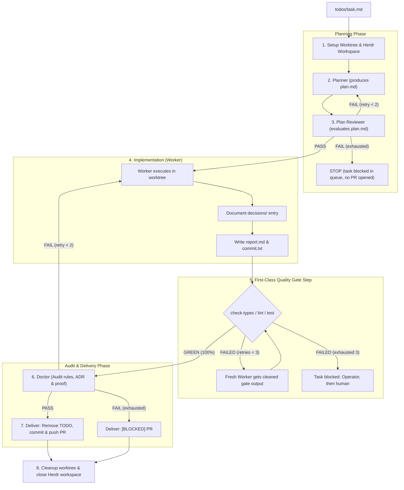

# SoftwareFactory 🏭

> **An autonomous AI harness transforming task specifications into verified, high-quality Pull Requests via multi-agent orchestration in Herdr terminal workspaces.**

`SoftwareFactory` is a modern AI harness engineered around the concept of an industrial assembly line. Instead of relying on a single monolithic LLM that tries to do everything, the system decomposes software delivery into specialized workstations (**Roles**) composed into declarative assembly lines (**Workflows**).

---

## 💡 Core Philosophy: The Software Assembly Line

In traditional agent workflows, a single LLM attempts to comprehend requirements, architect solutions, write code, run tests, and author commits. This inevitably leads to hallucinations, context window bloat, and escalating token costs.

**SoftwareFactory inverts this paradigm:**

1. **Deterministic Supervisor over LLM Micromanagement:** The line is driven by an ultra-fast, deterministic supervisor engine written in TypeScript/Bun. No LLM sits in a loop deciding "what step to run next." Step transitions, git snapshots, retry policies, and quality gates execute with 100% determinism.
2. **Runner-Agnostic via Herdr:** By relying on **Herdr** as the terminal workspace manager, the factory can mix and match any CLI coding agent within a single task: e.g., Claude Code for architecture planning, Codex for plan evaluation, and Cursor Composer for fast coding.
3. **Strict Isolation via Git Worktrees & Herdr Panes:** Each task runs in its own isolated `.worktrees/<taskId>`. Agents execute in dedicated Herdr tabs with clean environment variables.
4. **Deterministic Quality Gates:** Before code ever reaches a human or an expensive auditing model (the Doctor), native TypeScript typechecking, linting, and unit tests execute as first-class command steps, and their cleaned output is fed back to the worker for rapid self-correction.
5. **On-Call Incident Triage (The Operator):** An LLM is invoked for management **only during unexpected incidents** (e.g. broken environment, ambiguous question, exhausted retries). On the happy path, LLM management overhead is exactly 0 tokens.

---

## 🏛️ The Three Architectural Pillars

The system strictly decouples role capabilities, execution topology, and the runtime supervisor:

```
┌────────────────────┐       ┌──────────────────────┐       ┌────────────────────────┐
│   Roles (roles/)   │  ──▶  │ Workflows (*.yml)    │  ──▶  │   Supervisor Engine    │
│  "WHO and WHAT"    │       │ "IN WHAT SEQUENCE"   │       │   (Bun + SQLite + Git) │
└────────────────────┘       └──────────────────────┘       └────────────────────────┘
```

### 1. Roles (`roles/<id>.md`)

Interchangeable workstations defined in Markdown. A role defines instructions and an artifact contract (the exact files the agent must write, e.g. `plan.md`, `report.md`, `feedback.md`):

```markdown
---
id: planner
label: Architecture Planner
artifacts:
  plan: plan.md
---

Plan {{taskId}}. {{todoBody}}{{context}} Write {{planPath}}, then run `software-factory done`.
```

### 2. Workflows (`workflows/<name>.yml`)

Declarative production lines specifying the agent pool (`agents:`), execution sequence (`steps:`), command gates, and delivery conditions. Steps run sequentially: on success, execution automatically advances to the next step.

```yaml
name: feature
description: Plan, review the plan, build with automated quality gate, and audit

agents:
  planner:       { role: planner,       runner: claude, model: opus,          timeout: 20m }
  plan-reviewer: { role: plan-reviewer, runner: codex,  model: gpt-5.6-codex, timeout: 10m }
  worker:        { role: worker,        runner: claude, model: sonnet,        timeout: 60m }
  doctor:        { role: doctor,        runner: claude, model: sonnet,        timeout: 20m }

steps:
  - id: plan
    type: agent
    agent: planner

  - id: plan-review
    type: agent
    agent: plan-reviewer
    inputs: [plan.plan]
    onFail: { retry: plan, max: 2 }

  - id: build
    type: agent
    agent: worker
    inputs: [plan.plan]

  - id: quality-gate
    type: commands
    timeout: 15m
    exec:
      - pnpm check-types
      - pnpm lint
      - pnpm test
    onFail: { retry: build, max: 3 }

  - id: audit
    type: agent
    agent: doctor
    inputs: [plan.plan, build.report]
    onFail: { retry: build, max: 2 }

deliver:
  commit: build.commit
  report: build.report
  to: new-pr
```

#### Workflow JSON Schema

`schemas/workflow.schema.json` (JSON Schema 2020-12) is the authoring contract for `workflows/*.yml`. It mirrors the Zod schema in `src/definitions/workflow.ts`, which stays the source of truth for the loader.

- Required root fields: `name`, `description`, `setup`, `agents`, `operator`, `steps`, `deliver`. A missing `operator` fails both the schema and the loader.
- `operator` takes the same shape as an `agents:` entry: `role`, `runner`, `model`, `timeout`, optional `headless` and `permission`.
- Runners: `claude`, `codex`, `cursor`, `antigravity`, `opencode`.
- Steps are `type: agent` (`id`, `agent`, optional `inputs`, `onFail`) or `type: commands` (`id`, `timeout`, `exec`, optional `onFail`).
- Unknown keys are rejected at every level.

Editor setup: each shipped workflow starts with `# yaml-language-server: $schema=../schemas/workflow.schema.json`. Add the same line to a new workflow. The repo `.vscode/settings.json` also maps the schema to `packages/software-factory/workflows/*.yml` through `yaml.schemas` (Red Hat YAML extension, VS Code, Cursor).

`src/definitions/__tests__/schema.test.ts` compiles the schema with ajv in strict mode, validates every shipped workflow, and checks that invalid workflows fail.

#### Available workflows

A todo picks one with `workflow: <name>` in its frontmatter (default `feature`).

- `feature`: plan, plan-review, build, quality-gate, audit. Use for new features and behavior changes.
- `standard`: build, quality-gate, audit. No planning. Use for routine features and refactors.
- `fast`: build, quality-gate. No planning, no audit. Use for chores, docs and style fixes.

### 3. The Supervisor Engine (`software-factory run`)

A deterministic, long-running process built around a pure engine, `nextAction(workflow, task, events)`, that decides every transition without I/O:

- Tracks persistent task state, attempts, and event history in SQLite (`.evidences/software-factory.db`).
- Starts, prompts and watches agents through the `herdr` CLI.
- Takes lightweight worktree snapshots on hidden git refs (`refs/software-factory/...`) without polluting the branch history.
- Handles automated crash recovery and resuming after server restarts.

---

## 🔄 The Factory Workflow



---

## 🛡️ Reliability & Self-Healing Mechanisms

### 1. Deterministic Quality Gates

The `quality-gate` step runs every command in the task worktree, even after one fails, so the worker sees all failures in one round. For each failing command the supervisor strips ANSI codes, keeps the last 12,000 characters, saves the full log as an artifact, and injects the result into the next worker attempt:

```text
GATE FAILED: pnpm check-types (exit code: 1)
src/users/service.ts(42,18): error TS2339: Property 'tenantId' does not exist on type 'User'.
Full log: .evidences/login-form/quality-gate-1/check-types.log
(Gate retry 1/3)
```

No model is involved, so a failing gate costs nothing beyond the worker's fix.

### 2. Worktree Snapshots & Reverts

Before every step, the Supervisor records a snapshot on a hidden git ref (`refs/software-factory/<taskId>/<stepId>/<attemptId>`). If an agent crashes, stalls or times out, the supervisor restores the worktree to the pre-step snapshot and restarts the attempt once. Retries after gate or review failures start a fresh agent that fixes forward on top of existing changes, preserving working progress.

### 3. On-Call Incident Responder (The Operator)

If a task becomes `blocked` (exhausted retries, repeated stall, runner authorization prompt, or a question to the Operator), the Supervisor awakens the **Operator** (`roles/operator.md`). The Operator inspects the incident context (`software-factory log`, terminal backlog, gate feedback) and can do exactly three things: answer the agent (`software-factory answer`), nudge it with instructions, or escalate to a human via `software-factory escalate`. It never edits or reverts the worktree, and a question asked with `software-factory ask human` skips it entirely.

---

## 🛠️ Technology Stack (Bun Core)

The same stack as `packages/factory`, so its adapters port over. Details in [`docs/STACK.md`](docs/STACK.md).

- **Runtime:** `Bun` (fast CLI startup, native `Bun.spawn`, built-in SQLite).
- **CLI Engine:** `citty` (UnJS) – modular, lightweight subcommands with lazy loading.
- **State Engine:** plain `bun:sqlite` in WAL mode with `busy_timeout`, behind a `StorePort`.
- **Validation & Schemas:** `zod` + `yaml` (strict load-time checks for roles, workflows, and step inputs).
- **Terminal Orchestrator:** `herdr`, driven through its CLI.
- **Console Formatting:** `picocolors`; ANSI stripping via `node:util`.

---

## 📋 Agent CLI Reference (The Inter-Agent Lingua Franca)

Every runner has access to a shell; agents interact with the factory exclusively via the `software-factory` CLI:

| Command                       | Role             | Description                                              |
| :---------------------------- | :--------------- | :------------------------------------------------------- |
| `software-factory done`                | Any (non-judge)  | Report completion; rejected if a declared artifact is missing |
| `software-factory verdict pass\|fail`  | Judging roles    | Record the verdict; `fail` requires the feedback artifact |
| `software-factory ask operator "..."`  | Any              | Ask a question; the on-call Operator answers first       |
| `software-factory ask human "..."`     | Any              | Ask a human directly; the Operator never answers it      |
| `software-factory tell <name> "..."`   | Any              | Send an asynchronous note/message                        |
| `software-factory answer <id> "..."`   | Operator / Human | Answer a question and resume a blocked task              |
| `software-factory escalate <id> "..."` | Operator         | Escalate an incident to a human with diagnostic context  |
| `software-factory status`              | Human / Board    | Display the live hierarchical status of the factory line |
| `software-factory log <id>`            | Human / Board    | Print the chronological event stream for a task          |
